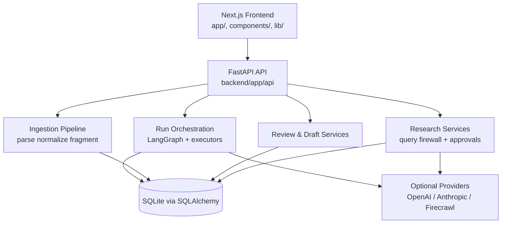

# Research-Funding-App

A full-stack assistant that helps teams prepare structured Innosuisse innovation project applications with human-reviewed AI support.

This project addresses a practical problem: application content is spread across source files, partner inputs, and domain requirements, which makes consistent drafting and review difficult. The system combines a Next.js frontend, a FastAPI backend, deterministic processing steps, and optional provider-backed AI suggestions. The technically interesting part is the explicit fail-closed policy design: deterministic baselines stay available, while AI and live web research are gated by data-class and approval controls.

## Overview

The application guides users from project intake and source import to evidence mapping, requirement checks, field-level draft suggestions, quality review, and export. It is designed as a reproducible engineering project with local demo data, versioned backend contracts, and extensive automated test coverage.

Detailed product and operator documentation is currently available in German:

- `docs/SCHNELLSTART.md`
- `docs/BEDIENUNGSANLEITUNG.md`

## Key Features

- Structured project intake and source import (`pdf`, `docx`, `txt`) with parsing status control
- Deterministic evidence discovery and requirement/rule assessment pipeline
- LangGraph-based run orchestration with explicit stage transitions and recovery of interrupted runs
- Field-level draft workflow with template drafts and advisory AI redraft suggestions
- Review package generation with open issues, findings, and human approval step
- Data-class-aware web research with query firewall and approval-gated execution
- Deterministic export workflow with background execution and orphan cleanup
- Role-based capability exposure for fake/live provider modes

## Architecture



More detail: `docs/architecture.md`.

Additional technical docs:
- `docs/demo.md`
- `docs/evaluation.md`

## Tech Stack

**Languages**
- TypeScript
- Python

**Frontend**
- Next.js
- React

**Backend**
- FastAPI
- SQLAlchemy
- Alembic
- LangGraph

**Testing**
- Vitest
- pytest
- Playwright

## Engineering Highlights

- Fail-closed startup checks for database connectivity and contract/registry loading
- Explicit provider policy separation between deterministic, fake-provider, and live-provider modes
- Query firewall and approval flow for privacy-aware web research tasks
- Separation of deterministic pipeline outputs and advisory AI outputs
- Bounded background execution with reconciliation and interrupted-run recovery
- Versioned backend contract artifacts under `final_backend_contracts_v1_1/`

## My Contribution

> Add a short, precise description of your personal contribution here (scope, core modules, and technical ownership).

## Results

### Technical Validation
- Frontend unit/integration tests (`test/**/*.test.{ts,tsx}`)
- Backend tests (`backend/tests`)
- End-to-end suites (`e2e/*.spec.ts`)
- One-command verification scripts (`scripts/verify_all.sh`, `scripts/verify_all.ps1`)

### Functional Validation
- End-to-end user flows for intake, import, review, orchestration, reliability, and export are covered in Playwright specs.

### Business Impact
- Not claimed in this repository.

## Demo / Screenshots

Current UI screenshots:

- Project overview: `docs/assets/bedienungsanleitung/01-projektuebersicht.png`
- Source import flow: `docs/assets/bedienungsanleitung/02-antrag-importieren.png`
- Draft editor: `docs/assets/bedienungsanleitung/06-entwurfseditor.png`
- Quality review: `docs/assets/bedienungsanleitung/08-qualitaetspruefung.png`

Recommended additional portfolio visuals: see `docs/demo.md`.

## Quick Start

### 1) Clone and install

```bash
git clone https://github.com/Karim-Abu/Research-funding-app.git
cd Research-funding-app
corepack pnpm install
python -m venv backend/.venv
# POSIX
backend/.venv/bin/pip install -r backend/requirements.txt
# Windows
backend/.venv/Scripts/pip install -r backend/requirements.txt
```

### 2) Configure demo mode

```bash
cp .env.example .env.local
cp backend/.env.demo.example backend/.env
```

### 3) Prepare database and demo data

```bash
cd backend
# POSIX
export APP_ENV=development DEMO_DATA_ENABLED=true DATABASE_URL="sqlite:///./var/demo.db"
python -m alembic -c alembic.ini upgrade head
python -m app.seed
python -m app.demo.seed --reset --evaluation
```

### 4) Run backend and frontend

```bash
# Terminal 1 (backend/)
python -m uvicorn app.main:app --host 127.0.0.1 --port 8000

# Terminal 2 (repo root)
APP_BACKEND_MODE=live FASTAPI_BRIDGE_URL=http://127.0.0.1:8000/api/v1 corepack pnpm dev
```

Open:
- Frontend: `http://localhost:3000`
- Backend health: `http://127.0.0.1:8000/api/v1/health`

## Testing

```bash
# Frontend
corepack pnpm test
corepack pnpm lint
corepack pnpm exec tsc --noEmit
corepack pnpm build

# Backend
cd backend && .venv/bin/python -m pytest -q

# End-to-end (servers running)
corepack pnpm exec playwright test --workers=1

# Full deterministic verification gate
scripts/verify_all.sh
# Windows: .\scripts\verify_all.ps1
```

## Repository Structure

- `app/`, `components/`, `lib/`: Next.js frontend
- `backend/app/`: FastAPI backend services and orchestration
- `backend/tests/`: backend test suite
- `test/`: frontend unit/integration tests
- `e2e/`: Playwright end-to-end tests
- `final_backend_contracts_v1_1/`: versioned API/rule/tool contract artifacts
- `scripts/`: verification, smoke, and evaluation utilities
- `docs/`: user guidance, architecture, demo, and evaluation notes

## Limitations

- The project is a local/single-instance beta architecture, not a production deployment setup.
- Live provider functionality depends on explicit key/configuration availability and policy gates.
- Public web research is data-class and approval constrained by design.
- No automatic submission/write-back into external funding portals.
- Source import quality depends on document format; encrypted/no-text PDFs require manual fallback.

## Further Development

- Add concise English operator docs parallel to existing German manuals.
- Add a small deterministic demo video/GIF for the end-to-end flow.
- Introduce CI status badges once workflow baselines are stable.
- Add explicit contribution ownership notes for portfolio transparency.

## Project Context

This repository is presented as an engineering portfolio project focused on reproducible AI-assisted application workflows and software quality controls.

## Collaboration and Security

- Contribution guidelines: `CONTRIBUTING.md`
- Security reporting: `SECURITY.md`
