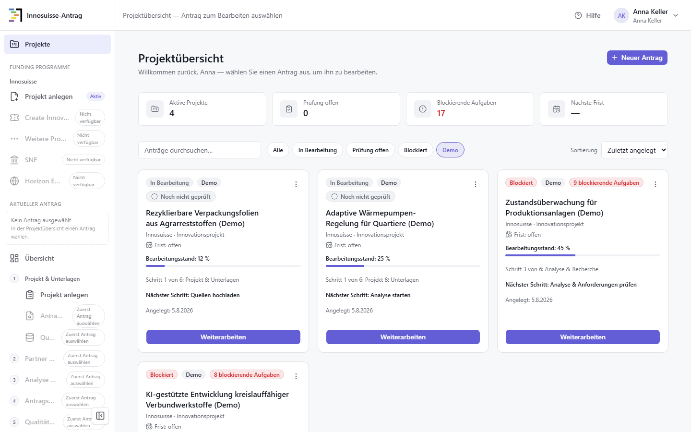
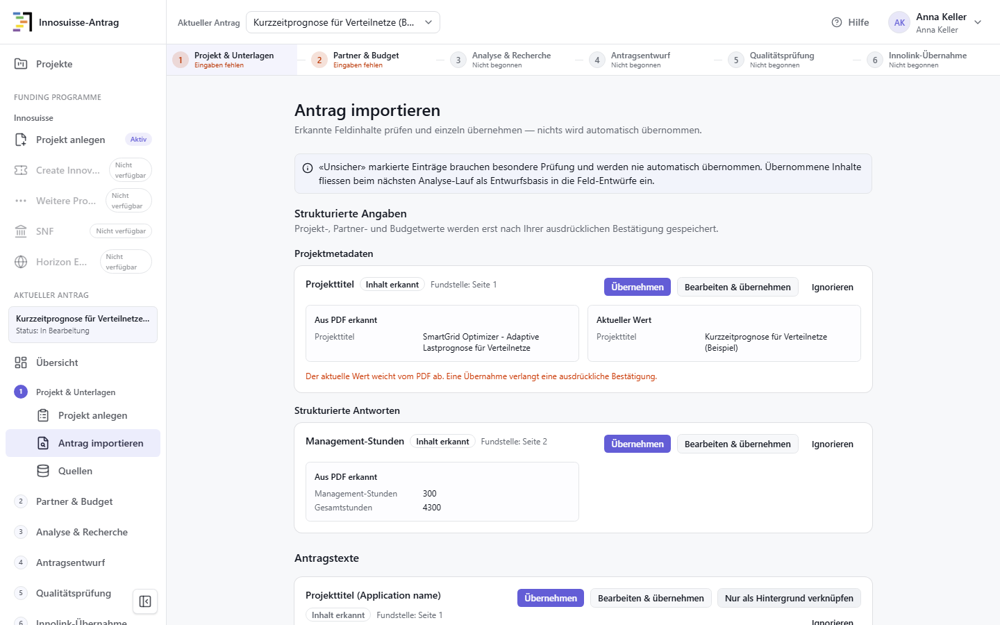
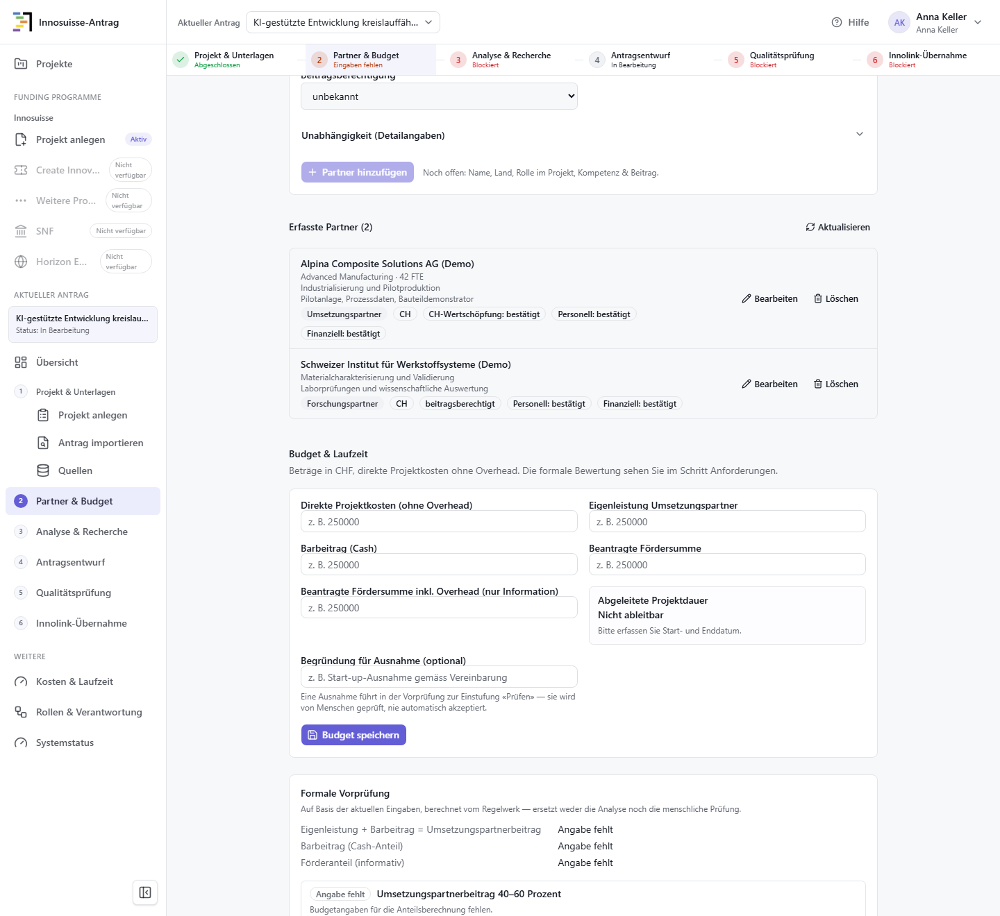
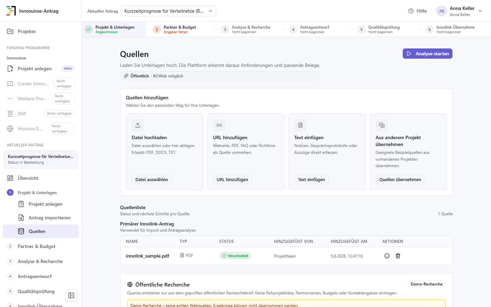
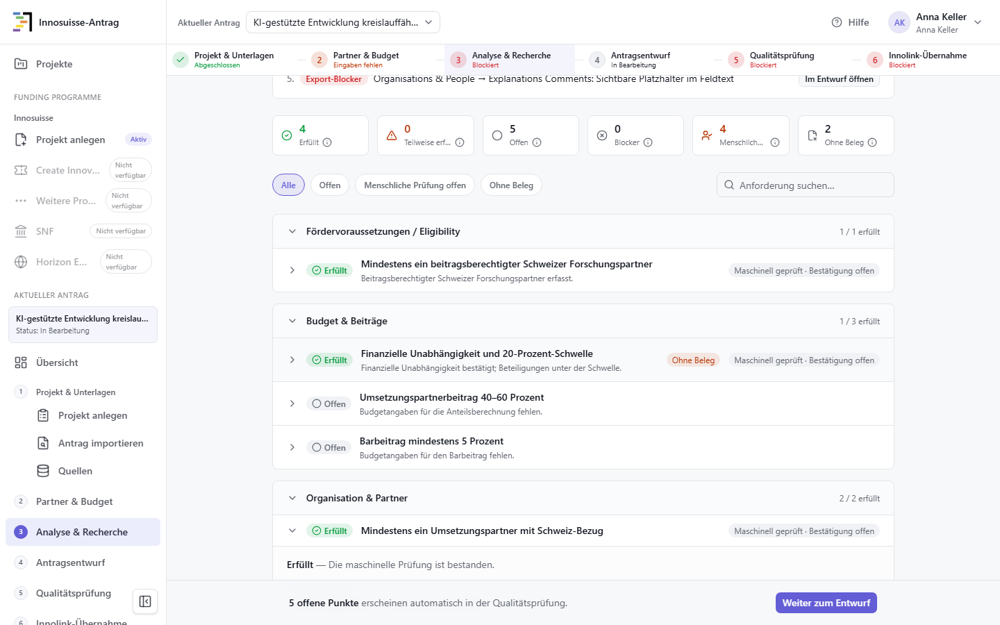
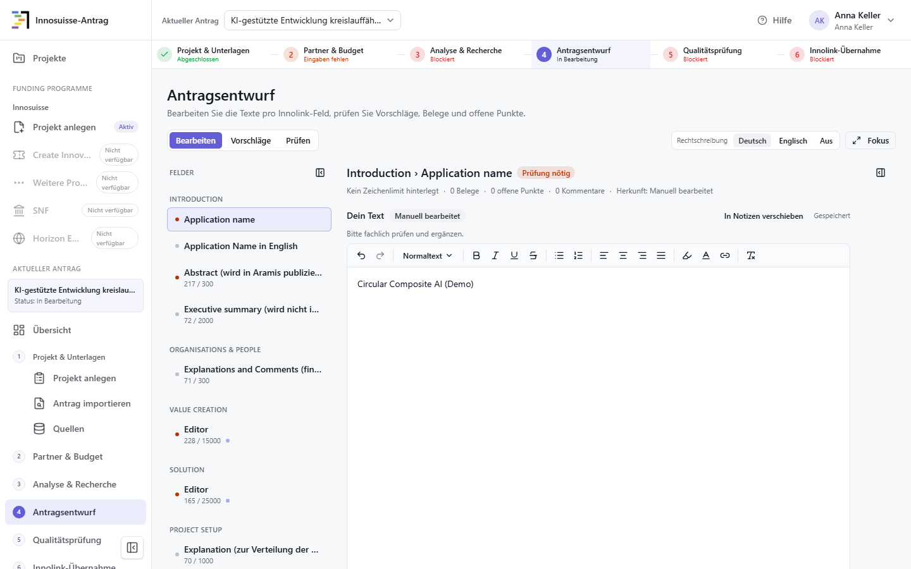
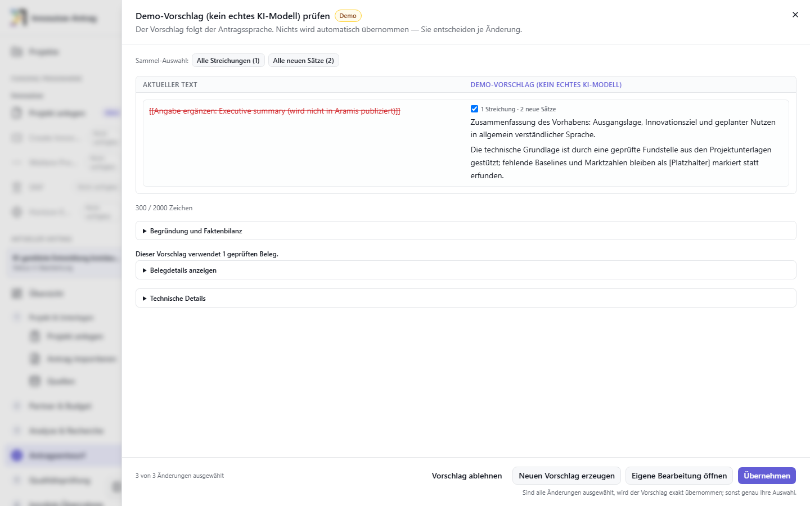
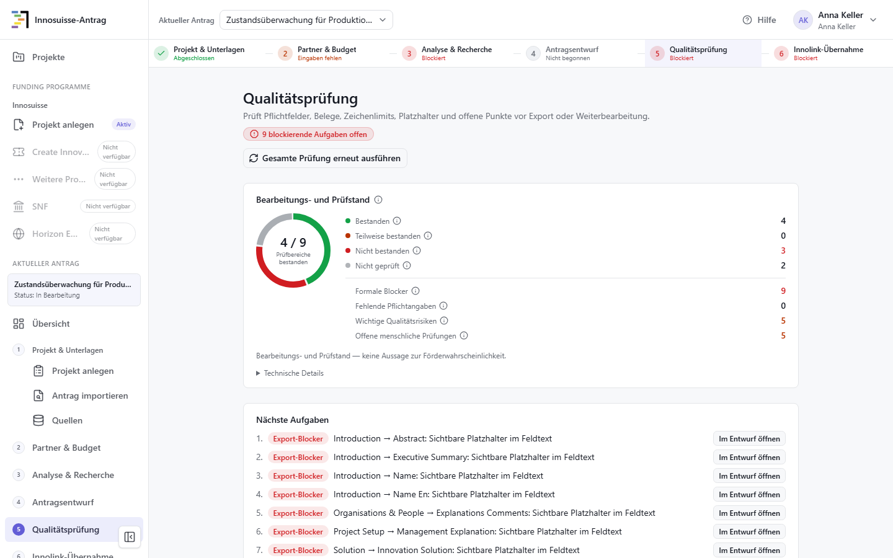
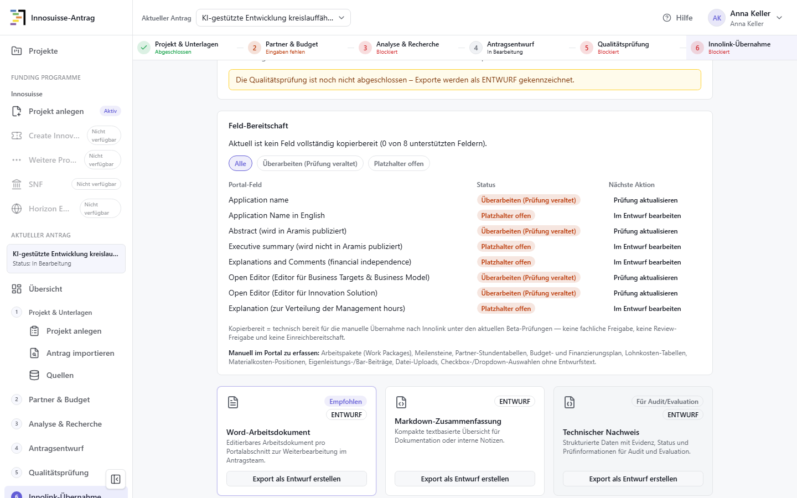
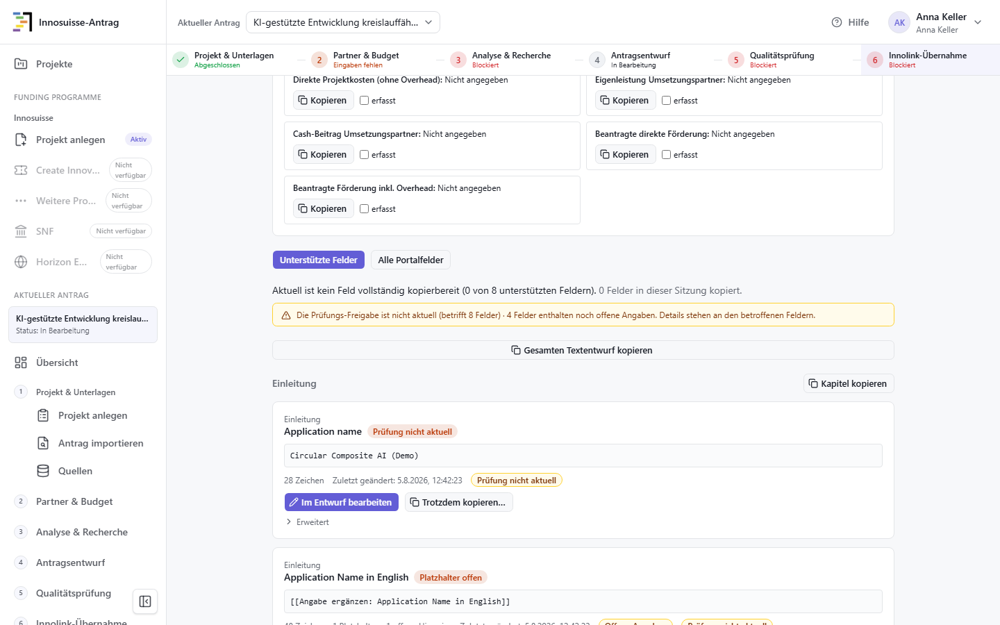

# Bedienungsanleitung «Innosuisse-Antrag»

Diese Anleitung beschreibt den lokal ausführbaren Stand der Anwendung «Innosuisse-Antrag». Sie richtet sich in erster Linie an Personen, die ein Innosuisse-Gesuch für ein Innovationsprojekt vorbereiten und dafür keine vertieften Informatikkenntnisse mitbringen. Teil A erklärt Installation und Start, Teil B die fachliche Bedienung, Teil C den sicheren Umgang und die Fehlerbehebung. Teil D enthält erweiterte Prüf- und Reset-Informationen für Entwicklerinnen und Entwickler.

«Innosuisse-Antrag» ist die Bezeichnung in der Seitenleiste der Anwendung. Anmeldeseite und Browser-Tab tragen die Bezeichnung «Evidenzbasierte Proposal-Unterstützung»; gemeint ist dieselbe Anwendung. `Reasearch-funding-app` ist ausschliesslich der technische Name des Repositorys.

Die Anleitung beruht auf dem tatsächlich vorhandenen Repository und wurde mit dem deterministischen Testprovider geprüft. «Deterministisch» bedeutet hier: Bei gleichen Testdaten entsteht reproduzierbares Demo-Verhalten, ohne dass Inhalte an einen externen KI- oder Rechercheanbieter gesendet werden. Die Anwendung ist ein lokaler Beta-/PoC-Arbeitsbereich. Sie ersetzt weder die fachliche Beurteilung durch das Gesuchsteam noch die Prüfung und Einreichung im Innolink-Portal.

Im Fliesstext dieser Anleitung steht «Gesuch» für das Vorhaben als Ganzes. «Antrag» wird dort verwendet, wo die Oberfläche dieses Wort wörtlich zeigt — etwa «Neuer Antrag», «Aktueller Antrag» oder «Antragsentwurf».

> **Sie installieren die Anwendung zum ersten Mal?** Dann genügt der
> [Schnellstart](SCHNELLSTART.md). Er führt von der Installation bis zum ersten
> Rundgang und enthält alles, was für den Einstieg nötig ist. Dieses Dokument
> ist die vollständige Referenz, die Sie danach bei Bedarf aufschlagen.
> Unbekannte Fachwörter schlagen Sie im [Glossar](#anhang-glossar) am Ende nach.
> Was wann geprüft wurde, steht im
> [Verifikationsbericht](VERIFIKATIONSBERICHT_BEDIENUNGSANLEITUNG.md).

## Inhalt

**Teil A: Installation und Start**

1. [Zweck der Anwendung](#1-zweck-der-anwendung)
2. [Funktionsumfang und Grenzen](#2-funktionsumfang-und-grenzen)
3. [Systemvoraussetzungen](#3-systemvoraussetzungen)
4. [Repository herunterladen](#4-repository-herunterladen)
5. [Konfiguration](#5-konfiguration)
6. [Installation](#6-installation)
7. [Anwendung starten](#7-anwendung-starten)
8. [Kurzfassung für den Einstieg](#8-kurzfassung-für-den-einstieg)

**Teil B: Bedienung und End-to-End-Ablauf**

9. [Bedienkonzept](#9-bedienkonzept) — inklusive [geführtem Rundgang mit den vier Demo-Projekten](#91-geführter-rundgang-mit-den-vier-demo-projekten)
10. [End-to-End-Ablauf](#10-end-to-end-ablauf)
11. [Seiten und Funktionen](#11-seiten-und-funktionen)
12. [KI-gestützte Funktionen](#12-ki-gestützte-funktionen)
13. [Quellen, Fundstellen und Belege](#13-quellen-fundstellen-und-belege)
14. [Qualitätsprüfung und Freigabe](#14-qualitätsprüfung-und-freigabe)
15. [Export und Innolink-Übernahme](#15-export-und-innolink-übernahme)
16. [Kosten und Laufzeit](#16-kosten-und-laufzeit)

**Teil C: Sichere Nutzung und Fehlerbehebung**

17. [Datenklassifikation und sichere Nutzung](#17-datenklassifikation-und-sichere-nutzung)
18. [Bekannte Einschränkungen](#18-bekannte-einschränkungen)
19. [Fehlerbehebung](#19-fehlerbehebung)

**Teil D: Erweiterte Informationen für Entwicklerinnen und Entwickler**

20. [Tests und Systemprüfung](#20-tests-und-systemprüfung)
21. [Anwendung beenden und lokale Daten zurücksetzen](#21-anwendung-beenden-und-lokale-daten-zurücksetzen)
22. [Technische Kontakt- und Nachweisinformationen](#22-technische-kontakt--und-nachweisinformationen)

[Anhang: Glossar](#anhang-glossar) · [Verifikationsstand (Kurzfassung)](#verifikationsstand-kurzfassung) · [Vollständiger Verifikationsbericht](VERIFIKATIONSBERICHT_BEDIENUNGSANLEITUNG.md)

---

# Teil A: Installation und Start

## 1 Zweck der Anwendung

Die Anwendung unterstützt ein Gesuchsteam beim Vorbereiten eines Innosuisse-Innovationsprojektantrags. Sie führt von einer Projektidee oder einem vorhandenen Innolink-PDF über Quellen, Partner- und Budgetangaben sowie Analyse und Recherche zu bearbeitbaren Antragstexten. Anforderungen, Fundstellen, offene Angaben und formale Blocker werden sichtbar zusammengeführt. Am Ende können geprüfte Feldtexte einzeln kopiert oder als Arbeitsdokument exportiert werden.

Vorgesehen ist der Arbeitsablauf für Innosuisse-Innovationsprojekte. Andere in der Navigation angedeutete Förderprogramme sind im geprüften Stand nicht als bedienbare Produktfunktionen verfügbar. Entscheidend ist deshalb immer die im linken Bereich als aktiv angezeigte Innosuisse-Strecke.

Die Anwendung unterstützt das Team, entscheidet aber nicht für das Team:

- Eine erkannte Textstelle ist nicht automatisch ein ausreichender fachlicher Beleg.
- Eine erfüllte technische Prüfung ist keine Bestätigung der Förderfähigkeit.
- Ein KI-Vorschlag ist ein separater Entwurf, keine bestätigte Tatsache.

Verantwortliche Personen müssen Quellen, Aussagen, Zahlen, Partnerangaben, Budgetwerte, Freigaben und den endgültigen Portalinhalt selbst prüfen.

Es gibt keine direkte Einreichung und keinen automatischen Rückschreibevorgang nach Innolink. Die letzte Phase ist eine manuelle Übernahme: Das Team kopiert geeignete Inhalte in das Portal und kontrolliert sie dort nochmals. Die Anzeige «kopierbereit» bezeichnet somit nur einen technischen Arbeitsstand innerhalb dieser Anwendung.

## 2 Funktionsumfang und Grenzen

Der aktuelle Stand unterstützt folgende Hauptaufgaben:

- Anmeldung mit vorab eingerichteten lokalen Benutzerkonten;
- Auswahl, Suche und Erstellung von Projekten;
- Erfassung einer Projektidee und Upload von PDF-, DOCX- oder TXT-Unterlagen;
- begrenzte Erkennung von Textfeldern aus einem Innolink-PDF mit anschliessender Einzelprüfung;
- Verwaltung von Quellen sowie Erfassung von Partner- und Budgetangaben;
- regelbasierte Prüfung von Voraussetzungen und Pflichtangaben;
- Erstellung und Freigabe eines öffentlichen Recherchebriefs;
- Analyse mit einem gekennzeichneten Demo-Generator oder, bei gesonderter Konfiguration, mit realen Providern;
- Bearbeitung von acht unterstützten Innolink-Textfeldern;
- getrennte Anzeige, Prüfung, Ablehnung und Übernahme von Textvorschlägen;
- Qualitätsprüfung mit Blockern, Warnungen, offenen menschlichen Prüfungen und veralteten Prüfständen;
- Export eines Word-Arbeitsdokuments, einer Markdown-Zusammenfassung und eines technischen Nachweises;
- manuelle feld- und zeilenbezogene Innolink-Kopieransicht;
- kompakte Ansichten zu Kosten und Laufzeit, Rollen, Systemstatus und Hilfe.

Einige Prüfungen sind rein regelbasiert, etwa Pflichtangaben und bestimmte Budgetregeln. Andere Ergebnisse entstehen aus der Analyse oder aus einem ausdrücklich aktivierten Vorschlagsgenerator. Die Benutzeroberfläche kennzeichnet den Testprovider-Betrieb als Demo und weist darauf hin, dass kein echtes KI-Modell beteiligt ist. In beiden Fällen bleibt die menschliche Prüfung zwingend.

Die Anwendung bearbeitet genau acht Textfelder der unterstützten Innolink-Strecke: Antragsname, englischer Antragsname, Abstract, Executive Summary, Erläuterung zur finanziellen Unabhängigkeit, je ein offenes Editorfeld für Geschäftsziele/Geschäftsmodell und für Innovation/Lösung sowie die Erläuterung zur Verteilung der Managementstunden. Die Feldbezeichnungen werden in der Oberfläche teilweise auf Englisch angezeigt, weil sie sich am Portal orientieren.

Strukturierte Portalbereiche bleiben manuell. Dazu gehören insbesondere Arbeitspakete, Meilensteine, Partnerstundentabellen, Budget- und Finanzierungsplan, Lohnkosten, Materialkostenpositionen, Eigen- und Barbeiträge, Uploads sowie reine Checkbox- oder Auswahlfelder ohne unterstütztes Textfeld. Die Kopieransicht kann dafür strukturierte Werte als Arbeitshilfe zeigen, synchronisiert aber nichts mit Innolink.

Der PDF-Import ist begrenzt. Er ordnet erkannte Passagen nur den unterstützten Textfeldern zu und verlangt für jeden Kandidaten eine bewusste Übernahme. Er erkennt nicht alle Felder zuverlässig: Ein Haupttitel ohne eindeutige Beschriftung bleibt manuell, und PDF-Layout, Scanqualität sowie abweichende Exportversionen beeinflussen das Ergebnis. Verlassen Sie sich deshalb nicht darauf, dass der Import ein Feld findet — kontrollieren Sie jedes Feld im Entwurf. Gemessene Erkennungsquoten stehen in der Evaluationsdokumentation ([`evaluation/pdf-import-gate-report.md`](evaluation/pdf-import-gate-report.md)); sie beschreiben einen bestimmten Testlauf und sind keine Zusicherung für Ihr Dokument.

Die lokale Demo ist nicht für echte vertrauliche oder NDA-geschützte Projektdaten freigegeben. Verwenden Sie für Installation, Tests und Screenshots ausschliesslich synthetische Angaben. Die Datenklassen und ihre Auswirkungen werden in Abschnitt 17 erklärt.

## 3 Systemvoraussetzungen

Der vollständig geprüfte Weg verwendet Windows und PowerShell. PowerShell ist das Befehlsfenster von Windows; Sie öffnen es beispielsweise über das Startmenü. Befehle werden jeweils vollständig kopiert und mit der Eingabetaste ausgeführt.

Erforderlich sind:

- Windows mit PowerShell;
- Git zum Herunterladen und Aktualisieren des Repositorys;
- Node.js ab Version 20.9 für das Frontend;
- Corepack und der darüber gestartete Paketmanager pnpm;
- Python ab Version 3.12 für das Backend;
- ein aktueller Browser, vorzugsweise Chromium, Chrome oder Edge;
- freie lokale Ports 3000 für die Benutzeroberfläche und 8000 für das Backend.

Ein *Repository* ist der Projektordner mit Anwendungscode, Dokumentation und Versionsgeschichte. Das *Frontend* ist die im Browser sichtbare Oberfläche. Das *Backend* verarbeitet und speichert die Daten. Der *Paketmanager* pnpm installiert die für das Frontend benötigten Softwarepakete.

Sind Git, Node.js oder Python noch nicht vorhanden, installieren Sie sie mit den vorgeschlagenen Standardeinstellungen von den offiziellen Bezugsquellen:

| Werkzeug | Bezugsquelle |
|---|---|
| Git | <https://git-scm.com/download/win> |
| Node.js (LTS) | <https://nodejs.org> |
| Python | <https://www.python.org/downloads/windows/> |

Setzen Sie beim Python-Installer auf der ersten Seite das Häkchen bei **«Add python.exe to PATH»**. Fehlt es, findet Windows Python später nicht und alle Backend-Befehle scheitern mit «Der Begriff `python` wurde nicht erkannt». Öffnen Sie nach jeder Installation ein neues PowerShell-Fenster, damit die neuen Programme bekannt sind.

Prüfen Sie die installierten Werkzeuge in PowerShell:

```powershell
git --version
node --version
corepack pnpm --version
python --version
```

Erwartet werden mindestens Node.js 20.9 und Python 3.12. Die beim Prüflauf tatsächlich eingesetzten Versionen stehen im [Verifikationsbericht](VERIFIKATIONSBERICHT_BEDIENUNGSANLEITUNG.md).

Corepack gehört zu aktuellen Node.js-Installationen und stellt pnpm bereit. Falls `corepack pnpm --version` nicht funktioniert, führen Sie einmal `corepack enable` in einer PowerShell mit den nötigen lokalen Rechten aus und wiederholen die Prüfung.

Das Repository legt **keine** pnpm-Version fest — es gibt weder ein `packageManager`- noch ein `engines`-Feld in `package.json`. Verbindlich ist allein das Format der Sperrdatei: `pnpm-lock.yaml` verwendet `lockfileVersion: '9.0'` und verlangt damit **pnpm ab Version 9**. Geprüft wurde diese Anleitung mit pnpm 11.5.3. Liefert Corepack eine ältere Version, aktivieren Sie die geprüfte Version gezielt:

```powershell
corepack prepare pnpm@11.5.3 --activate
```

Ändern oder löschen Sie `pnpm-lock.yaml` nicht, um einen Versionskonflikt zu umgehen.

Der Speicherbedarf ist nicht verbindlich festgelegt; planen Sie Platz für Pakete, Browser und lokale Daten ein. Externe Providerzugänge sind für den Standardweg nicht erforderlich.

## 4 Repository herunterladen

*Klonen* bedeutet, mit Git eine lokale Arbeitskopie des Repositorys anzulegen. Wechseln Sie zuerst in den Ordner, in dem das Projekt liegen soll, und führen Sie dann aus:

```powershell
git clone https://github.com/Karim-Abu/Reasearch-funding-app.git
Set-Location Reasearch-funding-app
```

Legen Sie den Projektordner nicht in ein synchronisiertes Cloud-Verzeichnis. OneDrive und vergleichbare Dienste sperren einzelne Dateien während der Synchronisation, was beim Frontend-Build zu `EPERM`-Fehlern führt.

Wenn Git nicht eingesetzt werden kann, lässt sich das Repository auf GitHub auch als ZIP-Datei herunterladen. Entpacken Sie die Datei vollständig und öffnen Sie PowerShell im entpackten Ordner. Bei dieser Variante fehlen einige komfortable Git-Funktionen; Installation und Start funktionieren aber aus einem vollständigen, aktuellen Archiv ebenfalls.

Kontrollieren Sie, dass Sie sich in der Repository-Wurzel befinden und der Download vollständig ist:

```powershell
Get-Location
Get-ChildItem README.md, package.json, pnpm-lock.yaml, backend, final_backend_contracts_v1_1
```

Alle Einträge müssen aufgelistet werden. Der Ordner `final_backend_contracts_v1_1` ist besonders wichtig: Das Backend prüft die darin abgelegten Vertrags- und Registry-Dateien beim Start und bricht bewusst ab, wenn sie fehlen. Ein unvollständig entpacktes ZIP-Archiv ist die häufigste Ursache für einen Backend-Start, der ohne offensichtlichen Grund scheitert.

Die wichtigsten Bereiche sind:

| Pfad | Bedeutung |
|---|---|
| `app/`, `components/`, `lib/` | Browseroberfläche und deren lokale Anbindung |
| `backend/app/` | Backend für Anmeldung, Projekte, Analyse, Prüfung und Export |
| `backend/app/migrations/` | Datenbankmigrationen |
| `final_backend_contracts_v1_1/` | verbindliche Feld- und Regelverträge; beim Start zwingend vorhanden |
| `backend/var/` | lokale Demo- und Verifikationsdatenbanken |
| `e2e/` | automatisierte Browserabläufe |
| `scripts/` | Start-, Prüf- und Hilfsskripte |
| `docs/` | Bedienungs-, Demo-, Sicherheits- und Evaluationsdokumente |

Eine *Migration* ist ein versionierter Schritt, der die Struktur einer Datenbank auf den für die Anwendung benötigten Stand bringt. Sie verändert nicht den Anwendungscode und muss vor dem ersten Start auf einer neuen Datenbank ausgeführt werden.

## 5 Konfiguration

Eine `.env`-Datei enthält lokale Einstellungen in der Form `NAME=WERT`. Sie darf echte Zugangsschlüssel enthalten und wird deshalb nicht öffentlich geteilt. Das Repository liefert Vorlagen ohne echte Geheimnisse.

Für den Demo-Betrieb liegen fertige Vorlagen bereit. Kopieren Sie sie in der Repository-Wurzel; **danach ist nichts zu bearbeiten**.

> **Vorsicht bei bestehenden Konfigurationsdateien.** Die folgende Befehlsfolge ist für einen frischen Klon vorgesehen. Existieren `.env.local` oder `backend\.env` bereits, dürfen sie nicht ungeprüft überschrieben werden: `backend\.env` kann echte Provider-Schlüssel enthalten, deren Verlust nicht rückgängig zu machen ist. Sichern Sie vorhandene Dateien zuerst oder vergleichen Sie sie mit den Vorlagen. Die Prüfungen brechen ab, statt zu überschreiben.

```powershell
if (Test-Path .env.local) {
    throw ".env.local existiert bereits. Datei zuerst prüfen oder sichern."
}
if (Test-Path backend\.env) {
    throw "backend\.env existiert bereits. Datei zuerst prüfen oder sichern."
}
Copy-Item .env.example .env.local
Copy-Item backend\.env.demo.example backend\.env
```

`.env.local` enthält die beiden Frontend-Werte bereits gesetzt:

```dotenv
APP_BACKEND_MODE=live
FASTAPI_BRIDGE_URL=http://127.0.0.1:8000/api/v1
```

`APP_BACKEND_MODE=live` bedeutet hier, dass die sichtbare Oberfläche mit dem lokal gestarteten Python-Backend spricht. «Live» bezeichnet nicht automatisch einen externen KI-Provider. `FASTAPI_BRIDGE_URL` ist die lokale Backend-Adresse.

> **Fehlt `APP_BACKEND_MODE=live`, meldet die Anwendung keinen Fehler.** Sie startet stattdessen in einem Mock-Modus und zeigt erfundene Beispieldaten aus dem Browser; Änderungen werden nicht gespeichert. Erkennbar ist dieser Zustand am grauen Hinweis «Demo-Daten · keine echten Antragsdaten» oben links neben der Projektauswahl. Erscheint er, beenden Sie das Frontend, stellen `.env.local` aus der Vorlage wieder her und starten neu. Der Hinweis ist etwas anderes als das Demo-Abzeichen auf den einzelnen Projektkacheln, das lediglich synthetische Seed-Projekte kennzeichnet.

`backend\.env.demo.example` enthält für den schlüsselfreien Demo-Betrieb diese wirksamen Werte:

```dotenv
DATABASE_URL=sqlite:///./var/demo.db
APP_ENV=development
DEMO_DATA_ENABLED=true
AGENT_FAKE_PROVIDER=true
WEB_RESEARCH_ENABLED=true
WEB_RESEARCH_FAKE_PROVIDER=true
AI_EVAL_MODE=off
```

`DATABASE_URL` legt die lokale SQLite-Datei fest. SQLite ist eine dateibasierte Datenbank; es muss dafür kein separater Datenbankserver installiert werden. Da der relative Pfad vom Arbeitsordner des Backends ausgeht, muss das Backend aus `backend\` gestartet werden. `DEMO_DATA_ENABLED=true` erlaubt die lokalen Demo-Daten. Die beiden Testprovider-Schalter aktivieren gekennzeichnete, reproduzierbare Demoausgaben. `AI_EVAL_MODE=off` verhindert den realen Evaluationspfad.

Die Vorlage enthält zusätzlich Einstellungen für Sitzungen, erlaubte Browserursprünge und die zwei vorab eingerichteten lokalen Benutzer. Diese Vorgaben bleiben unverändert.

`ALLOWED_ORIGINS` listet die erlaubten Browserursprünge für schreibende Anfragen. Es handelt sich um eine Origin- und CSRF-Prüfung im Backend, **nicht** um eine CORS-Freigabe: Das Backend setzt keine `Access-Control-Allow-Origin`-Antwortheader. Ändern Sie die Liste nicht, um die Anwendung von einem anderen Rechner erreichbar zu machen.

**Zu den Demo-Zugangsdaten:** Sie sind nur für eine lokal gebundene Entwicklungsinstanz bestimmt. Nicht im Netzwerk oder Internet bereitstellen. In jeder echten Umgebung müssen sie ersetzt werden.

Für eine bewusst abweichende Einrichtung — etwa reale Provider — gibt es weiterhin die vollständige Vorlage `backend\.env.example` mit allen verfügbaren Schaltern und ihren fail-closed Standardwerten. Sie ist nicht für den Demo-Betrieb vorbereitet: Demo-Daten, Demo-Generator und Webrecherche stehen dort auf `false`.

Provider-Schlüssel wie `OPENAI_API_KEY`, `ANTHROPIC_API_KEY`, `AZURE_OPENAI_API_KEY` oder `FIRECRAWL_API_KEY` bleiben für diese Anleitung leer. Wenn ein freigegebener Provider später bewusst eingerichtet wird, gehören Schlüssel ausschliesslich in `backend\.env`. Verwenden Sie dafür nie eine Variable mit dem Präfix `NEXT_PUBLIC_`, weil deren Inhalt im Browser sichtbar werden könnte. Eine gesetzte Providerkennung allein schaltet nicht automatisch alle Funktionen frei: Datenklasse, Verarbeitungsmodus, Modellroute, Preisregel und Verfügbarkeitsprüfung können einen Aufruf weiterhin blockieren.

Committen oder versenden Sie `.env.local`, `backend\.env`, Datenbankdateien und exportierte Projektdokumente nicht unbesehen. Zeigen Sie ihren Inhalt auch nicht in Screenshots.

## 6 Installation

### 6.1 Frontend installieren

Bleiben Sie in der Repository-Wurzel und installieren Sie exakt die in `pnpm-lock.yaml` festgelegten Versionen:

```powershell
corepack pnpm install --frozen-lockfile
```

Eine *Lockdatei* hält die aufgelösten Paketversionen fest. `--frozen-lockfile` verhindert, dass die Installation diese Datei still verändert. Erfolgreich ist der Schritt, wenn pnpm ohne Fehlercode endet; «Already up to date» ist ebenfalls ein korrektes Ergebnis.

### 6.2 Backend installieren

Eine *virtuelle Python-Umgebung* ist ein abgeschlossener Ordner mit Python-Paketen nur für dieses Projekt. Dadurch werden andere Python-Projekte auf dem Rechner nicht verändert.

Erstellen Sie die Umgebung und installieren Sie die festgelegten Backend-Abhängigkeiten:

```powershell
python -m venv backend\.venv
backend\.venv\Scripts\python.exe -m pip install -r backend\requirements.txt
backend\.venv\Scripts\python.exe -m pip check
```

`pip check` muss melden, dass keine fehlerhaften Abhängigkeiten vorhanden sind. Verwenden Sie in den weiteren Befehlen möglichst immer den vollständigen Pfad zur Python-Datei in `.venv`; dann ist keine separate Aktivierung der Umgebung nötig.

### 6.3 Datenbank vorbereiten

Wechseln Sie in den Backend-Ordner. Die Migration erstellt oder aktualisiert die Tabellen. Der anschliessende Basis-*Seed* legt die für den lokalen Einstieg notwendigen Grunddaten und zwei Demo-Benutzer an. Ein Seed ist ein Programm, das bekannte Ausgangsdaten in eine Datenbank schreibt.

```powershell
Set-Location backend
.\.venv\Scripts\python.exe -m alembic -c alembic.ini upgrade head
.\.venv\Scripts\python.exe -m app.seed
Set-Location ..
```

Diese beiden Schritte sind der normale, datenbewahrende Weg. Wiederholte Migrationen wenden nur noch fehlende Schritte an; der Basis-Seed ist für denselben lokalen Grundbestand wiederholbar.

Der dritte Schritt legt die vier synthetischen Demo-Projekte an. Er gehört bei einer **neuen** Datenbank zum Standardweg und entspricht dem Schnellstart:

```powershell
Set-Location backend
.\.venv\Scripts\python.exe -m app.demo.seed --reset --evaluation
Set-Location ..
```

> **Warnung: `--reset` setzt die Demo-Daten zurück.** Alle Bearbeitungen an den vier Demo-Projekten in der aktiven Datenbank gehen dabei verloren. Bei einer frisch angelegten Datenbank ist das folgenlos. Sichern Sie bestehende Arbeitsdaten vorher durch eine Kopie der Datenbankdatei (Abschnitt 21.2). Ohne `--reset` ergänzt der Befehl nur fehlende Demo-Objekte.

Der Zusatz `--evaluation` reichert das am weitesten fortgeschrittene Demo-Projekt zusätzlich an, damit Markt-, Evidenz- und Vorschlagsansichten befüllt sind. Für Anmeldung und ein eigenes synthetisches Projekt genügt auch der Basis-Seed allein.

### 6.4 Optionale externe Dienste einrichten

Für die vollständig verifizierte Bedienung sind keine externen Schlüssel nötig. Der Testprovider erzeugt klar gekennzeichnete Demo-Vorschläge, und der Test-Webprovider liefert keine echten Webnachweise. Damit lassen sich Prozess, Freigabepunkte und Persistenz prüfen, nicht aber Qualität oder Erreichbarkeit eines realen Modells.

Reale Provider sind eine gesonderte, opt-in Konfiguration für autorisierte Testfälle. Die Backend-Vorlage nennt OpenAI, Anthropic, Azure OpenAI und Firecrawl. Für einen realen Lauf müssen unter anderem passende Modellkennungen, Providerzugänge, Preisregeln und die erlaubte Datenklassifikation zusammenpassen. Azure-Werte sind im aktuellen Backend noch kein freigeschalteter aktiver Adapter. Weil Fehlkonfigurationen absichtlich sicher blockieren, gehört die reale Einrichtung nicht zum normalen Installationsweg dieser Bedienungsanleitung.

## 7 Anwendung starten

Der normale Start bewahrt die vorhandene Datenbank. Öffnen Sie zwei PowerShell-Fenster im Repository: eines für das Backend und eines für das Frontend. Ein *Terminal* ist in dieser Anleitung ein solches geöffnetes PowerShell-Fenster. Beide Prozesse bleiben während der Benutzung aktiv.

### 7.1 Backend in Terminal 1

```powershell
Set-Location backend
.\.venv\Scripts\python.exe -m uvicorn app.main:app --host 127.0.0.1 --port 8000
```

Die Einstellungen werden aus `backend\.env` gelesen. Erfolgreich gestartet ist der Dienst, wenn Uvicorn keinen Fehler meldet und auf `http://127.0.0.1:8000` lauscht. Prüfen Sie in einem weiteren PowerShell-Fenster:

```powershell
Invoke-RestMethod http://127.0.0.1:8000/api/v1/health
```

Die Antwort muss mindestens den Status `ok` enthalten. Der Health-Check zeigt die technische Erreichbarkeit, nicht die fachliche Richtigkeit von Projektinhalten oder die Verfügbarkeit jedes externen Providers.

### 7.2 Frontend in Terminal 2

Starten Sie aus der Repository-Wurzel:

```powershell
corepack pnpm dev --hostname 127.0.0.1
```

Warten Sie, bis Next.js die lokale Adresse anzeigt. Öffnen Sie danach im Browser:

<http://127.0.0.1:3000>

**Warum die Angabe `--hostname 127.0.0.1` wichtig ist.** Das Backend lauscht durch `--host 127.0.0.1` nur auf dem eigenen Rechner. Das Frontend dagegen bindet ohne diese Angabe auf alle Netzwerkschnittstellen; Next.js zeigt dann zusätzlich eine Netzwerkadresse an, und die Oberfläche ist im gesamten lokalen Netz erreichbar — mitsamt den bekannten Demo-Zugangsdaten. Da das Frontend Anfragen an das Backend weiterreicht, hilft die Loopback-Bindung des Backends allein nicht. Verwenden Sie die Angabe deshalb bei jedem Start. Beim Produktionsstart lautet sie ebenso:

```powershell
node node_modules/next/dist/bin/next start --port 3000 --hostname 127.0.0.1
```

Beachten Sie den Unterschied in der Schreibweise: Uvicorn erwartet `--host`, Next.js `--hostname`.

Wenn die Anmeldeseite erscheint und der Backend-Health-Check `ok` meldet, ist der Grundstart erfolgreich. Das Frontend kann beim ersten Seitenaufruf noch Dateien kompilieren; kurze Wartezeit ist normal.

### 7.3 Anmeldung und Systemstatus

Der Basis-Seed richtet ausschliesslich lokale Entwicklungszugänge ein:

| Lokale Rolle | E-Mail | Demo-Passwort |
|---|---|---|
| Lead/Admin | `anna.keller@example.test` | `changeme-dev-lead` |
| Member | `tobias.frei@example.test` | `changeme-dev-member` |

**Nur für eine lokal gebundene Entwicklungsinstanz. Nicht im Netzwerk oder Internet bereitstellen.** Eine Selbstregistrierung gibt es nicht.

Melden Sie sich für den vollständigen Übungsablauf als Lead/Admin an. Die Projektübersicht muss erscheinen, und oben links darf **kein** grauer Hinweis «Demo-Daten · keine echten Antragsdaten» stehen — dieser Hinweis würde den Mock-Modus anzeigen (siehe Abschnitt 5). Öffnen Sie danach in der linken Navigation «Systemstatus». Dort werden verfügbare und blockierte Funktionen erklärt. Im Testprovider-Betrieb dürfen externe Provider fehlen; der lokale Kernablauf bleibt trotzdem nutzbar.

### 7.4 Kontrolliertes Beenden

Speichern Sie zuerst offene Texte. Wechseln Sie anschliessend in Terminal 2 und drücken Sie `Strg+C`, danach in Terminal 1 ebenfalls `Strg+C`. Warten Sie jeweils, bis die Eingabeaufforderung zurückkehrt. Das beendet die Prozesse, löscht aber keine Daten. Schliessen Sie Terminals nicht während eines laufenden Speichervorgangs oder Exports.

### 7.5 Bewusst zurücksetzende Demo-Abkürzung

Das Skript `start_poc_demo.ps1` ist kein normaler datenbewahrender Start. Es löscht vor dem Aufbau ausdrücklich `backend\var\demo.db`. Alle Bearbeitungen in genau dieser Demo-Datenbank gehen dadurch verloren.

Nur wenn dieser Reset gewollt ist, starten Sie aus der Repository-Wurzel:

```powershell
.\scripts\start_poc_demo.ps1
```

Für fortgesetzte Arbeit verwenden Sie immer den Start mit zwei Terminals aus den Abschnitten 7.1 und 7.2.

## 8 Kurzfassung für den Einstieg

Eine zusammenhängende Kurzfassung aller Installations- und Startbefehle steht im
**[Schnellstart](SCHNELLSTART.md)**. Er deckt Voraussetzungen, Download,
Konfiguration, Datenbank, Start, Anmeldung, einen ersten Rundgang und die
häufigsten Fehler ab und ist eigenständig nutzbar.

Diese Anleitung wiederholt die Befehlsfolge bewusst nicht ein zweites Mal. Die
ausführlichen Erklärungen zu jedem einzelnen Schritt — was der Befehl bewirkt,
woran Sie Erfolg erkennen und welche Stolperstellen es gibt — stehen in den
Abschnitten 3 bis 7 dieses Dokuments. Die Befehle sind in beiden Dokumenten
identisch.

---

# Teil B: Bedienung und End-to-End-Ablauf

## 9 Bedienkonzept

Nach der Anmeldung erscheint die Projektübersicht. Ein Projekt ist der gemeinsame Arbeitsraum für Idee, Unterlagen, Partner, Analyseergebnisse, Entwürfe und Exporte. Wählen Sie immer zuerst das richtige Projekt. Der Name des aktuellen Antrags steht oben in einem Auswahlfeld und zusätzlich links unter «Aktueller Antrag». Prüfen Sie diese Anzeige besonders vor Änderungen, Freigaben oder Exporten.



*Projektübersicht mit aktiviertem Filter «Demo»: Kennzahlen oben, darunter die vier synthetischen Demo-Projekte mit Bearbeitungsstand, aktuellem Schritt und vorgeschlagenem nächstem Schritt. Sichtbar ist die synthetische Demo-Identität «Anna Keller»; eine E-Mail-Adresse zeigt die Oberfläche hier nicht.*

Die linke Navigation ordnet die Seiten nach den sechs fachlichen Schritten. Die horizontale Schrittleiste am oberen Rand zeigt denselben Prozess kompakt. Ein Schritt kann beispielsweise «Nicht begonnen», «In Bearbeitung», «Abgeschlossen» oder «Blockiert» sein. Die Anzeige ist eine Orientierung aus dem aktuellen Arbeitsstand; sie ist keine Bewertung der Förderchancen.

Farben und Statuswörter haben unterschiedliche Bedeutung:

- Grün bezeichnet einen für den betreffenden Prüfaspekt bestandenen oder abgeschlossenen Zustand.
- Orange weist auf teilweise erfüllte, offene oder erneut zu prüfende Punkte hin.
- Rot bezeichnet Blocker oder nicht bestandene Prüfpunkte.
- Grau bezeichnet noch nicht geprüfte oder nicht verfügbare Zustände.
- «Prüfung nicht aktuell» oder «Stand veraltet» bedeutet, dass seit der letzten Prüfung relevante Daten geändert wurden.

Blocker verhindern je nach Stelle eine Freigabe oder kennzeichnen einen Export zwingend als Entwurf. Sie lösen sich nicht dadurch, dass man zur nächsten Seite wechselt. Öffnen Sie die angegebene nächste Aktion, ergänzen oder prüfen Sie die Daten und führen Sie danach die Qualitätsprüfung erneut aus.

Automatische und menschliche Zustände bleiben getrennt. Die Anwendung kann beispielsweise erkennen, dass ein Feld gefüllt ist oder eine Textstelle wörtlich vorkommt. Ob die Aussage korrekt, aktuell, hinreichend und im Antrag sinnvoll ist, bestätigt eine verantwortliche Person. Auch ein angenommener Vorschlag muss gespeichert, erneut geprüft und gegebenenfalls ausdrücklich freigegeben werden.

Die Anwendung speichert serverseitig in der gewählten lokalen Datenbank. Verlassen Sie sich trotzdem nicht auf eine offene Browseransicht: Warten Sie nach «Speichern» auf die Bestätigung und laden Sie bei kritischen Änderungen die Seite einmal neu. Im verifizierten End-to-End-Test blieben Änderungen und Kopierstatus nach einem Reload erhalten.

### 9.1 Geführter Rundgang mit den vier Demo-Projekten

Der Demo-Seed aus Abschnitt 6.3 legt vier vollständig synthetische Projekte an, die absichtlich an unterschiedlichen Stellen des Ablaufs stehen. Sie sind der schnellste Weg, die Zustände der Anwendung kennenzulernen, ohne selbst Daten zu erfassen. Alle vier tragen den Zusatz «(Demo)» und ein Demo-Abzeichen; über den Filter «Demo» in der Projektübersicht lassen sie sich isolieren.

| Projekt | Zustand | Wofür es steht |
|---|---|---|
| Rezyklierbare Verpackungsfolien aus Agrarreststoffen (Demo) | Startphase, keine Unterlagen | ehrlicher Leerzustand; nächster Schritt «Quellen hochladen» |
| Adaptive Wärmepumpen-Regelung für Quartiere (Demo) | Quellen und Partner erfasst, kein Analyselauf | nächster Schritt «Analyse starten»; eignet sich für einen Live-Durchlauf mit dem Demo-Generator |
| Zustandsüberwachung für Produktionsanlagen (Demo) | Analyse gelaufen, blockiert | es fehlt bewusst ein beitragsberechtigter Forschungspartner — zeigt einen echten Blocker aus der Regelprüfung |
| KI-gestützte Entwicklung kreislauffähiger Verbundwerkstoffe (Demo) | am weitesten fortgeschritten | bearbeitete Feldtexte, verknüpfte Belege, ein sichtbarer Platzhalter in einem Pflichtfeld |

Ein sinnvoller Rundgang dauert rund zehn Minuten:

1. **Projektübersicht lesen.** Jede Kachel zeigt Bearbeitungsstand, aktuellen Schritt und den vorgeschlagenen nächsten Schritt; die Kacheln darüber fassen alle Projekte zusammen.
2. **Blocker ansehen.** Öffnen Sie «Zustandsüberwachung für Produktionsanlagen (Demo)» und darin Schritt 3 «Analyse & Recherche». Das Register «Anforderungen» zeigt die nicht erfüllte Voraussetzung und die nächste Aktion, das Register «Evidenz» die gefundenen Textstellen mit ihrem Prüfstand.
3. **Entwurfseditor ansehen.** Wechseln Sie auf «KI-gestützte Entwicklung kreislauffähiger Verbundwerkstoffe (Demo)» und öffnen Sie Schritt 4 «Antragsentwurf». Beachten Sie die drei Modi, den sichtbar belassenen Platzhalter im Feld «Innovation Solution» und den getrennten Dialog «Vorschlag prüfen».
4. **Qualitätsprüfung und Übernahme ansehen.** Schritt 5 bündelt Blocker, Pflichtlücken und offene menschliche Prüfungen; Schritt 6 zeigt Feldbereitschaft und die Kopieransicht. Solange Blocker offen sind, werden Exporte als `ENTWURF` gekennzeichnet.

Der Rundgang ersetzt nicht den eigenen Durchlauf. Abschnitt 10 führt vollständig durch den Kernablauf von der Projektanlage bis zur manuellen Portalübernahme.

## 10 End-to-End-Ablauf

Dieser Abschnitt führt durch den fachlichen Kernablauf. Für einen ersten Durchgang empfiehlt sich eine frische Demo-Datenbank und ein vollständig synthetisches Beispiel. Halten Sie Projektidee, eine kleine PDF-Unterlage, neutrale Partnerangaben und plausible Testwerte bereit.

### 10.1 Phase 1 — Projekt und Unterlagen einschliesslich Innolink-Import

**Zweck.** In dieser Phase wird der Arbeitsraum angelegt und die Ausgangsbasis festgelegt. Die Anwendung benötigt mindestens einen verständlichen Projekttitel, eine Idee oder geeignete Unterlagen sowie eine bewusste Datenklassifikation.

1. Öffnen Sie in der Projektübersicht «Neuer Antrag» oder links «Projekt anlegen».
2. Tragen Sie einen eindeutigen Projekttitel ein. Verwenden Sie in der Demo keine realen Firmen- oder Personennamen.
3. Beschreiben Sie die Projektidee so, dass Problem, geplante Lösung und erwarteter Nutzen erkennbar sind. Erfinden Sie keine Kennzahlen, nur um Felder zu füllen.
4. Wählen Sie die Vertraulichkeitsstufe. Für den verifizierten Testprovider-Ablauf mit synthetischen Daten wählen Sie «Öffentlich».
5. Laden Sie bei Bedarf über das sichtbare Dateifeld ein PDF, DOCX oder TXT hoch. Pro Datei sind höchstens 10 MB zulässig; eine Anfrage umfasst höchstens 10 Dateien und insgesamt höchstens 50 MB.
6. Wählen Sie «Projekt erstellen und weiter».

Enthält der Upload ein erkanntes Innolink-PDF, führt die Anwendung zur Importprüfung. Andernfalls gelangen Sie in den normalen Quellen- und Projektablauf. Ein Projekt kann auch ohne Import angelegt werden.

Auf «Antrag importieren» wählen Sie einen Innolink-Export als PDF oder Text. Die Anwendung speichert ihn zugleich als Quelle und ordnet erkannte Passagen deterministisch den unterstützten Feldern zu. Nichts wird automatisch übernommen.



*Importprüfung nach dem Upload einer synthetischen Beispieldatei: Jeder erkannte Kandidat steht einzeln mit Fundstelle und den Entscheidungen «Übernehmen», «Bearbeiten & übernehmen» und «Ignorieren». Nichts ist vorentschieden; weicht der erkannte Wert vom aktuellen ab, weist die Oberfläche ausdrücklich darauf hin.*

Prüfen Sie jeden Importkandidaten:

- Vergleichen Sie Feldbezeichnung und erkannte Passage mit dem Originaldokument.
- Übernehmen Sie nur den fachlich passenden Text.
- Lassen Sie unsichere Kandidaten offen oder lehnen Sie sie ab.
- Kontrollieren Sie anschliessend das entsprechende Feld im Antragsentwurf.

Das sichtbare Resultat ist ein Projekt mit Quellen und gegebenenfalls übernommenen Feldentwürfen. Warnungen entstehen, wenn Pflichtangaben fehlen, der Import eine Passage nicht sicher zuordnen kann oder die Datei nicht verarbeitet werden konnte. Ein nicht erkannter Haupttitel wird manuell im Entwurf ergänzt.

**Menschliche Prüfung.** Kontrollieren Sie Dateiname, Inhalt, Datenklasse und jede übernommene Passage. Die technische Erkennung bestätigt weder Vollständigkeit noch Aktualität des Antrags.

### 10.2 Phase 2 — Partner und Budget

Öffnen Sie «Partner & Budget». Diese Seite sammelt Forschungs- und Umsetzungspartner sowie Budgeteckwerte, die in formale Vorprüfungen einfliessen.



*Gespeicherte Partner mit ihren Prüfmerkmalen, darunter die Budgeteckwerte und die formale Vorprüfung. Im gezeigten Demo-Projekt sind die Budgetwerte noch nicht erfasst; die Vorprüfung meldet das ehrlich als «Angabe fehlt», statt einen Wert zu erfinden. Kontaktdaten werden nicht aus einem PDF übernommen.*

Für einen Partner erfassen Sie mindestens einen klaren Namen, den Partnertyp, das Land, die Rolle im Projekt und eine kurze Beschreibung der Kompetenz beziehungsweise des Beitrags. Weitere sichtbare Angaben wie Department, Branche, Vollzeitäquivalente, offizielle Vertretung und Beitragsberechtigung werden soweit bekannt ergänzt. Kontakt- oder Vertretungsangaben müssen aus einer verlässlichen internen Quelle stammen; der Import füllt sie nicht automatisch.

Wählen Sie «Partner hinzufügen» und kontrollieren Sie den neu angezeigten Eintrag. Erfassen Sie alle für den Test benötigten Forschungs- und Umsetzungspartner einzeln. Vermeiden Sie doppelte Organisationen und unklare Rollen.

Im Budgetbereich tragen Sie die sichtbaren Eckwerte ein, insbesondere direkte Projektkosten ohne Overhead, Eigenleistung des Umsetzungspartners und Barbeitrag. Projektstart und Projektende beeinflussen die angezeigte Laufzeit. Wählen Sie «Budget speichern» und warten Sie auf die Bestätigung.

Die Vorprüfung unter dem Budgetblock zeigt bestimmte Regeln sofort als erfüllt, teilweise erfüllt oder offen; fehlen Angaben, steht dort «Angabe fehlt». Sie rechnet ausschliesslich mit den von Ihnen erfassten Werten und ist weder eine Förderzusage noch ein Förderrat. Massgeblich sind die aktuellen Innosuisse-Vorgaben.

**Menschliche Prüfung.** Verantwortliche Personen gleichen Organisationstyp, Beitragsberechtigung, Projektrolle, Laufzeit und sämtliche Beträge mit den gültigen Innosuisse-Vorgaben und der internen Finanzplanung ab. Die Anwendung garantiert keine Förderfähigkeit und berechnet keinen vollständigen Portal-Finanzierungsplan.

### 10.3 Phase 3 — Analyse, Recherche, Anforderungen und Evidenz

Öffnen Sie zuerst «Quellen». Hier können Sie Dateien hochladen, eine URL vormerken, Text einfügen oder geeignete Beispielquellen aus einem anderen Projekt übernehmen. PDF, DOCX und TXT sind als Dateiformate sichtbar unterstützt. Prüfen Sie nach dem Hinzufügen den Status jeder Quelle.



*Die Quellenansicht zeigt die Wege zum Hinzufügen von Unterlagen und darunter die Quellenliste mit Status. Der primäre Innolink-Antrag steht getrennt von weiteren Unterlagen. Der gelbe Hinweis kennzeichnet Ergebnisse der Test-Recherche als Demo — sie sind keine echten Webquellen.*

Eine URL ist zunächst eine vorgemerkte Quelle. Erst ein tatsächlich abgerufener, gespeicherter und geprüfter Inhalt kann als Nachweis dienen. Ergebnisse des Test-Webproviders sind als Demo gekennzeichnet und dürfen nicht als echte Webquelle oder Marktbeleg behandelt werden.

Für öffentliche Webrecherche wird zuerst ein Recherchebrief erstellt. Wählen Sie «Recherchebrief vorschlagen», prüfen Sie die vorgeschlagene Fragestellung und entfernen Sie vertrauliche Projektdetails, Partnernamen, Budgetangaben und nicht öffentliche Behauptungen. Geben Sie den bereinigten Brief über «Public-safe Brief freigeben» frei. Diese Freigabe bezieht sich nur auf den sichtbaren, öffentlichen Recherchetext.

Starten Sie danach «Analyse starten». Im Dialog sehen Sie Verarbeitungsoptionen, Aufwandshinweise und gegebenenfalls vorbereitete Suchanfragen. Entscheiden Sie über jede ausgehende Suchanfrage einzeln. Im Testprovider-Betrieb aktivieren Sie den klar benannten Demo-Generator und bestätigen, dass er für diesen Durchlauf verwendet werden darf. Bei einem realen Provider ist zusätzlich die erlaubte Datenklasse und die gesonderte Live-Bestätigung entscheidend.

Warten Sie, bis der Durchlauf abgeschlossen oder sichtbar fehlgeschlagen ist. Schliessen Sie den Browser während eines laufenden Durchlaufs nicht vorschnell. Ein Kosten- oder Schutzlimit kann den Lauf automatisch stoppen; bereits erzeugte Ergebnisse bleiben dabei sichtbar.

Öffnen Sie anschliessend «Analyse & Recherche». Die Register «Anforderungen» und «Evidenz» beziehen sich auf denselben Analyselauf. Anforderungen zeigen erkannte Fördervoraussetzungen, Pflichtangaben, offene Punkte und nächste Aktionen. Evidenz zeigt Fundstellen und ihre Beziehung zu Aussagen oder Feldern.



*Die Anforderungsansicht bündelt Erfüllungsstand, fehlende Belege und menschliche Prüfaufgaben, gruppiert nach Themenblöcken. Unten ist ein Beispiel aufgeklappt: «Erfüllt» heisst dort ausdrücklich nur, dass die maschinelle Prüfung bestanden ist — die Bestätigung durch eine Person bleibt offen.*

Prüfen Sie nacheinander:

1. Ist die Anforderung für das konkrete Gesuch relevant?
2. Verweist die Fundstelle auf die richtige Quelle und Passage?
3. Stützt die Passage wirklich die behauptete Aussage?
4. Ist die Quelle aktuell, autoritativ und für den Verwendungszweck geeignet?
5. Sind offene Angaben als offene Punkte oder Platzhalter sichtbar, statt erfunden zu werden?
6. Ist eine menschliche Bestätigung erforderlich und von der richtigen Rolle vorzunehmen?

Ein technisch exakt gefundener Text kann fachlich unzureichend sein, etwa weil er nur eine Absicht formuliert, eine Zahl ohne Bezugsjahr nennt oder aus einer Demo-Recherche stammt. Markieren Sie ihn erst nach eigener Prüfung als geeignet. Änderungen an Quellen oder Entwürfen können frühere Bezüge veralten lassen.

### 10.4 Phase 4 — Antragsentwurf und getrennte KI-Vorschläge

Öffnen Sie «Antragsentwurf». Links stehen die acht unterstützten Portal-Felder; rechts wird das ausgewählte Feld bearbeitet. Die Modi «Bearbeiten», «Vorschläge» und «Prüfen» halten eigenen Text, maschinelle Vorschläge und Prüfinformationen getrennt.



*Im Bearbeitungsmodus bleibt der eigene Feldtext im Zentrum. Zeichenlimit, Herkunft, Belege, offene Punkte und Speicherstand sind direkt sichtbar.*

Wählen Sie zuerst ein Feld. Lesen Sie Feldbezeichnung, Zeichenlimit, Herkunft und Status. Bearbeiten Sie den Inhalt im Textfeld. Verwenden Sie die Formatierungsleiste nur soweit die spätere manuelle Portalübernahme es sinnvoll erlaubt. Entfernen Sie sichtbare Platzhalter erst, wenn die fehlende Information belegt vorliegt. Wählen Sie «Speichern» und warten Sie auf «Gespeichert».

Ein Speichervorgang macht eine frühere Prüfung absichtlich veraltet. Das ist kein Fehler: Die Qualitätsprüfung muss den neuen Text erst wieder beurteilen. Wechseln Sie in «Prüfen», um Belege, offene Punkte, Hinweise und Versionshistorie anzusehen. Versionen helfen nachzuvollziehen, ob ein Text manuell oder aus einem Vorschlag hervorgegangen ist.

Für einen Vorschlag wechseln Sie zu «Vorschläge». Je nach Konfiguration heisst die Aktion «Demo-Vorschlag erstellen» oder weist auf eine verfügbare KI-Unterstützung hin. Die Anwendung zeigt den Vorschlag nicht direkt als eigenen Text an. Öffnen Sie «Vorschlag prüfen».



*Der Dialog stellt aktuellen Text und Demo-Vorschlag gegenüber. Änderungen, Begründung, Faktenbilanz und fehlende Belege bleiben vor der Übernahme prüfbar.*

Im Dialog vergleichen Sie jede Ergänzung und Streichung. Öffnen Sie «Begründung und Faktenbilanz» sowie die technischen Details nur, wenn Sie den Ursprung oder Warnungen nachvollziehen müssen. Prüfen Sie insbesondere Zahlen, Eigennamen, Kausalbehauptungen, Zeichenlimit, verwendete Belege und markierte fehlende Eingaben.

Danach stehen drei bewusste Entscheidungen zur Verfügung:

- «Vorschlag ablehnen» verwirft ihn;
- «Neuen Vorschlag erzeugen» fordert eine andere Fassung an, sofern der Modus dies zulässt;
- «Eigene Bearbeitung öffnen» übernimmt nichts automatisch, sondern führt zurück zur redaktionellen Arbeit;
- «Übernehmen» übernimmt die ausgewählten Änderungen beziehungsweise, bei entsprechend gekennzeichneten Vorschlägen, den ganzen Vorschlag.

Kontrollieren und speichern Sie übernommene Inhalte anschliessend als normalen Feldtext. Die Übernahme ist keine Freigabe. Im Testprovider-Betrieb beweist sie nur, dass der Prüf- und Persistenzablauf funktioniert.

### 10.5 Phase 5 — Qualitätsprüfung, Blocker und menschliche Freigaben

Öffnen Sie «Qualitätsprüfung». Die Seite prüft Pflichtfelder, Belege, Zeichenlimits, Platzhalter, offene Punkte und weitere formale Regeln. Sie zeigt zusätzlich KI-gestützte Hinweise, sofern ein entsprechender Lauf Ergebnisse erzeugt hat.



*Die Qualitätsprüfung trennt Prüfstand, formale Blocker, fehlende Pflichtangaben und offene menschliche Prüfungen. Der gezeigte Demo-Antrag ist bewusst noch blockiert.*

Gehen Sie von oben nach unten vor:

1. Prüfen Sie, ob der Stand aktuell ist. Bei «Prüfung nicht aktuell» wählen Sie «Gesamte Prüfung erneut ausführen».
2. Öffnen Sie die «Nächsten Aufgaben». Die Schaltfläche «Im Entwurf öffnen» führt direkt zum betroffenen Feld.
3. Beheben Sie echte Pflichtlücken und sichtbare Platzhalter. Verschleiern Sie fehlende Fakten nicht mit vagen Formulierungen.
4. Prüfen Sie teilweise bestandene und nicht bestandene Regeln.
5. Bearbeiten Sie offene menschliche Prüfungen mit der fachlich zuständigen Person.
6. Wiederholen Sie die Gesamtprüfung nach jeder relevanten Änderung.

Ein Blocker kann beispielsweise durch ein leeres Pflichtfeld, einen Platzhalter, ein überschrittenes Zeichenlimit, fehlende Evidenz oder einen veralteten Prüfstand entstehen. Nicht jeder Warnhinweis ist automatisch ein Blocker, aber auch nicht blockierende Hinweise dürfen fachlich relevant sein.

Eine in der Anwendung abgeschlossene Prüfung bedeutet: Der aktuelle lokale Stand erfüllt die implementierten Prüfregeln und die dokumentierten menschlichen Schritte wurden erfasst. Sie bedeutet ausdrücklich nicht, dass Innosuisse das Vorhaben fördert oder dass das Gesuch einreichbereit ist. Die endgültige Freigabe, Portalprüfung und Einreichung bleiben ausserhalb der Anwendung.

### 10.6 Phase 6 — Export und manuelle Innolink-Kopieransicht

Öffnen Sie «Innolink-Übernahme». Im Register «Exportoptionen» sehen Sie die Qualitätslage, Feldbereitschaft und die verfügbaren Formate. Sind Blocker oder ein veralteter Prüfstand vorhanden, werden Exporte als Entwurf gekennzeichnet.



*Die Exportseite macht vor dem Erstellen sichtbar, wie viele Felder bereit sind und welche nächsten Aktionen fehlen. Darunter stehen die drei Formate — Word-Arbeitsdokument, Markdown-Zusammenfassung und technischer Nachweis. Da die Qualitätsprüfung nicht abgeschlossen ist, sind alle drei als ENTWURF gekennzeichnet.*

Erstellen Sie je nach Arbeitszweck ein Word-Arbeitsdokument, eine Markdown-Zusammenfassung oder den technischen Nachweis. Warten Sie, bis «Bereit zum Herunterladen» erscheint, und speichern Sie die Datei in einem geschützten Projektordner. Öffnen und kontrollieren Sie das Ergebnis. Das Word-Dokument dient der redaktionellen Weiterarbeit; Markdown ist eine kompakte Textübersicht; der technische Nachweis ist für Audit und Evaluation gedacht, nicht als Gesuchstext.

Wechseln Sie für die Portalübernahme zum Register «Innolink-Kopieransicht».



*Die Kopieransicht zeigt strukturierte Werte und Feldtexte als manuelle Arbeitshilfe. Kein Kopiervorgang wird mit dem Portal synchronisiert.*

Für unterstützte Textfelder und sichtbare strukturierte Zeilen gilt:

1. Prüfen Sie den angezeigten Inhalt und seinen Status.
2. Wählen Sie «Text kopieren», «Kopieren» oder «Zeile kopieren».
3. Öffnen Sie Innolink separat und fügen Sie den Inhalt in das passende Feld ein.
4. Kontrollieren Sie im Portal Zeilenumbrüche, Zeichenlimit, Auswahlfelder, Zahlenformat und Bezug zum richtigen Projekt.
5. Markieren Sie einen lokalen Übernahmeschritt nur dann als erfasst, wenn die manuelle Kontrolle wirklich erfolgt ist.

Die Zwischenablage kann von anderen lokalen Anwendungen gelesen werden. Kopieren Sie deshalb keine geschützten Inhalte auf gemeinsam genutzten oder ungesicherten Rechnern. Ein angezeigter Kopierzeitpunkt belegt keinen erfolgreichen Eintrag in Innolink.

### 10.7 Abschlusskontrolle des Kernablaufs

Laden Sie nach einer gespeicherten Textänderung und einem Kopiervorgang die Seite neu. Prüfen Sie Text, Status und Verlauf im selben Projekt und melden Sie sich danach ab. Dieser Ablauf ist als automatisierter Browser-Test hinterlegt («Golden Path»); Befehl, Datum und Ergebnis des letzten Laufs stehen im [Verifikationsbericht](VERIFIKATIONSBERICHT_BEDIENUNGSANLEITUNG.md).

## 11 Seiten und Funktionen

Dieser Überblick nennt nur erreichbare Hauptseiten. Platzhalter und reine Weiterleitungen sind keine Produktfunktionen.

| Seite | Zweck und wichtigste Grenze | Phase |
|---|---|---|
| Anmeldung | Zugang mit vorab eingerichteten Konten; keine Selbstregistrierung. | Einstieg |
| Projektübersicht | Suchen, filtern, auswählen und nächsten Schritt öffnen; aktuellen Antrag kontrollieren. | 1 |
| Projekt anlegen | Titel, Idee, Datenklasse und optionale Unterlagen erfassen. | 1 |
| Antrag importieren | PDF-/Text-Kandidaten einzeln prüfen; keine automatische Massenübernahme. | 1 |
| Quellen und Recherche | Unterlagen, URLs, Texte, Recherchebrief, Queries und Analysestart verwalten; externe Wege hängen von Klasse und Konfiguration ab. | 3 |
| Partner und Budget | Partnerprofile, Eckwerte und Vorprüfungen; kein vollständiger Portal-Finanzierungsplan. | 2 |
| Anforderungen/Evidenz | Erfüllungsstände, Fundstellen, Beleglücken und nächste Aktionen desselben Laufs prüfen. | 3 |
| Antragsentwurf | Acht Textfelder in den Modi Bearbeiten, Vorschläge und Prüfen; keine strukturierten Portalbereiche. | 4 |
| Qualitätsprüfung | Regeln, Pflichtlücken, Blocker, Hinweise und menschliche Prüfungen bündeln. | 5 |
| Export/Kopieransicht | Entwurfsstatus, Feldbereitschaft, Downloads und manuelle Übernahme; keine Einreichung. | 6 |
| Kosten und Laufzeit | Läufe, Tokens und bekannte oder fehlende externe Kosten anzeigen. | Ergänzend |
| Rollen und Verantwortung | Assistenzrollen erklären; vergibt keine Benutzerrechte und ist kein Workflow-Schritt. | Ergänzend |
| Systemstatus | Verfügbare und blockierte Fähigkeiten sowie harmlose Providerchecks zeigen; keine Projektinhalte übertragen. | Ergänzend |
| Hilfe | Ablauf, Belege, Kostenstopp, Vertraulichkeit und Kontaktfunktion kompakt erklären. | Ergänzend |

## 12 KI-gestützte Funktionen

Die Anwendung verwendet den Begriff KI für klar abgegrenzte Assistenzaufgaben. Dazu können die Analyse von Anforderungen, feldbezogene Textvorschläge und Hinweise auf mögliche Schwächen gehören. Im dokumentierten Standard erzeugt der Testprovider reproduzierbare Demoausgaben; die Oberfläche benennt sie als «Demo-Vorschlag (kein echtes KI-Modell)». Reale Modelle sind optional und standardmässig nicht verfügbar.

Ein Vorschlag bleibt bis zur bewussten Entscheidung getrennt vom aktuellen Entwurf. Der Prüfdialog zeigt Änderungen, Begründung, verwendete oder fehlende Belege, offene Eingaben und Warnungen. Je nach Vorschlag können einzelne Änderungen ausgewählt werden; bei einem als Ganzes zu übernehmenden Vorschlag weist die Oberfläche darauf hin. Nichts darf allein deshalb übernommen werden, weil es sprachlich überzeugend klingt.

Prüfen Sie insbesondere:

- Sind Zahlen und Tatsachen durch geeignete Quellen belegt?
- Wurden aus einer Absicht versehentlich bereits erreichte Ergebnisse gemacht?
- Enthält der Text reale Partnernamen oder vertrauliche Details, die im gewählten Verarbeitungspfad nicht erlaubt sind?
- Passen Aussage, Ton, Sprache und Zeichenlimit zum konkreten Portal-Feld?
- Sind Platzhalter sichtbar geblieben, wenn eine Angabe fehlt?
- Widerspricht der Vorschlag Budget, Laufzeit, Partnerrollen oder anderen Feldern?

«Übernehmen» bedeutet nur, den vorgeschlagenen Text oder ausgewählte Änderungen in den lokalen Entwurf zu übernehmen. Danach gelten die normalen Schritte Speichern, Belege prüfen, Qualitätsprüfung erneuern und menschlich freigeben. «Ablehnen» hat keine negative Auswirkung auf das Projekt; es ist der richtige Weg für unbelegte oder unpassende Inhalte.

Der Testprovider eignet sich zur Prüfung des Ablaufs, nicht zur Bewertung realer Textqualität. Test-Webresultate sind keine importierbaren echten Quellen. Bei realen Providern darf die Anwendung nur im freigegebenen Modus und mit zulässiger Datenklasse arbeiten. D3-/NDA- oder unbekannte Inhalte werden auch dann blockiert, wenn technische Schlüssel vorhanden sind. Es gibt keinen stillen Wechsel von einem gescheiterten realen Modell auf einen Demo-Provider.

Die Seite «Rollen und Verantwortung» erläutert fachliche Assistenzrollen. Unabhängig von deren Namen bleibt die Verantwortung bei Personen: Projektleitung und Fachteam bestätigen Fakten und strategische Aussagen, Finanzverantwortliche prüfen Budgetwerte, und die einreichende Person kontrolliert den endgültigen Innolink-Antrag.

## 13 Quellen, Fundstellen und Belege

Eine **Quelle** ist ein vollständiges Dokument, ein eingefügter Text oder ein tatsächlich gespeicherter Webinhalt. Eine vorgemerkte URL ist zunächst nur ein Verweis. Eine **Fundstelle** ist eine konkrete Passage innerhalb einer Quelle, gegebenenfalls mit Seite oder Abschnitt. Ein **Belegkandidat** ist eine maschinell gefundene Passage, die zu einer Aussage passen könnte. Eine **Belegverknüpfung** entsteht, wenn die Passage einem Feld oder einer Anforderung zugeordnet wird. Keine dieser technischen Stufen ersetzt die fachliche Prüfung.

Beim Hinzufügen einer Quelle kontrollieren Sie Dateityp, Grösse, Herkunft, Aktualität und Datenklasse. Benennen Sie Dateien so, dass andere Teammitglieder Zweck und Version erkennen. Vermeiden Sie unnötige Duplikate. Löschen Sie eine Quelle nicht, solange Entwürfe oder Prüfungen noch darauf Bezug nehmen; solche Änderungen können Fundstellen und Prüfergebnisse veralten lassen.

Bei einer Fundstelle vergleichen Sie die angezeigte Passage mit dem Original. Eine exakte technische Übereinstimmung sagt nur, dass die Zeichenfolge gefunden wurde. Prüfen Sie Kontext, Sprecher, Bezugsjahr, Einheit und Geltungsbereich. Eine Aussage zu einem Markt in einem anderen Land, eine Zielzahl ohne Messung oder eine veraltete Richtlinie kann trotz exakter Fundstelle ungeeignet sein.

Ein guter Beleg ist nachvollziehbar, aktuell genug, thematisch passend und für die Aussage stark genug. Projektinterne Absichtserklärungen können Projektpläne stützen, aber in der Regel keine unabhängigen Marktbehauptungen. Demo-Recherche darf nie als echte Evidenz ausgegeben werden. Wenn kein geeigneter Beleg vorliegt, bleibt die Lücke sichtbar; ergänzen Sie keine erfundene Quelle.

Nach einer Quellenänderung kann die Anwendung einen Bezug als veraltet kennzeichnen. Öffnen Sie dann die Fundstelle neu, prüfen Sie die aktuelle Quellenversion und verknüpfen oder bestätigen Sie sie erneut. Dasselbe gilt, wenn ein Vorschlag auf einer früheren Entwurfsversion beruhte.

## 14 Qualitätsprüfung und Freigabe

Die Qualitätsprüfung betrachtet den aktuellen lokalen Stand in mehreren Ebenen: formale Pflichtangaben, Zeichenlimits, Platzhalter, Beleglage, offene Punkte, regelbasierte Voraussetzungen, maschinelle Hinweise und menschliche Entscheidungen. Die Übersichtskennzahl allein genügt nicht; öffnen Sie immer die konkreten Aufgaben.

Eine **Warnung** verlangt Aufmerksamkeit, blockiert aber nicht zwingend jede weitere Aktion. Ein **Blocker** verhindert einen als geprüft geltenden Abschluss oder erzwingt eine deutliche Entwurfskennzeichnung beim Export. Ein **veralteter Prüfstand** bedeutet, dass Eingaben nach der letzten Prüfung verändert wurden. In diesem Fall sagt das alte Resultat nichts Verlässliches über die neue Version aus.

Der korrekte Zyklus lautet: Aufgabe öffnen, Inhalt oder Beleg prüfen, Änderung speichern, Gesamtprüfung erneuern, Resultat kontrollieren und erst dann die vorgesehene menschliche Entscheidung erfassen. Werden danach erneut Quellen, Partner, Budget oder Texte verändert, beginnt dieser Zyklus für die betroffenen Prüfungen wieder.

«Technisch geprüft» bedeutet, dass implementierte Regeln auf den aktuellen Datenstand angewendet wurden. «Kopierbereit» bedeutet, dass ein unterstütztes Feld unter den aktuellen Beta-Regeln technisch für die manuelle Übernahme bereit ist. «Einreichbereit» ist eine umfassendere fachliche und organisatorische Entscheidung, welche die Anwendung nicht treffen kann. Es gibt weder eine Förderfreigabe noch eine Einreichfreigabe von Innosuisse.

Vor der tatsächlichen Portalübernahme empfiehlt sich ein Vier-Augen-Prinzip: Eine Person prüft Inhalt und Belege, eine zweite kontrolliert Portalzuordnung, Zahlen und Vollständigkeit. Dokumentieren Sie ausserhalb dieses PoC, wer die endgültige Einreichung freigegeben hat.

## 15 Export und Innolink-Übernahme

Der **Word-Export** erzeugt ein editierbares Arbeitsdokument pro Portalabschnitt. Er eignet sich für interne Review-Runden, ist aber kein fertig formatiertes Innolink-Dokument. Die **Markdown-Zusammenfassung** ist eine kompakte, textbasierte Übersicht für Dokumentation oder Notizen. Der **technische Nachweis** enthält strukturierte Evidenz-, Status- und Prüfinformationen für Audit oder Evaluation; er richtet sich nicht an nicht technische Portalbenutzende.

Wenn Qualitätsprüfung oder Freigabe fehlt oder veraltet ist, kennzeichnet die Anwendung Exporte als `ENTWURF`. Beheben Sie den Zustand nach Möglichkeit vor dem Erstellen. Ein Entwurf kann zur internen Arbeit heruntergeladen werden, darf aber nicht mit einer fachlich freigegebenen Endfassung verwechselt werden.

Die Innolink-Kopieransicht ist der eigentliche Übergabepunkt. Sie zeigt die acht unterstützten Feldtexte und zusätzliche strukturierte Werte als Kopierhilfe. Nicht unterstützt bleiben unter anderem Arbeitspakete, Meilensteine, Partnerstunden-, Lohn- und Materialkostentabellen, der vollständige Budget- und Finanzierungsplan, Beiträge, Uploads sowie Auswahlfelder. Diese Bereiche werden direkt im Portal ausgefüllt und dort geprüft.

Öffnen Sie nach jedem Kopieren das Ziel in Innolink und vergleichen Sie Quellfeld, Zielbezeichnung, Text, Zeichenanzahl und Format. Die Anwendung kennt nicht den aktuellen Inhalt des Portals und kann keine Kollision mit parallel vorgenommenen Änderungen erkennen. Es gibt keinen Portal-Writeback, keine Synchronisation und keine automatische Einreichung.

Speichern Sie Exportdateien gemäss Schutzbedarf des Projekts. Word-, Markdown- und Nachweisdateien können sensible Inhalte enthalten, auch wenn die Anwendung lokal läuft. Löschen Sie nicht mehr benötigte Testexporte und teilen Sie sie nicht über unfreigegebene Kanäle.

## 16 Kosten und Laufzeit

«Kosten & Laufzeit» zeigt Messwerte pro Analyselauf: Start und Ende, Laufzeit, externe KI-Aufrufe, Eingabe- und Ausgabe-Tokens, verwendete Rolle beziehungsweise Modellroute sowie bekannte Kosten. Die Anzeige fasst die Läufe des aktuellen Projekts zusammen.

Kosten werden primär in USD dargestellt. Ein CHF-Wert ist nur eine dokumentierte Orientierung mit sichtbarem Referenzkurs und -datum. Liegt für einen Aufruf keine veröffentlichte und konfigurierte USD-Preisregel vor, zeigt die Anwendung keinen erfundenen Gesamtpreis, sondern «unvollständig bepreist», einen bekannten Mindestwert oder «noch nicht bepreisbar». Firecrawl ist kreditbasiert und wird nicht als USD-Preis pro Aufruf in die KI-Kostensumme eingerechnet.

Der Testprovider und interne Werkzeugaufrufe haben keine ausgewiesenen externen KI-Kosten. Eine leere oder mit Gedankenstrich dargestellte Summe bedeutet deshalb nicht zwingend einen Fehler. Laufzeiten beziehen sich auf gespeicherte Start- und Endzeitpunkte; ein noch laufender oder abgebrochener Durchlauf kann die Gesamtlaufzeit unvollständig machen.

Vor einem Analyselauf zeigt die Anwendung Aufwandshinweise und setzt ein nicht abschaltbares Schutzlimit. Wird das Limit erreicht, stoppt der Lauf; bereits erzeugte Resultate bleiben erhalten. Die Kostenansicht ist eine technische Nutzungsübersicht und keine Rechnung, kein Budgetangebot und keine Garantie zukünftiger Providerpreise.

---

# Teil C: Sichere Nutzung und Fehlerbehebung

## 17 Datenklassifikation und sichere Nutzung

Die Datenklassifikation legt fest, welche Verarbeitung für ein Projekt zulässig ist. Sie ist keine blosse Beschriftung. Die Anwendung verwendet sie zusammen mit Provider- und Rechercheeinstellungen, um nicht erlaubte externe Wege zu sperren. Wählen Sie beim Anlegen die strengste zutreffende Klasse und lockern Sie sie nicht nur, um eine Schaltfläche verfügbar zu machen.

| Klasse | Einfache Bedeutung | Auswirkung auf sichtbare Funktionen |
|---|---|---|
| Öffentlich | Inhalte sind zur Veröffentlichung bestimmt oder vollständig synthetisch. | Demo-Generator und öffentliche Recherche können je nach Konfiguration verfügbar sein; reale externe Verarbeitung erfordert weiterhin bewusst konfigurierte und bestätigte Providerpfade. |
| Intern | Nicht öffentliche Arbeitsinhalte ohne besonders geschützte Vertragsdaten. | Externe Verarbeitung ist eingeschränkt und verlangt den vorgesehenen Freigabe- beziehungsweise Bereinigungspfad; Recherche darf nur mit einem geprüften öffentlichen Brief erfolgen. |
| Vertraulich | Geschäfts- oder Projektdaten, die nicht an allgemeine externe Dienste gehen dürfen. | Verarbeitung wird auf zulässige kontrollierte Wege begrenzt; externe KI und Webrecherche sind im normalen PoC-Ablauf nicht verfügbar. |
| NDA/gesperrt | Vertraglich oder besonders geschützte Inhalte sowie nicht sicher klassifizierbare Daten. | Externe Verarbeitung wird blockiert. Auch Export- oder Weitergabeschritte können gesperrt sein. Klären Sie die Freigabe ausserhalb der Anwendung. |

Die vierte Klasse kann in technischen Statusinformationen als D3 oder «unknown» erscheinen. «Unknown» ist nicht weniger streng: Wenn die Anwendung den Schutzbedarf nicht sicher bestimmen kann, blockiert sie aus Sicherheitsgründen.

Für den öffentlichen Recherchebrief gilt ein eigener Grundsatz: Nur die tatsächlich angezeigte und von einer Person freigegebene, bereinigte Frage darf eine externe Suchanfrage begründen. Kopieren Sie keine Rohidee, Partnernamen, Budgets, unveröffentlichte Kennzahlen, interne Dateinamen oder vertrauliche Textpassagen in diesen Brief. Prüfen Sie jede erzeugte Suchanfrage einzeln.

Verwenden Sie in der lokalen Demo keine echten Projektunterlagen. Der aktuelle PoC ist keine Produktivfreigabe für vertrauliche Innosuisse-Gesuche.

Lokale Ausführung allein macht einen Rechner nicht sicher. Inhalte liegen an mehreren Stellen gleichzeitig:

- in der SQLite-Datenbankdatei unter `backend\var\`;
- in hochgeladenen Quelldateien und erzeugten Exportdateien;
- möglicherweise in der Zwischenablage nach einem Kopiervorgang;
- vorübergehend im Browser.

Schützen Sie das Benutzerkonto, den Projektordner und Datensicherungen gemäss den Vorgaben Ihrer Organisation.

Provider-Schlüssel sind Geheimnisse. Sie gehören nur in `backend\.env`, nicht in Screenshots, Dokumente, Chatnachrichten oder `NEXT_PUBLIC_*`-Variablen. Teilen Sie auch keine Sitzungs-Cookies, technischen Nachweisdateien oder Terminalausgaben, ohne sie auf vertrauliche Inhalte zu prüfen.

Vor einer realen Nutzung sollten mindestens Datenverantwortung, zulässige Provider, Speicherort, Aufbewahrung, Backups, Benutzerverwaltung, Incident-Prozess und Freigabeverfahren organisatorisch festgelegt sein. Diese Bedienungsanleitung ersetzt keine Datenschutz-, Informationssicherheits- oder Rechtsprüfung.

## 18 Bekannte Einschränkungen

Der geprüfte Stand hat folgende nachweisbare Grenzen:

- Die dokumentierte Hauptausführung ist lokal auf Windows und besitzt keine Produktivfreigabe.
- Die Innosuisse-Strecke für Innovationsprojekte ist aktiv; andere Förderprogramme in der Navigation sind nicht als verfügbare Funktionen dokumentiert.
- Es werden nur acht textbasierte Innolink-Felder bearbeitet. Strukturierte Portalbereiche bleiben manuell.
- Es gibt keinen automatischen Innolink-Writeback, keine Portalsynchronisation und keine automatische Einreichung.
- «Kopierbereit» und eine abgeschlossene Qualitätsprüfung sind keine Förder- oder Einreichfreigabe.
- Der PDF-Import ist layoutabhängig und unvollständig; ein nicht beschrifteter Haupttitel bleibt manuell. Gemessene Quoten: [`evaluation/pdf-import-gate-report.md`](evaluation/pdf-import-gate-report.md).
- Uploads sind auf PDF, DOCX und TXT, 10 MB pro Datei, 10 Dateien pro Anfrage und 50 MB insgesamt begrenzt.
- Der Testprovider prüft Abläufe reproduzierbar, aber nicht die Qualität eines realen KI-Modells. Test-Recherche ist kein echter Webnachweis.
- Reale KI- und Recherchepfade benötigen externe Schlüssel, gültige Modellrouten, Preisregeln, Verfügbarkeitsprüfung, zulässige Datenklasse und bewusste Freigaben. Sie gehören nicht zum Standardtest.
- Der in der Konfigurationsvorlage erwähnte Azure-Zielpfad ist noch nicht als aktiver Backend-Adapter freigeschaltet.
- Externe Dienste können unabhängig von der Anwendung ausfallen, ihr Verhalten ändern oder Kosten verursachen.
- Kosten sind nur vollständig, wenn für alle externen Aufrufe eine passende Preisregel vorliegt. CHF-Werte sind Referenzwerte.
- DOCX-Erzeugung kann ohne Microsoft Word getestet werden; die automatisierte Renderprüfung des erzeugten Dokuments benötigt jedoch Microsoft Word.
- OneDrive-Synchronisation kann den Next.js-Buildordner `.next` sperren und einen `EPERM`-Fehler auslösen.
- Statische Hilfe- und Transparenzseiten vereinfachen einzelne Regeln. Massgeblich für eine konkrete Aktion sind zusätzlich die aktuellen Hinweise und Sperren im gewählten Projekt.

Nicht navigierbare Platzhalter sowie Redirects sind keine versteckten Produktfunktionen. Verlassen Sie sich nur auf die in Abschnitt 11 aufgeführten erreichbaren Seiten.

## 19 Fehlerbehebung

Beginnen Sie mit drei einfachen Kontrollen: Ist das richtige Projekt gewählt, laufen beide Terminals noch, und antwortet der Backend-Health-Check mit `ok`? Notieren Sie die sichtbare Fehlermeldung, ohne Projektinhalte oder Geheimnisse zu kopieren.

| Problem | Mögliche Ursache | Lösung |
|---|---|---|
| Ein Skript aus `scripts\` startet nicht: «Die Datei … kann nicht geladen werden, da die Ausführung von Skripts auf diesem System deaktiviert ist» | Windows blockiert PowerShell-Skripte in der Standardeinstellung. Die Befehle der Abschnitte 6 und 7 sind davon nicht betroffen — nur die Skripte aus `scripts\`. | Bevorzugt ohne dauerhafte Änderung, nur für diesen einen Aufruf: `powershell -ExecutionPolicy Bypass -File .\scripts\verify_all.ps1`. Alternativ für das aktuelle Fenster: `Set-ExecutionPolicy -Scope Process -ExecutionPolicy Bypass`; die Einstellung endet mit dem Fenster. Ändern Sie die Richtlinie weder dauerhaft für das Benutzerkonto noch maschinenweit. |
| `corepack pnpm install --frozen-lockfile` meldet einen Konflikt mit der Sperrdatei | Die von Corepack bereitgestellte pnpm-Version ist älter als 9 und versteht `lockfileVersion: '9.0'` nicht. | Geprüfte Version aktivieren: `corepack prepare pnpm@11.5.3 --activate`, danach den Befehl wiederholen. `pnpm-lock.yaml` nicht ändern oder löschen (Abschnitt 3). |
| Oberfläche funktioniert scheinbar, zeigt aber unbekannte Projekte; Änderungen sind nach dem Neuladen weg; oben links steht «Demo-Daten · keine echten Antragsdaten» | `.env.local` fehlt oder enthält `APP_BACKEND_MODE=live` nicht. Die Anwendung läuft dann ohne Fehlermeldung im Mock-Modus gegen Browser-Beispieldaten. | Frontend beenden. Prüfen Sie zuerst den Inhalt von `.env.local`; fehlt nur `APP_BACKEND_MODE=live`, ergänzen Sie diese Zeile. Nur wenn die Datei nichts Eigenes enthält: `Copy-Item .env.example .env.local -Force` — **das überschreibt die bestehende Datei ohne Rückfrage**. Danach neu starten. Siehe Abschnitt 5. |
| `python` oder `pip` wird nicht als Befehl erkannt | Python fehlt, wurde ohne «Add python.exe to PATH» installiert, oder das PowerShell-Fenster stammt von vor der Installation. | Neues PowerShell-Fenster öffnen. Hilft das nicht, Python gemäss Abschnitt 3 mit gesetztem PATH-Häkchen erneut installieren. |
| Backend bricht beim Start mit einem Hinweis auf Registry, Contracts oder fehlende Verträge ab | Der Ordner `final_backend_contracts_v1_1` fehlt oder ist unvollständig — typisch nach einem teilweise entpackten ZIP-Archiv. | Kontrollbefehl aus Abschnitt 4 ausführen und das Repository vollständig neu beziehen. |
| Die Oberfläche ist von einem anderen Gerät im Netzwerk erreichbar | Das Frontend wurde ohne `--hostname 127.0.0.1` gestartet und bindet dann auf alle Netzwerkschnittstellen. | Frontend beenden und gemäss Abschnitt 7.2 mit `--hostname 127.0.0.1` neu starten. Kontrolle: `Get-NetTCPConnection -LocalPort 3000 -State Listen` muss `127.0.0.1` als lokale Adresse zeigen. |
| `http://127.0.0.1:3000` ist nicht erreichbar | Frontend läuft nicht, startet noch oder Port 3000 ist belegt. | Prüfen Sie Terminal 2. Starten Sie aus der Repository-Wurzel `corepack pnpm dev --hostname 127.0.0.1`. Kontrollieren Sie belegte Ports mit `Get-NetTCPConnection -LocalPort 3000,8000 -State Listen`. Beenden Sie nur einen Prozess, den Sie eindeutig als früheren lokalen App-Prozess identifiziert haben. |
| Anmeldeseite erscheint, aber Aktionen schlagen fehl | Backend läuft nicht oder `FASTAPI_BRIDGE_URL` ist falsch. | Rufen Sie `Invoke-RestMethod http://127.0.0.1:8000/api/v1/health` auf. Starten Sie Terminal 1 neu und prüfen Sie `.env.local` auf `FASTAPI_BRIDGE_URL=http://127.0.0.1:8000/api/v1`. |
| Port 3000 oder 8000 ist bereits belegt | Eine frühere App-Instanz oder ein anderes Programm lauscht auf dem Port. | Verwenden Sie `netstat -ano \| Select-String ":3000\|:8000"`, vergleichen Sie die Prozess-ID mit Ihren gestarteten Terminals und beenden Sie die alte Instanz kontrolliert mit `Strg+C`. Ändern Sie Ports nicht einseitig, weil Frontend-Adresse, erlaubte Ursprünge und Bridge zusammenpassen müssen. |
| «E-Mail oder Passwort ist nicht korrekt» bei einem Seed-Konto | Falsche Datenbank, Basis-Seed fehlt oder lokale Zugangsdaten wurden geändert. | Prüfen Sie, dass Migration, Seed und Backend dieselbe `DATABASE_URL` verwenden. Führen Sie in `backend\` `.\.venv\Scripts\python.exe -m app.seed` aus und starten Sie das Backend neu. Dadurch werden keine Demo-Projekte zurückgesetzt. |
| Backend meldet fehlende Tabelle oder Migration | Neue oder leere Datenbank wurde noch nicht migriert. | Stoppen Sie das Backend. Führen Sie in `backend\` `.\.venv\Scripts\python.exe -m alembic -c alembic.ini upgrade head` und danach `.\.venv\Scripts\python.exe -m app.seed` aus. Starten Sie erneut. |
| Eine Einstellung fehlt oder wird ignoriert | `.env.local` oder `backend\.env` fehlt, enthält einen Tippfehler oder liegt im falschen Ordner. | Vergleichen Sie die Dateien mit `.env.example` und `backend\.env.example`. Frontend-Einstellungen gehören in die Wurzel, Backend- und Providerwerte nach `backend\`. Starten Sie den betroffenen Dienst nach Änderungen neu. |
| Ein Provider oder eine KI-Funktion ist «nicht verfügbar» | Im Standard sind reale Schlüssel und Modellrouten leer; oder Datenklasse und Modus blockieren den Weg. | Für die Demo setzen Sie die Testprovider-Schalter aus Abschnitt 5 und verwenden synthetische öffentliche Daten. Für reale Provider lassen Sie eine autorisierte Person Systemstatus, Schlüssel, Modellroute, Preisregel und Datenfreigabe prüfen. Es gibt keinen stillen Fallback. |
| Eine Webrecherche wird blockiert | Recherche ist deaktiviert, der Brief ist nicht freigegeben, die einzelne Query ist nicht genehmigt oder die Datenklasse erlaubt sie nicht. | Prüfen Sie `WEB_RESEARCH_ENABLED`, den sichtbaren Recherchebrief und jede Query-Entscheidung. Bereinigen Sie den Brief; ändern Sie die Datenklasse nicht ohne sachliche Berechtigung. |
| Upload wird abgelehnt | Nicht unterstütztes Format, Datei über 10 MB, mehr als 10 Dateien oder über 50 MB Gesamtgrösse. | Verwenden Sie PDF, DOCX oder TXT. Reduzieren oder teilen Sie nur synthetische Testunterlagen. Prüfen Sie vor erneutem Upload, ob dadurch wichtige Seiten oder Zusammenhänge verloren gehen. |
| PDF-Import erkennt ein Feld nicht | Das Label fehlt im Export, das Layout weicht ab oder die Passage ist nicht eindeutig. | Übernehmen Sie keine unpassende Stelle. Öffnen Sie das entsprechende Feld im Entwurf und erfassen Sie den geprüften Inhalt manuell. Bewahren Sie das Original zum Vergleich auf. |
| Analyse bleibt fehlgeschlagen oder stoppt | Konfigurationsfehler, Providerfehler, blockierter Modus oder erreichtes Schutzlimit. | Lesen Sie die sichtbare Laufmeldung und Terminal-1-Ausgabe. Prüfen Sie Systemstatus und Kosten/Laufzeit. Beheben Sie zuerst die Ursache und starten Sie einen neuen Lauf; bereits gespeicherte Ergebnisse des alten Laufs bleiben getrennt sichtbar. |
| Demo-Vorschlag kann nicht erstellt werden | Projekt ist auf regelbasierte Verarbeitung beschränkt oder Testprovider ist nicht aktiv. | Öffnen Sie «Quellen» beziehungsweise den Verarbeitungsmodus und prüfen Sie Datenklasse und Laufkonfiguration. Für die lokale Demo muss `AGENT_FAKE_PROVIDER=true` gesetzt und der Demo-Generator im Lauf bestätigt sein. |
| «Prüfung nicht aktuell» oder «Vorschlag veraltet» | Text, Quelle, Partner oder Budget wurde nach dem früheren Ergebnis geändert. | Das ist eine Schutzfunktion. Prüfen Sie die neue Version, erzeugen Sie bei Bedarf einen neuen Vorschlag und wählen Sie in der Qualitätsprüfung «Gesamte Prüfung erneut ausführen». |
| Export ist blockiert oder als Entwurf markiert | Blocker, fehlende Prüfung oder veraltete Freigabe. | Öffnen Sie die Qualitätsprüfung, bearbeiten Sie die nächsten Aufgaben und erneuern Sie die Prüfung. Ein interner Entwurf darf nur mit der sichtbaren Kennzeichnung verwendet werden. |
| Exporterstellung schlägt technisch fehl | Backend nicht erreichbar, Laufzustand inkonsistent oder Dateierzeugung fehlgeschlagen. | Prüfen Sie Health-Check und Terminal 1. Laden Sie die Exportseite neu und versuchen Sie die konkrete Datei nochmals. Bleibt der Fehler bestehen, sichern Sie die Fehlermeldung ohne Projektdaten und führen Sie die Tests aus Abschnitt 20 aus. |
| `EPERM` beim Frontend-Build | OneDrive oder ein laufender Next.js-Prozess sperrt `.next`. | Beenden Sie Frontend-Prozesse. Entfernen Sie ausschliesslich den Buildordner mit `Remove-Item .next -Recurse -Force -ErrorAction SilentlyContinue` oder pausieren Sie die Synchronisation kurz. Starten Sie danach `corepack pnpm build` erneut. |
| Der Entwicklungsserver startet fehlerfrei, aber jede Seite antwortet mit `404` | Im Buildordner `.next` liegt ein veralteter Stand, etwa aus einem vorangegangenen `corepack pnpm build`. Der Entwicklungsserver löst dann Routen nicht mehr auf. | Frontend beenden, `Remove-Item .next -Recurse -Force -ErrorAction SilentlyContinue` ausführen und `corepack pnpm dev --hostname 127.0.0.1` neu starten. |
| Änderungen scheinen nach Seitenwechsel zu fehlen | Speichern war noch nicht abgeschlossen oder das falsche Projekt ist aktiv. | Kehren Sie zum Feld zurück, prüfen Sie «Gespeichert» und den aktuellen Antrag oben links. Wiederholen Sie die Änderung nicht blind. Laden Sie erst danach neu und kontrollieren Sie die Versionsanzeige. |

Wenn ein Fehler nicht reproduzierbar ist, halten Sie Zeitpunkt, Seite, Projektklassifikation, sichtbaren Status und die letzten ungefährlichen Schritte fest. Teilen Sie keine Quelldokumente, Schlüssel, Cookies oder vollständigen technischen Nachweise in einer ungeschützten Supportanfrage.

---

# Teil D: Erweiterte Informationen für Entwicklerinnen und Entwickler

Die folgenden Abschnitte sind **erweiterte Informationen für Entwicklerinnen und Entwickler**. Sie sind keine Voraussetzung, um den Bedienablauf aus Teil B zu verstehen. Führen Sie Prüf-, Reset- und Nachweisbefehle nur auf einer Entwicklungs- oder Testkopie aus.

## 20 Tests und Systemprüfung

Starten Sie Tests aus einer sauberen Entwicklungsumgebung. Verwenden Sie für Tests mit Schreibzugriff eine eigene SQLite-Datei, damit `backend\var\demo.db` und andere lokale Arbeitsdaten unangetastet bleiben. Das Repository ignoriert lokale Datenbankdateien im vorgesehenen Variablenordner.

**Der einfachste isolierte Weg ist das Gesamtgate.** `scripts\verify_all.ps1` übernimmt die Isolation vollständig: Es legt eigene Wegwerf-Datenbanken unter `backend\var\` an, migriert und seedet sie selbst, startet Backend und Frontend, führt die Prüfungen aus und löscht die Wegwerf-Datenbanken am Ende wieder. Ihre Arbeitsdatenbank wird dabei nicht angefasst. Einzelheiten in Abschnitt 20.4.

**Manuell isoliert arbeiten.** Wenn Sie einzelne Schritte gegen eine eigene Datenbank ausführen wollen, genügen drei Umgebungsvariablen. Sie gelten nur für das aktuelle PowerShell-Fenster und haben Vorrang vor `backend\.env` — diese Datei muss also nicht verändert werden:

```powershell
Set-Location backend
$env:DATABASE_URL = "sqlite:///./var/mein-test.db"
$env:APP_ENV = "development"
$env:DEMO_DATA_ENABLED = "true"
.\.venv\Scripts\python.exe -m alembic -c alembic.ini upgrade head
.\.venv\Scripts\python.exe -m app.seed
.\.venv\Scripts\python.exe -m app.demo.seed --reset --evaluation
Set-Location ..
```

Drei Punkte sind dabei wichtig:

- **Der Ordner zählt.** Der Pfad in `DATABASE_URL` ist relativ zum Arbeitsordner. Alle Befehle müssen aus `backend\` laufen, sonst entsteht die Datei an einer anderen Stelle.
- **Bei einer live konfigurierten `backend\.env`** setzen Sie zusätzlich `$env:AI_EVAL_MODE = "off"` und `$env:AGENT_FAKE_PROVIDER = "true"`. Der Demo-Seed führt Analyseläufe aus; ohne diese beiden Werte könnten dabei reale Provider angesprochen werden.
- **`--reset` löscht die Demo-Daten** der gewählten Datenbank. Bei einer neu angelegten Testdatei ist das folgenlos; auf einer Arbeitsdatenbank nicht.

Ein Backend, das mit dieser Testdatenbank arbeiten soll, muss im selben Fenster mit denselben Variablen gestartet werden.

### 20.1 Backend-Pytest

Die vollständige Backend-Suite wird aus `backend\` mit der virtuellen Umgebung gestartet:

```powershell
Set-Location backend
.\.venv\Scripts\python.exe -m pytest -q
Set-Location ..
```

Die Suite prüft unter anderem Anmeldung, Projektisolation, Datenrichtlinien, Ingestion, Analyse, Recherche, Entwürfe, Reviews und Exporte. Verwenden Sie nicht die Anzahl Tests aus einem alten Bericht als Erwartungswert, weil sie sich mit dem Repository weiterentwickeln kann. Massgeblich sind Exit-Code und die aktuelle Pytest-Zusammenfassung.

Der Test `backend\tests\test_docx_render_smoke.py` öffnet und rendert das erzeugte DOCX über Microsoft Word. Dafür sind eine lokale Word-Installation und eine interaktive Windows-Anmeldesitzung erforderlich. Die reine DOCX-Erzeugung wird auch anderweitig geprüft; nur der Render-Smoke hat diese Word-Abhängigkeit. Für eine gezielte Prüfung:

```powershell
Set-Location backend
.\.venv\Scripts\python.exe -m pytest -q tests\test_docx_render_smoke.py
Set-Location ..
```

Ein Fehler wegen nicht verfügbarer Word-/COM-Sitzung ist ein Umgebungsproblem und darf nicht als bestandener Rendernachweis umgedeutet werden.

### 20.2 Frontend-Prüfungen

Führen Sie aus der Repository-Wurzel nacheinander aus:

```powershell
corepack pnpm test
corepack pnpm lint
corepack pnpm exec tsc --noEmit
corepack pnpm build
```

Diese vier Befehle prüfen Tests, Code-Regeln, Typen und den vollständigen Produktions-Build; der Entwicklungsserver ersetzt sie nicht.

### 20.3 Browser-End-to-End-Tests

Starten Sie Backend und Frontend wie in Abschnitt 7, jedoch mit einer separaten Testdatenbank und Testprovidern. Führen Sie dann aus der Repository-Wurzel Playwright mit nur einem Worker aus:

```powershell
corepack pnpm exec playwright test --workers=1
```

Ein Worker verhindert, dass mehrere Browserabläufe dieselben lokalen Demo-Daten gleichzeitig verändern. Der gezielte fachliche Kernablauf lässt sich separat prüfen:

```powershell
corepack pnpm exec playwright test e2e\golden-path.spec.ts --workers=1
```

Der Golden Path ist ein technischer E2E-Nachweis mit Test-Sprachmodell und Test-Webprovider. Er prüft die Persistenz und die Bedienkette, nicht die Qualität eines realen PDF-Imports, eines Modells oder einer Förderentscheidung.

### 20.4 Gesamtgate und optionale Live-Prüfungen

Das Repository enthält für Windows ein Gesamtgate, das eine frische Datenbank vorbereitet, Server startet, die vorgesehenen Prüfgruppen ausführt und die Prozesse wieder beendet:

```powershell
.\scripts\verify_all.ps1
```

Lesen Sie das Kategorienresultat und die erzeugten Nachweise vollständig. «Nicht ausgeführt» ist nie gleichbedeutend mit «bestanden». Das Gate kann mehrere Minuten dauern und benötigt für die eigene DOCX-Renderzeile Microsoft Word.

Reale Provider-Erreichbarkeit ist opt-in und gehört nicht zum deterministischen Standardgate. Sie darf nur mit freigegebenen Testzugängen und harmlosen synthetischen Daten geprüft werden. **Ein solcher Lauf spricht kostenpflichtige externe Dienste an und kann Gebühren verursachen**; führen Sie ihn nur mit ausdrücklicher Freigabe der kontoführenden Stelle aus:

```powershell
$env:RUN_REAL_PROVIDER_SMOKE="true"
$env:AI_EVAL_MODE="real"
backend\.venv\Scripts\python.exe scripts\run_provider_availability_smoke.py
```

Dieser Smoke prüft Verfügbarkeit, nicht inhaltliche Modellqualität. Live-Evaluationen, Modellvergleich und überwachte Live-End-to-End-Abläufe sind eigene, bewusst freizuschaltende Kategorien. Sie dürfen nicht durch Testprovider-Ergebnisse ersetzt oder in einem Bericht als bestanden bezeichnet werden, wenn sie nicht liefen.

Bestandene technische Tests belegen einen definierten Softwarestand. Sie sind keine Datenschutz-, Sicherheits-, Fach-, Förder- oder Produktivfreigabe.

## 21 Anwendung beenden und lokale Daten zurücksetzen

### 21.1 Dienste beenden

Beenden Sie zuerst das Frontend in seinem Terminal mit `Strg+C`, danach das Backend ebenfalls mit `Strg+C`. Kontrollieren Sie, dass beide Eingabeaufforderungen zurückkehren. Bei automatisierten Tests warten Sie auf den eigenen Teardown des Skripts, statt parallel Prozesse zu beenden.

Falls unklar ist, ob noch ein Prozess lauscht, verwenden Sie:

```powershell
netstat -ano | Select-String ":3000|:8000"
```

Eine Ausgabe zeigt auch eine Prozess-ID. Beenden Sie einen Prozess nur, wenn Sie ihn eindeutig Ihrer lokalen App-Sitzung zuordnen können.

### 21.2 Daten sichern

Die dokumentierte Standarddatenbank liegt als `backend\var\demo.db`. Andere Entwicklungs- oder Verifikationsläufe können weitere `.db`-Dateien unter `backend\var\` verwenden. Die wirksame Datei steht immer in `DATABASE_URL` des Backend-Prozesses.

Stoppen Sie das Backend vor einer Dateikopie. Kopieren Sie anschliessend die konkrete Datenbankdatei mit dem Datei-Explorer in einen geschützten Backup-Ordner und geben Sie der Kopie Datum und Zweck. Sichern Sie bei Bedarf auch relevante Upload- und Exportdateien. Eine Kopie während laufender Schreibvorgänge ist kein verlässliches Backup.

Behandeln Sie Datenbank- und Exportdateien entsprechend der höchsten enthaltenen Datenklasse. Speichern Sie sie nicht in einem öffentlich synchronisierten Ordner und prüfen Sie die Wiederherstellung, bevor Sie das Original zurücksetzen.

### 21.3 Demo-Daten zurücksetzen

Der im Repository vorhandene, gezielte Demo-Reset wird aus `backend\` ausgeführt:

```powershell
Set-Location backend
.\.venv\Scripts\python.exe -m app.demo.seed --reset --evaluation
Set-Location ..
```

Der Befehl baut den synthetischen Evaluationsbestand in der durch `DATABASE_URL` ausgewählten Datenbank neu auf. Er löscht vorher die betroffenen Demo-Daten und damit deren lokale Bearbeitungen. Prüfen Sie den aktiven Datenbankpfad und ein vorhandenes Backup unmittelbar vor der Ausführung.

Die Startabkürzung hat eine noch deutlichere Wirkung:

```powershell
.\scripts\start_poc_demo.ps1
```

Sie löscht `backend\var\demo.db` vor dem Neuaufbau. Verwenden Sie sie nie zum Fortsetzen einer bearbeiteten Demo und nie, wenn `demo.db` schützenswerte Daten enthält. Der normale Start aus Abschnitt 7 löscht nichts.

Für beliebige andere lokale Datenbanken ist kein pauschaler Löschbefehl dokumentiert. Entfernen oder ersetzen Sie deshalb keine `.db`-Datei nach Namensmuster. Klären Sie zuerst `DATABASE_URL`, Zweck, Eigentümerschaft und Backup.

## 22 Technische Kontakt- und Nachweisinformationen

Der Projektname im Repository lautet `Reasearch-funding-app`; die Schreibweise des Ordnernamens ist für Pfade beizubehalten. Die Repository-Adresse ist `https://github.com/Karim-Abu/Reasearch-funding-app.git`.

Für Installation und Betrieb sind vor allem diese Dateien relevant:

- `docs\SCHNELLSTART.md` — Kurzanleitung für die Erstinstallation durch nicht technische Personen;
- `docs\VERIFIKATIONSBERICHT_BEDIENUNGSANLEITUNG.md` — Prüfstand dieser Anleitung;
- `README.md` — kompakter Schnellstart, Demo und Testübersicht;
- `package.json` und `pnpm-lock.yaml` — Frontend-Skripte und gesperrte Abhängigkeiten;
- `.env.example`, `backend\.env.demo.example` und `backend\.env.example` — Konfigurationsvorlagen ohne echte Schlüssel;
- `backend\requirements.txt` — Backend-Abhängigkeiten;
- `backend\alembic.ini` und `backend\app\migrations\` — Datenbankmigrationen;
- `playwright.config.ts` und `e2e\golden-path.spec.ts` — Browserkonfiguration und Kernablauf;
- `scripts\start_poc_demo.ps1` und `scripts\verify_all.ps1` — zurücksetzender Demo-Start und Gesamtprüfung;
- `docs\demo\demo-runbook.md` — ausführbarer Demoablauf;
- `docs\security\provider-policy.md` — Provider- und Datenrichtlinie;
- `docs\evaluation\` — Evaluationsprotokolle und technische Nachweise.

Der über die Exportseite erzeugte «Technische Nachweis» wird durch den Browser in den gewählten Downloadordner geschrieben. Behandeln Sie ihn wie Projektdaten. Vom Gesamtgate erzeugte technische Nachweise liegen in den vom Skript benannten Verzeichnissen unter `docs\evaluation\`, insbesondere in den Finalisierungs- und generierten Berichten. Verlassen Sie sich nicht auf alte Ergebnisdateien als Nachweis für einen späteren Commit.

Im Repository ist keine allgemeine Support-E-Mail als verbindlicher Kontakt dokumentiert. Die erreichbare Seite «Hilfe» enthält die vorgesehene Kontaktfunktion. Für technische Fehler sollte zusätzlich der verantwortliche Repository-Owner oder das intern benannte Entwicklungsteam kontaktiert werden. Geben Sie Branch, Commit, Betriebssystem, ausgeführten Befehl und eine bereinigte Fehlermeldung an, aber keine Schlüssel oder Projektdaten.

## Anhang: Glossar

Diese Begriffe erscheinen in der Anleitung oder in der Oberfläche. Sie sind hier in Alltagssprache erklärt.

**Antrag / Projekt** — Der gemeinsame Arbeitsraum für Idee, Unterlagen, Partner, Budget, Analyseergebnisse, Entwürfe und Exporte. In der linken Navigation als «Aktueller Antrag» sichtbar; alle Schritte beziehen sich darauf.

**Backend** — Der Teil der Anwendung, der Daten verarbeitet und speichert. Läuft im ersten Terminal und ist im Browser nicht sichtbar.

**Beleg / Belegverknüpfung** — Die bewusste Zuordnung einer Fundstelle zu einer Aussage oder einem Feld. Erst die fachliche Prüfung durch eine Person macht daraus einen tragfähigen Nachweis.

**Blocker** — Ein Punkt, der einen als geprüft geltenden Abschluss verhindert oder einen Export zwingend als Entwurf kennzeichnet. Ein Blocker verschwindet nicht durch einen Seitenwechsel.

**Datenklasse / Vertraulichkeitsstufe** — Die Einstufung der Projektinhalte von «Öffentlich» bis «NDA/gesperrt». Sie steuert technisch, welche Verarbeitungswege erlaubt sind (Abschnitt 17).

**Demo-Generator / Testprovider** — Ein eingebauter Ersatz für ein echtes KI-Modell. Er erzeugt reproduzierbare, in der Oberfläche als «Demo-Vorschlag (kein echtes KI-Modell)» gekennzeichnete Texte, ohne etwas an einen externen Dienst zu senden.

**Frontend** — Die im Browser sichtbare Benutzeroberfläche. Läuft im zweiten Terminal.

**Fundstelle** — Eine konkrete Textpassage innerhalb einer Quelle. Dass eine Passage technisch gefunden wurde, sagt nichts über ihre fachliche Eignung.

**Lauf (Analyselauf)** — Ein Durchgang der Analyse über die erfassten Quellen. Er erzeugt Anforderungen, Evidenz, Feldvorlagen und gegebenenfalls Vorschläge. Anforderungen, Evidenz, Entwurf, Prüfung und Export beziehen sich auf denselben aktiven Lauf.

**Migration** — Ein versionierter Schritt, der die Struktur der Datenbank auf den benötigten Stand bringt. Muss vor dem ersten Start auf einer neuen Datenbank ausgeführt werden.

**Mock-Modus** — Ein Betriebszustand, in dem die Oberfläche mit erfundenen Beispieldaten aus dem Browser statt mit dem lokalen Backend arbeitet. Erkennbar am Hinweis «Demo-Daten · keine echten Antragsdaten» (Abschnitt 5).

**Portalfeld** — Eines der acht unterstützten Innolink-Textfelder, die in der Anwendung bearbeitet werden können. Strukturierte Portalbereiche wie Tabellen gehören nicht dazu.

**Quelle** — Ein vollständiges Dokument, ein eingefügter Text oder ein tatsächlich gespeicherter Webinhalt. Eine bloss vorgemerkte URL ist noch keine Quelle.

**Repository** — Der Projektordner mit Anwendungscode, Dokumentation und Versionsgeschichte.

**Seed** — Ein Programm, das bekannte Ausgangsdaten in die Datenbank schreibt: den Basisbestand mit zwei Anmeldekonten und wahlweise die vier Demo-Projekte.

**SQLite** — Eine dateibasierte Datenbank. Es muss kein Datenbankserver installiert werden; die Daten liegen in einer einzelnen Datei unter `backend\var\`.

**Terminal** — Ein geöffnetes PowerShell-Fenster. Für den Betrieb sind zwei nötig, die während der Benutzung offen bleiben.

**Veralteter Prüfstand** — Anzeige «Prüfung nicht aktuell» oder «Stand veraltet»: Nach der letzten Prüfung wurden Daten geändert, das alte Ergebnis gilt nicht mehr für die neue Fassung.

**Virtuelle Umgebung (venv)** — Ein abgeschlossener Ordner mit den Python-Paketen nur für dieses Projekt. Andere Python-Installationen auf dem Rechner bleiben unberührt.

## Verifikationsstand (Kurzfassung)

Diese Anleitung wurde zuletzt am **5. August 2026** auf Windows mit PowerShell geprüft. Der dokumentierte Installations- und Startweg lief dabei vollständig durch: Konfiguration kopieren, Abhängigkeiten installieren, Migration, Basis-Seed, Demo-Seed, Backend, Frontend, Health-Check und Anmeldung. Der fachliche Kernablauf von der Projektanlage bis zur Innolink-Kopieransicht wurde als Browser-Durchlauf bestanden.

**Nicht geprüft** wurden die Installation der Systemvoraussetzungen auf einem frisch aufgesetzten Rechner, Installationsdauer und Speicherbedarf sowie sämtliche realen Providerpfade (OpenAI, Anthropic, Azure OpenAI, Firecrawl) einschliesslich Live-Modellqualität und einer echten Portaleinreichung.

Die vollständigen Angaben — Commit, Working-Tree-Status, Werkzeugversionen, jeder ausgeführte Befehl sowie bestandene, fehlgeschlagene, übersprungene und nicht ausgeführte Prüfungen samt bekannter Flakes — stehen im [Verifikationsbericht](VERIFIKATIONSBERICHT_BEDIENUNGSANLEITUNG.md).
