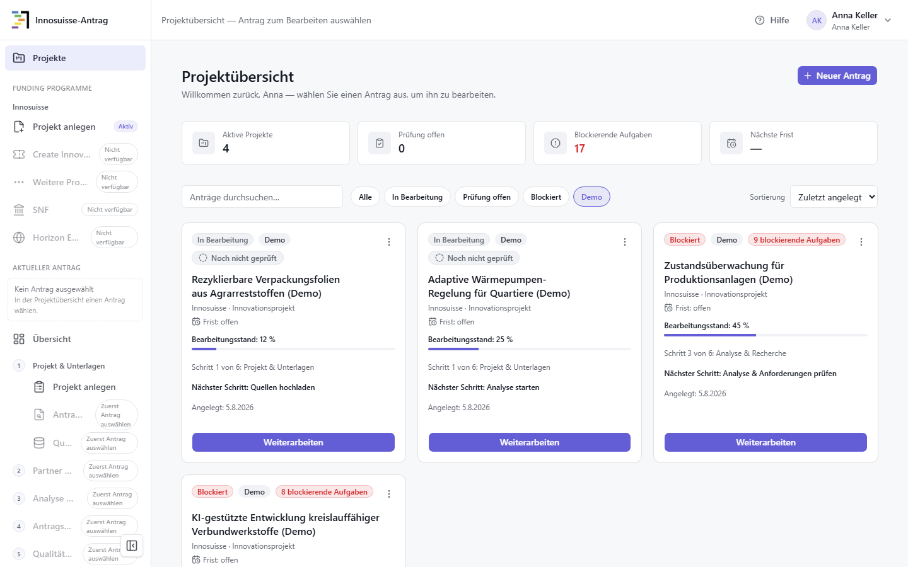
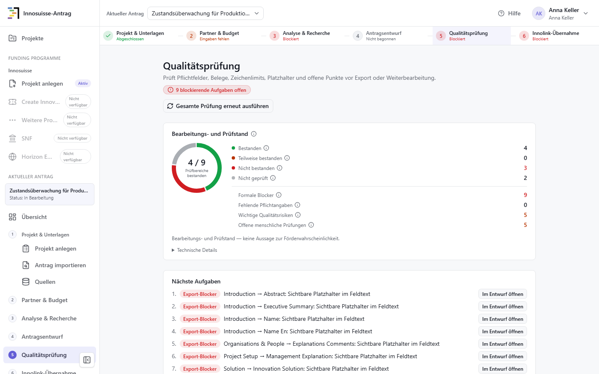
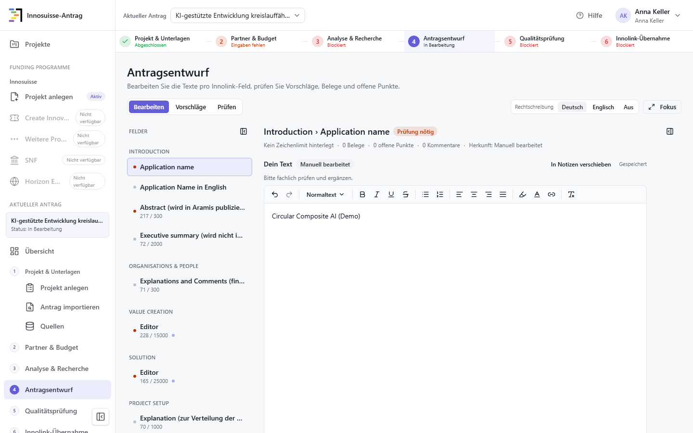

# Schnellstart — «Innosuisse-Antrag» lokal starten

Diese Kurzanleitung führt Sie von der Installation bis zu einem ersten Rundgang
durch die Anwendung. Sie brauchen dafür **keine Programmierkenntnisse** und
**keine kostenpflichtigen Zugänge**. Alles läuft lokal auf Ihrem Rechner; es
werden keine Inhalte an einen externen KI- oder Recherchedienst gesendet.

> **Wie die Anwendung heisst.** In der Seitenleiste steht «Innosuisse-Antrag».
> Anmeldeseite und Browser-Tab tragen die Bezeichnung «Evidenzbasierte
> Proposal-Unterstützung» — gemeint ist dieselbe Anwendung. `Reasearch-funding-app`
> ist nur der Name des Projektordners.

> **Geprüft auf Windows mit PowerShell.** macOS und Linux sind nicht geprüft und
> hier nicht beschrieben. Die Installation der Systemvoraussetzungen wurde nicht
> auf einem frisch aufgesetzten Rechner nachgestellt; Installationsdauer und
> Speicherbedarf wurden nicht gemessen. Einzelheiten:
> [Verifikationsbericht](VERIFIKATIONSBERICHT_BEDIENUNGSANLEITUNG.md).

> **Nur synthetische Daten.** Verwenden Sie zum Ausprobieren keine echten oder
> vertraulichen Projektunterlagen ([Bedienungsanleitung](BEDIENUNGSANLEITUNG.md),
> Abschnitt 17).

## Inhalt

1. [Was die Anwendung tut](#1-was-die-anwendung-tut)
2. [Voraussetzungen](#2-voraussetzungen)
3. [Anwendung herunterladen](#3-anwendung-herunterladen)
4. [Konfiguration kopieren](#4-konfiguration-kopieren)
5. [Installieren](#5-installieren)
6. [Datenbank und Beispieldaten anlegen](#6-datenbank-und-beispieldaten-anlegen)
7. [Starten und anmelden](#7-starten-und-anmelden)
8. [Erster Rundgang](#8-erster-rundgang)
9. [Beenden und wieder starten](#9-beenden-und-wieder-starten)
10. [Wenn etwas nicht klappt](#10-wenn-etwas-nicht-klappt)
11. [Weiterlesen](#11-weiterlesen)

---

## 1 Was die Anwendung tut

Die Anwendung unterstützt ein Team beim Vorbereiten eines Innosuisse-Gesuchs für
ein Innovationsprojekt. Sie führt von der Projektidee oder einem vorhandenen
Innolink-PDF über Quellen, Partner und Budget zu bearbeitbaren Feldtexten und
zeigt dabei offene Punkte, fehlende Belege und formale Blocker.

Sie **unterstützt die menschliche Prüfung — sie ersetzt sie nicht**:

- Sie entscheidet **nicht** über Förderfähigkeit.
- Sie reicht **nichts** automatisch bei Innosuisse ein.
- Sie überträgt **nichts** automatisch ins Innolink-Portal; Texte werden zum
  manuellen Kopieren vorbereitet.
- Sie bearbeitet **acht** Innolink-Textfelder. Tabellen, Arbeitspakete sowie
  Budget- und Finanzierungsplan bleiben Handarbeit im Portal.

In diesem Schnellstart läuft die Anwendung mit einem **Testprovider**:
Textvorschläge und Rechercheergebnisse erzeugt ein klar gekennzeichneter
Demo-Generator ohne echtes KI-Modell. Das eignet sich, um den Ablauf
kennenzulernen — nicht, um die Qualität eines echten Modells zu beurteilen.

---

## 2 Voraussetzungen

**PowerShell öffnen:** Windows-Taste drücken, `PowerShell` tippen, **Windows
PowerShell** öffnen. Befehle kopieren Sie vollständig hinein und bestätigen mit
der Eingabetaste.

**Diese drei Programme installieren**, falls noch nicht vorhanden — jeweils mit
den vorgeschlagenen Standardeinstellungen:

| Programm | Wofür | Bezugsquelle |
|---|---|---|
| **Git** | lädt die Anwendung herunter | <https://git-scm.com/download/win> |
| **Node.js** (LTS, mindestens 20.9) | führt die Benutzeroberfläche aus | <https://nodejs.org> |
| **Python** (mindestens 3.12) | führt die Datenverarbeitung aus | <https://www.python.org/downloads/windows/> |

> **Beim Python-Installer** auf der ersten Seite das Häkchen bei **«Add python.exe
> to PATH»** setzen. Ohne dieses Häkchen findet Windows Python später nicht.

> **Nach jeder Installation** das PowerShell-Fenster schliessen und ein neues
> öffnen — erst dann kennt Windows die neuen Programme.

Danach den Paketmanager freischalten und alles kontrollieren:

```powershell
corepack enable
git --version
node --version
python --version
corepack pnpm --version
```

**Erwartet:** vier Zeilen mit Versionsnummern. Node muss mindestens 20.9 sein,
Python mindestens 3.12, pnpm mindestens 9 (die Sperrdatei des Projekts verlangt
Format 9). Geprüft wurde mit Git 2.50.1, Node 24.16.0, Python 3.13.6 und
pnpm 11.5.3.

---

## 3 Anwendung herunterladen

Wechseln Sie in den Ordner, in dem die Anwendung liegen soll:

```powershell
Set-Location $HOME\Documents
```

> **Nicht in einen synchronisierten Cloud-Ordner.** OneDrive und ähnliche Dienste
> sperren Dateien während der Synchronisation; das führt später zu Fehlern.

```powershell
git clone https://github.com/Karim-Abu/Reasearch-funding-app.git
Set-Location Reasearch-funding-app
```

Kontrollieren Sie, dass der Download vollständig ist:

```powershell
Get-ChildItem README.md, package.json, backend, final_backend_contracts_v1_1
```

**Erwartet:** alle vier Einträge werden aufgelistet. Fehlt einer — insbesondere
`final_backend_contracts_v1_1` —, startet die Anwendung später nicht. Ohne Git
können Sie das Projekt auf GitHub als ZIP-Datei laden; entpacken Sie es dann
**vollständig** und wiederholen Sie diese Kontrolle.

---

## 4 Konfiguration kopieren

Für den Demo-Betrieb liegen fertige Vorlagen bereit. Sie kopieren sie nur,
**es ist nichts zu bearbeiten**.

> **Nur für einen frischen Download gedacht.** Bestehen `.env.local` oder
> `backend\.env` bereits, dürfen sie nicht ungeprüft überschrieben werden — sie
> können echte Zugangsschlüssel enthalten. Sichern oder vergleichen Sie
> vorhandene Dateien zuerst. Die folgende Befehlsfolge bricht deshalb ab, statt
> etwas zu überschreiben:

```powershell
if (Test-Path .env.local) {
    throw ".env.local existiert bereits. Datei zuerst prüfen oder sichern."
}
if (Test-Path backend\.env) {
    throw "backend\.env existiert bereits. Datei zuerst prüfen oder sichern."
}
Copy-Item .env.example .env.local
Copy-Item backend\.env.demo.example backend\.env
```

**Erwartet:** keine Ausgabe — das ist in PowerShell das Zeichen für Erfolg.
Erscheint eine der beiden Fehlermeldungen, existiert die Datei schon; klären Sie
ihren Inhalt, bevor Sie weitermachen.

`.env.local` verbindet die Oberfläche mit der lokalen Datenverarbeitung.
`backend\.env` legt die Demo-Datenbank fest, schaltet die Beispieldaten frei und
aktiviert den Testprovider. Alle Felder für externe Zugangsschlüssel bleiben
bewusst leer; für diesen Schnellstart brauchen Sie keine.

---

## 5 Installieren

Beide Befehle laden Bausteine aus dem Internet. Lassen Sie das Fenster offen, bis
sie durchgelaufen sind.

```powershell
corepack pnpm install --frozen-lockfile
python -m venv backend\.venv
backend\.venv\Scripts\python.exe -m pip install -r backend\requirements.txt
backend\.venv\Scripts\python.exe -m pip check
```

**Erwartet:** pnpm endet mit einer Zusammenfassung (auch «Already up to date» ist
richtig), pip meldet «Successfully installed …», und `pip check` antwortet
«No broken requirements found.»

---

## 6 Datenbank und Beispieldaten anlegen

Die Anwendung speichert in einer Datei auf Ihrem Rechner; ein Datenbankserver ist
nicht nötig. Die folgenden Befehle legen die Struktur an, richten die zwei
Anmeldekonten ein und erzeugen vier Beispielprojekte. Der Wechsel nach `backend`
ist wichtig, weil die Befehle von dort aus arbeiten:

```powershell
Set-Location backend
.\.venv\Scripts\python.exe -m alembic -c alembic.ini upgrade head
.\.venv\Scripts\python.exe -m app.seed
.\.venv\Scripts\python.exe -m app.demo.seed --reset --evaluation
Set-Location ..
```

**Erwartet:** der erste Befehl meldet mehrere Zeilen «Running upgrade …», die
beiden anderen enden ohne Fehler.

> **Der letzte Befehl setzt die Beispieldaten zurück.** Beim ersten Mal ist das
> richtig. Wiederholen Sie ihn später nur, wenn Sie Ihre Änderungen an den
> Demo-Projekten bewusst verwerfen wollen.

---

## 7 Starten und anmelden

Die Anwendung besteht aus zwei Teilen, die gleichzeitig laufen müssen. Sie
brauchen **zwei PowerShell-Fenster**, die während der Benutzung offen bleiben.

**Fenster 1 — Datenverarbeitung:**

```powershell
Set-Location backend
.\.venv\Scripts\python.exe -m uvicorn app.main:app --host 127.0.0.1 --port 8000
```

**Erwartet:** zuletzt `Uvicorn running on http://127.0.0.1:8000`. Das Fenster
kehrt nicht zur Eingabezeile zurück — das ist richtig, der Dienst läuft.

**Fenster 2 — Benutzeroberfläche:**

```powershell
corepack pnpm dev --hostname 127.0.0.1
```

**Erwartet:** eine Meldung von Next.js mit der Adresse `http://127.0.0.1:3000`.

> **Warum `--hostname 127.0.0.1`?** Ohne diese Angabe ist die Oberfläche im
> gesamten lokalen Netzwerk erreichbar — zusammen mit den unten stehenden
> Demo-Zugangsdaten. Mit der Angabe hört sie nur auf Ihrem eigenen Rechner.

Öffnen Sie <http://127.0.0.1:3000> und melden Sie sich an:

| Rolle | E-Mail | Passwort |
|---|---|---|
| Projektleitung (empfohlen) | `anna.keller@example.test` | `changeme-dev-lead` |
| Mitarbeit | `tobias.frei@example.test` | `changeme-dev-member` |

> **Nur für eine lokal gebundene Entwicklungsinstanz. Nicht im Netzwerk oder
> Internet bereitstellen.** Eine Selbstregistrierung gibt es nicht.

**Drei Kontrollen:**

1. Die Projektübersicht zeigt die vier Beispielprojekte mit dem Zusatz «(Demo)».
   Bei einer frisch angelegten Datenbank sind es genau diese vier.
2. Oben links steht **kein** grauer Hinweis «Demo-Daten · keine echten
   Antragsdaten». Erscheint er doch, arbeitet die Oberfläche mit erfundenen
   Beispieldaten statt mit Ihrer lokalen Datenverarbeitung — siehe
   [Abschnitt 10](#10-wenn-etwas-nicht-klappt).
3. Optional: `Invoke-RestMethod http://127.0.0.1:8000/api/v1/health` antwortet
   mit dem Status `ok`.



---

## 8 Erster Rundgang

Die vier Beispielprojekte stehen absichtlich an unterschiedlichen Stellen des
Ablaufs. So sehen Sie die wichtigsten Zustände, ohne selbst Daten zu erfassen.
Alle Inhalte sind erfunden. Rechnen Sie mit rund zehn Minuten.

| Projekt | Zustand |
|---|---|
| Rezyklierbare Verpackungsfolien aus Agrarreststoffen (Demo) | Startphase, noch keine Unterlagen — nächster Schritt «Quellen hochladen» |
| Adaptive Wärmepumpen-Regelung für Quartiere (Demo) | Quellen und Partner erfasst, Analyse fehlt — nächster Schritt «Analyse starten» |
| Zustandsüberwachung für Produktionsanlagen (Demo) | blockiert: es fehlt bewusst ein beitragsberechtigter Forschungspartner |
| KI-gestützte Entwicklung kreislauffähiger Verbundwerkstoffe (Demo) | am weitesten: Analyse gelaufen, Texte bearbeitet, ein Platzhalter offen |

**1. Übersicht lesen.** Jede Kachel zeigt Bearbeitungsstand, den aktuellen Schritt
von sechs und den vorgeschlagenen nächsten Schritt.

**2. Blocker ansehen.** Öffnen Sie «Zustandsüberwachung für Produktionsanlagen
(Demo)» und darin links Schritt 5 «Qualitätsprüfung». Sie sehen, wie viele
Aufgaben blockieren, welche Prüfbereiche bestanden sind und welche nächste
Aktion vorgeschlagen wird.



**3. Entwurfseditor ansehen.** Wechseln Sie oben auf «KI-gestützte Entwicklung
kreislauffähiger Verbundwerkstoffe (Demo)» und öffnen Sie Schritt 4
«Antragsentwurf». Achten Sie auf drei Dinge:

- Die Modi **Bearbeiten**, **Vorschläge** und **Prüfen** halten Ihren Text,
  maschinelle Vorschläge und Prüfinformationen getrennt.
- Fehlende Angaben bleiben als Platzhalter in doppelten eckigen Klammern sichtbar,
  statt erfunden zu werden.
- Ein Vorschlag wird nie automatisch übernommen. Über «Vorschlag prüfen» sehen Sie
  Änderungen, Begründung und fehlende Belege nebeneinander und entscheiden selbst.



**4. Übernahme ansehen.** Schritt 6 «Innolink-Übernahme» zeigt im Register
«Exportoptionen», welche Felder bereit sind, und im Register
«Innolink-Kopieransicht» die Texte zum manuellen Kopieren. Solange Blocker offen
sind, werden Exporte sichtbar als **ENTWURF** gekennzeichnet.

Wollen Sie den Ablauf selbst durchlaufen — eigenes Projekt anlegen, Unterlagen
hochladen, Analyse starten, Texte schreiben, exportieren —, führt Sie Teil B der
[Bedienungsanleitung](BEDIENUNGSANLEITUNG.md) Schritt für Schritt hindurch.

---

## 9 Beenden und wieder starten

**Beenden:** Offene Texte speichern. Dann in Fenster 2 `Strg+C` drücken, danach
in Fenster 1 ebenfalls `Strg+C`. Warten Sie jeweils, bis die Eingabezeile
zurückkehrt. Ihre Daten bleiben erhalten.

**Wieder starten:** Die Abschnitte 2 bis 6 sind einmalig. Beim nächsten Mal
genügen die beiden Startbefehle aus [Abschnitt 7](#7-starten-und-anmelden).

---

## 10 Wenn etwas nicht klappt

Prüfen Sie zuerst: Läuft in beiden Fenstern noch etwas, und ist oben das richtige
Projekt gewählt? Eine ausführliche Fehlertabelle steht in der
[Bedienungsanleitung](BEDIENUNGSANLEITUNG.md), Abschnitt 19.

| Beobachtung | Ursache | Lösung |
|---|---|---|
| Oben links steht «Demo-Daten · keine echten Antragsdaten»; Änderungen sind nach dem Neuladen weg | `.env.local` fehlt oder enthält `APP_BACKEND_MODE` nicht. Die Oberfläche läuft dann ohne Fehlermeldung mit erfundenen Beispieldaten. | Fenster 2 mit `Strg+C` beenden. Prüfen Sie zuerst den Inhalt von `.env.local`; fehlt nur die Zeile `APP_BACKEND_MODE=live`, ergänzen Sie sie. Nur wenn die Datei nichts Eigenes enthält: `Copy-Item .env.example .env.local -Force` — **das überschreibt die bestehende Datei ohne Rückfrage**. Danach neu starten. |
| `python` oder `pip` «wurde nicht als Name eines Cmdlet erkannt» | Beim Python-Installer fehlte «Add python.exe to PATH», oder das Fenster wurde nicht neu geöffnet. | Neues PowerShell-Fenster öffnen; hilft das nicht, Python mit gesetztem Häkchen erneut installieren. |
| `corepack pnpm --version` schlägt fehl | Corepack ist nicht aktiviert. | `corepack enable` ausführen. Hilft das nicht: `corepack prepare pnpm@11.5.3 --activate`. |
| Die Anmeldung erscheint, aber jede Aktion meldet einen Fehler | Fenster 1 läuft nicht. | Startbefehl aus Abschnitt 7 wiederholen; zur Kontrolle `Invoke-RestMethod http://127.0.0.1:8000/api/v1/health`. |
| «E-Mail oder Passwort ist nicht korrekt» | Abschnitt 6 wurde nicht oder im falschen Ordner ausgeführt. | Die drei Befehle aus Abschnitt 6 aus dem Ordner `backend` wiederholen und Fenster 1 neu starten. |

Notieren Sie bei einem unbekannten Fehler die sichtbare Meldung, aber kopieren Sie
keine Projektinhalte, Zugangsschlüssel oder Anmeldedaten in eine Supportanfrage.

---

## 11 Weiterlesen

- **[Bedienungsanleitung](BEDIENUNGSANLEITUNG.md)** — die vollständige Referenz:
  fachlicher Ablauf, Belege und Prüfstände, Datenklassifikation, bekannte Grenzen,
  ausführliche Fehlerbehebung, Glossar.
- **[Verifikationsbericht](VERIFIKATIONSBERICHT_BEDIENUNGSANLEITUNG.md)** — was
  wann womit geprüft wurde und was ausdrücklich nicht.
- **[Innolink-Kopiervorlage](demo/Innolink_Copy_Paste_Guide.md)** — welcher Text in
  welches Portalfeld gehört.
