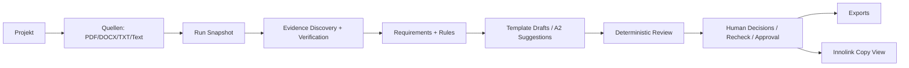

# System Overview

## Produktziel

Aktuell implementiert ist eine supervised-beta-fähige Assistenz-App zur Vorbereitung von Innosuisse-Anträgen. Sie verwaltet Projekte und Quellen, führt Analyse-Runs aus, erzeugt Requirements-/Evidence-/Draft-/Review-Artefakte und stellt Exporte sowie eine manuelle Innolink-Kopieransicht bereit (`backend/app/api/projects.py:21`, `backend/app/api/sources.py:80`, `backend/app/runs/graph.py:349`, `backend/app/exports/__init__.py:3`, `components/portal-transfer/portal-transfer.tsx:32`).

Das Produktziel "manuelle Copy-Paste-Übernahme nach Innolink" ist im UI belegt; automatisches Portal-Writeback ist nicht gefunden (`lib/export-view.ts:21`, `lib/portal-transfer.ts:1`).

## Nicht-Ziele

| Nicht-Ziel | Status | Codebeleg |
|---|---|---|
| Automatisches Innolink-Submit | Nicht implementiert | Keine Submit-Route gefunden; `SUM.SUBMIT.BUTTON` ist Registry-Feld/Portal-Aktion, nicht App-Aktion (`final_backend_contracts_v1_1/innosuisse_innovation_project_v1_1.yaml:5841`) |
| Finales Förderfähigkeitsurteil | Nicht implementiert | Review/Exports formulieren Draft/Review-Status, nicht Bewilligung (`backend/app/exports/generators/common.py:9`) |
| Automatische Übernahme von KI-Vorschlägen | Nicht implementiert als Auto-Accept; A2 akzeptiert Vorschläge explizit über Suggestion/Redraft-Flows. | `backend/app/repositories/draft_suggestions.py:1`, `components/editor/suggestion-review-dialog.tsx:1` |
| Vollständige Innolink-Portalstruktur | Teilweise implementiert | Unsupported Areas werden explizit im Copy-Modul genannt (`lib/portal-transfer.ts:112`) |

## Nutzerrollen

Im Code gibt es `lead_admin` und `member` als Rollen im Auth-Kontrakt und in der UI-Session (`backend/app/contracts/auth.py:17`, `lib/session.ts:9`). Role Guards existieren im Backend (`backend/app/security/deps.py:89`). Eine feinere Capability-/Permission-Matrix über Organisationen hinweg ist nicht gefunden.

## Hauptworkflow

Der technische Run-Graph folgt linear von `initialize` bis `finalize_run`; `human_review` markiert Review als verfügbar und pausiert nicht als interaktive Schleife (`backend/app/runs/graph.py:267`, `backend/app/runs/graph.py:349`). Recheck und Approval sind separate API-Operationen nach dem Run (`backend/app/api/review.py:71`, `backend/app/review/recheck.py:37`, `backend/app/review/service.py:405`).

## Aktueller Funktionsumfang

| Funktion | Status | Codebeleg |
|---|---|---|
| Projektliste/-anlage | Aktuell implementiert | `backend/app/api/projects.py:21`, `backend/app/api/projects.py:33` |
| Login/Session/CSRF | Aktuell implementiert | `backend/app/api/auth.py:33`, `backend/app/security/deps.py:65` |
| Quellenimport Datei/Text | Aktuell implementiert | `backend/app/api/sources.py:93`, `backend/app/api/sources.py:200` |
| URL-Import als Quelle | Nicht implementiert/deaktiviert | `backend/app/api/sources.py:251`, `backend/app/config/settings.py:52` |
| Public Web Research | Teilweise implementiert | `backend/app/api/research.py:60`, `backend/app/research/executor.py:84` |
| Market Comparison | Teilweise implementiert | `backend/app/api/market.py:51`, `backend/app/market/executor.py:1` |
| Requirements/Rules | Aktuell implementiert | `backend/app/registry/loader.py:141`, `backend/app/api/requirements.py:20` |
| Deterministische Evidence Anchors | Aktuell implementiert | `backend/app/evidence/pipeline.py:1`, `backend/app/api/evidence.py:18` |
| PortalFieldDrafts | Teilweise implementiert | `backend/app/repositories/drafts.py:122`, `backend/app/registry/loader.py:94` |
| Review/Recheck/Approval | Aktuell implementiert | `backend/app/review/service.py:1`, `backend/app/review/recheck.py:1` |
| DOCX/Markdown/Technical Evidence Export | Aktuell implementiert | `backend/app/exports/generators/docx.py:1`, `backend/app/exports/generators/markdown.py:3`, `backend/app/exports/generators/technical_evidence.py:1` |
| Innolink Copy View | Teilweise implementiert | `components/export/live-export.tsx:433`, `components/portal-transfer/field-transfer-card.tsx:60` |

## Supervised Beta vs. Production Ready

Supervised Beta ist belegt durch Fake Provider, Demo-/Mock-Pfade, direkte lokale Storage-/SQLite-Defaults, fehlende Azure-/Managed-Identity-Implementierung und mehrere UI-Mockbereiche (`backend/app/agents/providers/fake.py:1`, `backend/app/storage/__init__.py:1`, `backend/app/config/settings.py:20`, `lib/api.ts:51`, `components/kosten/kosten-screen.tsx:31`).

Production Ready ist nicht belegt: Key Vault, Managed Identity, Private Endpoint, RLS/Mandantentrennung, Backup/Restore und Observability sind im Code nicht als vollständige Implementierung gefunden. Azure ist als Ziel/Policy erwähnt, aber kein aktiver Provider (`final_backend_contracts_v1_1/data_policy_v1_1.yaml:89`, `backend/app/agents/gateway.py:107`).

## Demo/Mock vs. Produktiv implementiert

| Bereich | Status | Codebeleg |
|---|---|---|
| Backend API/DB | Produktiv-nahe Beta-Implementierung | `backend/app/main.py:1`, `backend/app/db/models.py:30` |
| Legacy UI API-Layer | Mock/Demo bleibt für `legacy` aktiv | `lib/api.ts:51`, `lib/app-mode.ts:43` |
| Live UI für Editor/Review/Export | Teilweise live | `components/editor/live-editor.tsx:101`, `components/review/live-review.tsx:63`, `components/export/live-export.tsx:91` |
| Fake LLM Provider | Mock/Fake Provider | `backend/app/agents/providers/fake.py:1` |
| OpenAI/Anthropic Provider | Dormant/Env-gated | `backend/app/agents/providers/openai.py:1`, `backend/app/agents/providers/anthropic.py:1` |
| Kosten-Screen | Mock/Demo | `components/kosten/kosten-screen.tsx:31` |

## Aktuelle Grenzen

- Die Copy-Ansicht warnt, blockiert aber nicht technisch (`lib/portal-transfer.ts:80`).
- Export blockiert Draft-Exporte bei Blockern nicht; es setzt `draft_marked` (`backend/app/exports/eligibility.py:3`).
- A2 ist im Run-Graph als deaktiviert protokolliert; gezielte Redrafts/Suggestions existieren separat (`backend/app/runs/graph.py:191`, `backend/app/fields/redraft_service.py:49`).
- Der Portal-Field-Support ist eine Teilmenge der Registry (`backend/app/registry/loader.py:94`, `backend/app/registry/loader.py:131`).
- Innolink-PDF-Import oder Portal-Scraping ist nicht gefunden.

