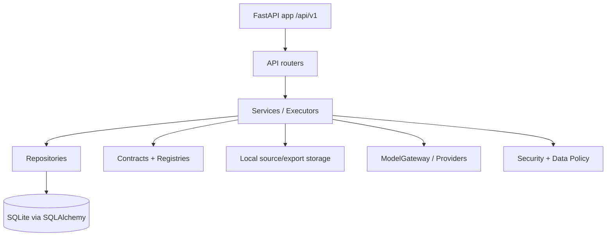

# Backend Architecture

## Backend Layering

Der Einstiegspunkt ist `backend/app/main.py`, der Router importiert und unter `/api/v1` registriert (`backend/app/main.py:12`, `backend/app/main.py:30`, `backend/app/main.py:64`). Startup prüft DB-Konnektivität, lädt Requirement-/Rule-Registry fail-closed, lädt Agent Registry fail-closed und startet Recovery für Quellen, Runs und Exporte (`backend/app/main.py:37`, `backend/app/main.py:43`, `backend/app/main.py:48`, `backend/app/main.py:54`).

## API Routes / Endpoints

| Endpoint | Methode | Zweck | Input | Output | Auth/Policy | Status |
|---|---:|---|---|---|---|---|
| `/api/v1/health` | GET | Health Check | - | `Health` | öffentlich/Infrastructure | Implementiert (`backend/app/api/health.py:13`) |
| `/api/v1/session` | POST | Login | Email/Password | Session + CSRF | Password + Cookie | Implementiert (`backend/app/api/auth.py:33`) |
| `/api/v1/session` | GET | Session Bootstrap | Cookie | Session + CSRF | Session | Implementiert (`backend/app/api/auth.py:62`) |
| `/api/v1/session` | DELETE | Logout | Cookie + CSRF | 204 | Unsafe Guards | Implementiert (`backend/app/api/auth.py:72`) |
| `/api/v1/me` | GET | aktueller User | Cookie | User | Session | Implementiert (`backend/app/api/me.py:13`) |
| `/api/v1/capabilities` | GET | Feature Flags | Cookie | Capabilities | Session | Implementiert (`backend/app/api/capabilities.py:13`) |
| `/api/v1/projects` | GET/POST | Projekte listen/anlegen | ProjectCreate bei POST | Project/List | Session/Unsafe | Implementiert (`backend/app/api/projects.py:21`, `backend/app/api/projects.py:33`) |
| `/api/v1/projects/{id}` | GET/PATCH | Projekt lesen/ändern | ProjectPatch | Project | Session/Unsafe | Implementiert (`backend/app/api/projects.py:162`, `backend/app/api/projects.py:179`) |
| `/api/v1/projects/{id}/sources` | GET | Quellen listen | Project ID | SourceDocument[] | Session | Implementiert (`backend/app/api/sources.py:80`) |
| `/api/v1/projects/{id}/sources/files` | POST | PDF/DOCX/TXT Upload | Multipart + DataClassification | SourceDocument[] | CSRF/Origin, Limits | Implementiert (`backend/app/api/sources.py:93`) |
| `/api/v1/projects/{id}/sources/text` | POST | Textquelle | TextSourceCreate | SourceDocument | CSRF/Origin | Implementiert (`backend/app/api/sources.py:200`) |
| `/api/v1/projects/{id}/sources/url` | POST | URL-Import | UrlSourceCreate | Async | CSRF/Origin | Deaktiviert (`backend/app/api/sources.py:251`) |
| `/api/v1/projects/{id}/runs` | GET/POST | Runs listen/starten | RunCreate | RunList/AsyncAccepted | Session/Cloud Gate | Implementiert (`backend/app/api/runs.py:43`, `backend/app/api/runs.py:98`) |
| `/api/v1/runs/{id}` | GET | Run lesen | Run ID | AnalysisRun | Session | Implementiert (`backend/app/api/runs.py:109`) |
| `/api/v1/runs/{id}/cancel` | POST | Run abbrechen | Run ID | AnalysisRun | Unsafe | Implementiert (`backend/app/api/runs.py:126`) |
| `/api/v1/runs/{id}/resume` | POST | Resume | Run ID | AsyncAccepted | Unsafe | Teilweise; nur wenn Status passt (`backend/app/api/runs.py:187`) |
| `/api/v1/runs/{id}/requirements` | GET | Requirements | Run ID | RequirementAssessment[] | Session | Implementiert (`backend/app/api/requirements.py:20`) |
| `/api/v1/runs/{id}/evidence` | GET | Evidence Anchors | Run ID | EvidenceAnchor[] | Session | Implementiert (`backend/app/api/evidence.py:18`) |
| `/api/v1/runs/{id}/fields` | GET | PortalFieldDrafts | Run ID | Draft[] | Session | Implementiert (`backend/app/api/fields.py:66`) |
| `/api/v1/runs/{id}/fields/{field}` | GET/PATCH | Feld lesen/speichern | DraftPatch | Draft | Session/Unsafe | Implementiert (`backend/app/api/fields.py:81`, `backend/app/api/fields.py:93`) |
| `/api/v1/runs/{id}/fields/{field}/redrafts` | POST | A2 Redraft | RedraftCreate | DraftSuggestion | Policy/Provider | Teilweise (`backend/app/api/fields.py:116`) |
| `/api/v1/runs/{id}/review` | GET | ReviewPackage | Run ID | ReviewPackage | Session | Implementiert (`backend/app/api/review.py:61`) |
| `/api/v1/runs/{id}/human-decisions` | POST | Human Decision | DecisionCreate | HumanDecision | Unsafe | Implementiert (`backend/app/api/review.py:71`) |
| `/api/v1/runs/{id}/approvals` | POST | Approval | ApprovalCreate | ReviewApproval | Unsafe/Gates | Implementiert (`backend/app/api/review.py:104`) |
| `/api/v1/runs/{id}/rechecks` | POST | Targeted Recheck | Version Hash | AsyncAccepted | Unsafe | Implementiert (`backend/app/api/review.py:134`) |
| `/api/v1/runs/{id}/exports` | POST | Export erzeugen | ExportCreate | AsyncAccepted | Export Gates | Implementiert (`backend/app/api/exports.py:57`) |
| `/api/v1/exports/{id}` | GET | Export status | Export ID | ExportArtifact | Session | Implementiert (`backend/app/api/exports.py:103`) |
| `/api/v1/exports/{id}/download` | GET | Export Download | Export ID | Binary | Session | Implementiert (`backend/app/api/exports.py:113`) |
| `/api/v1/projects/{id}/research-tasks` | POST | Public Web Research | ResearchTaskCreate | AsyncAccepted | Firewall/Policy | Teilweise (`backend/app/api/research.py:60`) |
| `/api/v1/projects/{id}/market-comparisons` | POST | Market Comparison | Request | AsyncAccepted | Policy/Provider | Teilweise (`backend/app/api/market.py:51`) |
| `/api/v1/runs/{id}/reliability` | GET/POST | Reliability Pass/View | Run ID | ReliabilityView/Async | Session/Unsafe | Implementiert (`backend/app/api/reliability.py:38`) |

## Services und Repositories

Repositories sind unter `backend/app/repositories/*` organisiert, z. B. `projects`, `sources`, `runs`, `requirements`, `evidence`, `drafts`, `audit`, `partners`, `processing_confirmations` (`backend/app/repositories/projects.py:1`, `backend/app/repositories/sources.py:1`, `backend/app/repositories/runs.py:1`, `backend/app/repositories/drafts.py:1`). Services/Executors liegen domänennah: Runs, Sources, Evidence, Review, Exports, Research, Market, Reliability (`backend/app/runs/executor.py:1`, `backend/app/sources/service.py:1`, `backend/app/review/service.py:1`, `backend/app/exports/service.py:1`, `backend/app/research/service.py:1`, `backend/app/reliability/executor.py:1`).

## DB Models

Zentrale Modelle sind in `backend/app/db/models.py` implementiert. Belegt sind u. a. `Project`, `SourceDocument`, `SourceVersion`, `SourceFragment`, `AnalysisRun`, `Partner`, `RequirementAssessment`, `OpenIssue`, `EvidenceAnchor`, `EvidenceLink`, `PortalFieldDraft`, `DraftVersion`, `ReviewFinding`, `ReviewApproval`, `ExportArtifact`, `AgentInvocation`, `ResearchTask`, `MarketComparison`, `DraftClaim`, `ClaimLineage`, `RunQualitySummary` (`backend/app/db/models.py:92`, `backend/app/db/models.py:185`, `backend/app/db/models.py:213`, `backend/app/db/models.py:255`, `backend/app/db/models.py:313`, `backend/app/db/models.py:471`, `backend/app/db/models.py:565`, `backend/app/db/models.py:593`, `backend/app/db/models.py:686`, `backend/app/db/models.py:738`, `backend/app/db/models.py:777`, `backend/app/db/models.py:810`, `backend/app/db/models.py:839`, `backend/app/db/models.py:904`, `backend/app/db/models.py:998`, `backend/app/db/models.py:1050`, `backend/app/db/models.py:1271`, `backend/app/db/models.py:1374`, `backend/app/db/models.py:1510`, `backend/app/db/models.py:1547`, `backend/app/db/models.py:1580`).

## Run-Orchestrierung

Der RunExecutor führt einen LangGraph-Workflow aus (`backend/app/runs/executor.py:1`, `backend/app/runs/graph.py:16`). Der Graph ist linear: `initialize -> validate_source_snapshot -> extract_facts_and_map_evidence -> verify_evidence -> evaluate_requirements_and_rules -> draft_fields -> create_template_drafts -> critic_review -> aggregate_review -> human_review -> finalize_run` (`backend/app/runs/graph.py:349`, `backend/app/runs/graph.py:362`). `human_review` dokumentiert Review-Verfügbarkeit, aber pausiert nicht (`backend/app/runs/graph.py:267`).

## Rules Engine

Requirement-/Rule-Registries werden aus `final_backend_contracts_v1_1` geladen und validiert (`backend/app/registry/loader.py:1`, `backend/app/registry/loader.py:279`). Der Rule-Engine-Code liegt unter `backend/app/rules/*`; der Run-Graph bewertet Requirements deterministisch und erzeugt Assessments/OpenIssues (`backend/app/runs/graph.py:153`).

## Review Service

Review ist deterministisch über bereits persistierte Artefakte. Findings werden idempotent erzeugt/aktualisiert und per Scope Hash versioniert (`backend/app/review/checks.py:1`, `backend/app/review/package.py:1`, `backend/app/review/package.py:197`). Approval wird durch Recheck-Pflicht, Platzhalter, Zeichenlimit, stale Evidence Links, Blocker Issues und Reliability blockiert (`backend/app/review/service.py:331`, `backend/app/review/service.py:364`).

## Export Service

Exports frieren Snapshot und Draft-Markierung atomar ein (`backend/app/exports/service.py:3`, `backend/app/exports/snapshot.py:1`). Nicht freigegebene/stale/blockierte Stände werden als `ENTWURF` markiert, aber Draft-Export ist möglich (`backend/app/exports/eligibility.py:3`, `backend/app/exports/generators/common.py:14`).

## Market/Webresearch Service

Public Web Research hat Firewall, Data-Class-Policy, Provider Resolver, Fake/Firecrawl Provider und URL-Safety (`backend/app/research/service.py:61`, `backend/app/research/executor.py:84`, `backend/app/research/providers/resolver.py:14`, `backend/app/research/url_safety.py:54`). MarketComparison ist eine separate Funktion unter `backend/app/market/*` (`backend/app/api/market.py:51`, `backend/app/market/executor.py:1`).

## Security/Policy Services

Auth, Sessions, Origin/CSRF, Data Class, Search Query Firewall, Redaction, Policy Matrix und Cloud Policy sind implementiert (`backend/app/security/sessions.py:1`, `backend/app/security/deps.py:65`, `backend/app/security/data_class.py:1`, `backend/app/security/search_query_firewall.py:1`, `backend/app/security/redaction.py:1`, `backend/app/security/policy_matrix.py:1`, `backend/app/runs/cloud_policy.py:1`).

