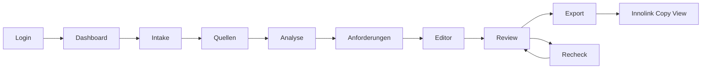

# Frontend UI/UX Architecture

## Hauptscreens und Navigation

Die App nutzt Next.js App Router Pages (`app/page.tsx`, `app/intake/page.tsx`, `app/quellen/page.tsx`, `app/anforderungen/page.tsx`, `app/editor/page.tsx`, `app/review/page.tsx`, `app/export/page.tsx`, `app/portal-transfer/page.tsx`). Shell/Navigation liegen unter `components/shell/*` (`components/shell/app-shell.tsx:39`, `components/shell/sidebar.tsx:1`, `components/shell/topbar.tsx:44`).

## Live/Mock-Modus

Der Modus wird serverseitig über `APP_BACKEND_MODE` gesetzt und im Provider verteilt (`app/layout.tsx:19`, `components/providers/app-providers.tsx:73`). `lib/app-mode.ts` beschreibt, dass ältere Ressourcen im Milestone-Kontext weiterhin Mock sein können (`lib/app-mode.ts:3`, `lib/app-mode.ts:38`, `lib/app-mode.ts:43`). `lib/api.ts` enthält weiterhin Legacy-Mock-Run-/Review-/Draft-Flows (`lib/api.ts:51`, `lib/api.ts:137`, `lib/api.ts:407`).

## Screen Map

| Screen | Live-Komponente/Logik | Backend-Endpunkte | Mock/Fallback | Status |
|---|---|---|---|---|
| Dashboard `/` | Projektkarten aus `lib/projects.ts` | `/api/projects` | `lib/mock-data.ts` | Teilweise live (`app/page.tsx:52`) |
| Intake `/intake` | Lokaler Intake Store | Nicht direkt persistiert als vollständiger Backend-Intake | `lib/intake-store.ts` | Teilweise (`app/intake/page.tsx:3`) |
| Quellen `/quellen` | Live Sources, Run Start, Evidence, Research, Market | `/projects/{id}/sources`, `/runs`, `/evidence`, `/research-tasks` | `lib/quellen-mock-data.ts` | Teilweise live (`app/quellen/page.tsx:559`) |
| Anforderungen `/anforderungen` | `LiveRequirements` | `/runs/{id}/requirements` | `RequirementsScreen` Mock | Teilweise live (`app/anforderungen/page.tsx:134`) |
| Editor `/editor` | `LiveEditor` | `/runs/{id}/fields`, `/evidence`, `/review`, `/redrafts` | `DraftWorkspace` Mock | Teilweise live (`components/editor/live-editor.tsx:101`) |
| Review `/review` | `LiveReview` | `/runs/{id}/review`, `/human-decisions`, `/approvals`, `/rechecks` | `ReviewScreen` Mock | Teilweise live (`app/review/page.tsx:197`) |
| Export `/export` | `LiveExport` | `/runs/{id}/exports`, `/exports/{id}`, `/download`, `/fields`, `/review` | `ExportScreen` Mock | Teilweise live (`app/export/page.tsx:189`) |
| Portal Transfer `/portal-transfer` | `PortalTransfer` | `/fields`, `/review` | Mock adapter | Teilweise live (`app/portal-transfer/page.tsx:208`) |
| Kosten `/kosten` | Mock | Nicht gefunden | `lib/kosten-mock-data.ts` | Mock/Demo (`components/kosten/kosten-screen.tsx:31`) |

## User Flow

## UX-Logik pro Screen

Dashboard lädt im Live-Modus Projekte und nutzt Mock-Karten im Mock-Modus (`app/page.tsx:52`, `app/page.tsx:80`). Quellen verwaltet Live-Uploads, Textquellen, optional URL-Import-Fallback und Analyse-Start; Analysefortschritt wird aus Operation/Run-Status auf UI-Schritte gemappt (`app/quellen/page.tsx:420`, `app/quellen/page.tsx:478`, `app/quellen/page.tsx:559`). Editor lädt Feldentwürfe und Evidence parallel und verwaltet lokalen Rich-Text-Zustand plus Save/Recheck-Hinweis (`components/editor/live-editor.tsx:191`, `components/editor/live-editor.tsx:222`). Review bündelt ReviewPackage, Approval Panel, Blocker-Gruppierung und Next Actions (`components/review/live-review.tsx:63`, `components/review/live-review.tsx:306`, `components/review/live-review.tsx:398`). Export zeigt Review-Status, Exportkarten, Export-Download und eingebettete Innolink-Copy-Ansicht (`components/export/live-export.tsx:91`, `components/export/live-export.tsx:433`).

## Welche Daten werden von welchem Backend-Endpunkt geholt?

| UI-Modul | Client | Endpoint | Codebeleg |
|---|---|---|---|
| Projects | `lib/projects.ts` | `/api/projects` | `lib/projects.ts:86`, `lib/projects.ts:109` |
| Sources | `lib/sources.ts` | `/api/projects/{id}/sources*` | `lib/sources.ts:79`, `lib/sources.ts:100`, `lib/sources.ts:118` |
| Runs | `lib/runs.ts` | `/api/projects/{id}/runs`, `/api/runs/{id}` | `lib/runs.ts:103`, `lib/runs.ts:128` |
| Fields | `lib/fields.ts` | `/api/runs/{id}/fields` | `lib/fields.ts:78`, `lib/fields.ts:84`, `lib/fields.ts:95` |
| Evidence | `lib/evidence.ts` | `/api/runs/{id}/evidence` | `lib/evidence.ts:225` |
| Requirements | `lib/requirements.ts` | `/api/runs/{id}/requirements` | `lib/requirements.ts:67` |
| Review | `lib/review.ts` | `/api/runs/{id}/review`, decisions, approvals, rechecks | `lib/review.ts:144`, `lib/review.ts:150`, `lib/review.ts:170`, `lib/review.ts:199` |
| Exports | `lib/exports.ts` | `/api/runs/{id}/exports`, `/api/exports/{id}` | `lib/exports.ts:63`, `lib/exports.ts:74` |
| Research | `lib/research.ts` | `/api/projects/{id}/research-tasks`, results/import | `lib/research.ts:127`, `lib/research.ts:149`, `lib/research.ts:159` |
| Market | `lib/market-comparison.ts` | `/market-comparisons*` | `lib/market-comparison.ts:163`, `lib/market-comparison.ts:177` |

## Mock-/Fallback-Daten

Mockdaten liegen u. a. in `lib/mock-data.ts`, `lib/quellen-mock-data.ts`, `lib/anforderungen-mock-data.ts`, `lib/draft-mock-data.ts`, `lib/export-mock-data.ts`, `lib/review-mock-data.ts`, `lib/kosten-mock-data.ts` (`lib/api.ts:9`, `components/kosten/kosten-screen.tsx:31`, `components/export/export-screen.tsx:28`). Der Legacy-API-Layer enthält Dummy-Texte und simulierte Latenz (`lib/api.ts:118`, `lib/api.ts:274`, `lib/api.ts:348`, `lib/api.ts:480`).

## UX-Logikfehler / Risiken

| Risiko | Status | Codebeleg |
|---|---|---|
| Copy trotz Blockern möglich | Aktuell implementiert, nicht blockierend | `lib/portal-transfer.ts:80`, `components/portal-transfer/field-transfer-card.tsx:76` |
| Copy-Audit fehlt | Nicht gefunden | `components/portal-transfer/portal-transfer.tsx:46` |
| Placeholder-Erkennung uneinheitlich | Im Code als TODO markiert | `lib/portal-transfer.ts:29` |
| Live Market im Editor nur read-only/leer bei fehlender Comparison | Teilweise implementiert | `components/editor/market-competition-panel.tsx:70` |
| Kosten-Screen zeigt Mockdaten | Mock/Demo | `components/kosten/kosten-screen.tsx:31` |
| Legacy API-Stubs | Teilweise nicht implementiert | `app/api/exports/route.ts:1`, `app/api/sections/[fieldId]/route.ts:1`, `app/api/suggestions/[id]/accept/route.ts:1` |

## Screenshot-relevante UI-Komponenten

Wichtige visuelle Komponenten: `SourceTable`, `PublicResearchPanel`, `MarketComparisonSection`, `LiveEvidence`, `LiveRequirements`, `LiveEditor`, `RichTextEditor`, `LiveReview`, `QualitySummary`, `LiveExport`, `PortalTransfer`, `FieldTransferCard` (`components/quellen/source-table.tsx:73`, `components/quellen/public-research-panel.tsx:61`, `components/quellen/market-comparison-section.tsx:29`, `components/quellen/live-evidence.tsx:72`, `components/anforderungen/live-requirements.tsx:90`, `components/editor/live-editor.tsx:101`, `components/editor/rich-text-editor.tsx:160`, `components/review/live-review.tsx:63`, `components/review/quality-summary.tsx:1`, `components/export/live-export.tsx:91`, `components/portal-transfer/portal-transfer.tsx:32`, `components/portal-transfer/field-transfer-card.tsx:32`).

