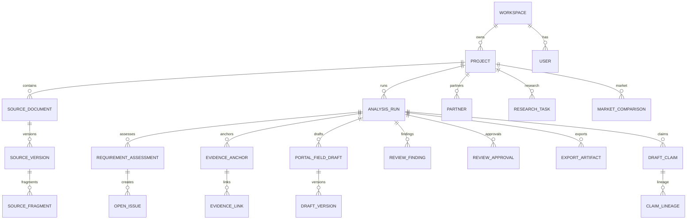

# Domain Model And Data Flow

## Zentrale Entitäten

| Entität aus Zielarchitektur | Code-Status | Codebeleg | Bemerkung |
|---|---|---|---|
| Project | Aktuell implementiert | `backend/app/db/models.py:92` | Enthält u. a. Funding Profile, DataClassification, Statusfelder |
| Partner | Aktuell implementiert | `backend/app/db/models.py:471`, `backend/app/api/partners.py:38` | Partner CRUD vorhanden |
| SourceDocument | Aktuell implementiert | `backend/app/db/models.py:185` | Projektquelle |
| SourceVersion | Aktuell implementiert | `backend/app/db/models.py:213` | Version/Storage/Parsing |
| SourceFragment | Aktuell implementiert | `backend/app/db/models.py:255` | Fragmentierung für Evidence/Agenten |
| Requirement | Teilweise implementiert | `backend/app/registry/loader.py:54`, `final_backend_contracts_v1_1/requirements.yaml:1` | Registry-Definition, nicht DB-Tabelle als `Requirement` |
| EvidenceAnchor | Aktuell implementiert | `backend/app/db/models.py:686` | Deterministische Fundstelle |
| EvidenceLink | Aktuell implementiert | `backend/app/db/models.py:738` | Verknüpft Anchor mit Requirement/Draft |
| PortalFieldDefinition | Teilweise implementiert | `backend/app/registry/loader.py:85` | Registry-Dataclass, keine DB-Tabelle |
| PortalFieldDraft | Aktuell implementiert | `backend/app/db/models.py:777` | Run-scoped Feldentwurf |
| DraftVersion | Aktuell implementiert | `backend/app/db/models.py:810` | Immutable Draft-Version |
| Claim | Aktuell implementiert als `DraftClaim` | `backend/app/db/models.py:1510` | Reliability-spezifisch |
| ReviewFinding | Aktuell implementiert | `backend/app/db/models.py:839` | Deterministisch, agentisch, human |
| Approval | Aktuell implementiert als `ReviewApproval` | `backend/app/db/models.py:904` | Run-/Field-Scope |
| Run | Aktuell implementiert als `AnalysisRun` | `backend/app/db/models.py:313` | Analyse-Orchestrierung |
| AuditEvent | Aktuell implementiert | `backend/app/db/models.py:118` | Metadata-only Audit |
| ExportArtifact | Aktuell implementiert | `backend/app/db/models.py:998` | Exportdatei + Snapshot |
| MarketComparison | Aktuell implementiert | `backend/app/db/models.py:1374` | Public-source Market/Competitor |

## Beziehungen

Die Beziehungsskizze ist aus DB-Klassen und Repository-Zugriffen abgeleitet (`backend/app/db/models.py:92`, `backend/app/repositories/sources.py:74`, `backend/app/repositories/drafts.py:112`, `backend/app/reliability/lineage.py:72`).

## Lebenszyklus eines Projekts

1. Projekt wird über `/projects` angelegt (`backend/app/api/projects.py:33`).
2. DataClassification wird mitgeführt (`backend/app/contracts/project.py:13`, `backend/app/db/models.py:103`).
3. Partner können separat angelegt/geändert/gelöscht werden (`backend/app/api/partners.py:49`, `backend/app/api/partners.py:95`, `backend/app/api/partners.py:112`).
4. Quellen und Runs hängen am Projekt (`backend/app/api/sources.py:80`, `backend/app/api/runs.py:43`).
5. ProcessingConfirmation kann für einen cloud_assisted Run erzeugt werden (`backend/app/api/projects.py:88`, `backend/app/repositories/processing_confirmations.py:3`).

## Lebenszyklus einer Quelle

1. Upload/Textquelle erzeugt `SourceDocument` und `SourceVersion` mit effektiver Klassifikation (`backend/app/api/sources.py:163`, `backend/app/sources/service.py:68`).
2. Binärdaten werden lokal mit traversal-safe Storage Ref gespeichert (`backend/app/storage/local.py:1`, `backend/app/storage/local.py:26`).
3. Parser verarbeitet PDF/DOCX/TXT deterministisch, ohne OCR/Netzwerk (`backend/app/ingestion/parsers.py:1`, `backend/app/ingestion/parsers.py:50`, `backend/app/ingestion/parsers.py:94`).
4. Bei no extractable text wird `needs_manual_input` gesetzt (`backend/app/ingestion/pipeline.py:136`).
5. Fragmente und Content Hashes werden persistiert (`backend/app/ingestion/pipeline.py:145`, `backend/app/ingestion/pipeline.py:150`).

## Lebenszyklus eines Feldentwurfs

1. Unterstützte M6-Draft-Felder kommen aus `registry.m6_draft_fields()` (`backend/app/registry/loader.py:131`).
2. Template Drafts werden idempotent erzeugt (`backend/app/repositories/drafts.py:122`, `backend/app/runs/graph.py:207`).
3. User-/Agent-Änderungen erzeugen neue `DraftVersion` statt Mutation der alten Version (`backend/app/repositories/drafts.py:56`, `backend/app/repositories/drafts.py:168`).
4. Edits/Evidence-Link-Änderungen invalidieren Approvals und setzen Recheck-Pflicht (`backend/app/review/invalidation.py:14`, `backend/app/review/service.py:364`).
5. A2-Suggestions sind separat und müssen explizit akzeptiert werden (`backend/app/repositories/draft_suggestions.py:4`).

## Lebenszyklus eines Review Findings

1. Deterministische Checks erzeugen FindingSpecs (`backend/app/review/checks.py:53`).
2. `apply_findings` upsertet offene Findings und resolved fixierte (`backend/app/review/package.py:115`).
3. Human Comments erzeugen eigene ReviewFindings (`backend/app/review/service.py:251`).
4. Human Decisions ändern Review-Status, umgehen aber harte Gates nicht (`backend/app/review/service.py:237`, `backend/app/review/service.py:364`).
5. Reliability-Findings werden als `ReviewFinding` mit Profil `M9K` persistiert (`backend/app/reliability/gate.py:1`, `backend/app/reliability/approval.py:88`).

## Kritische Lücken im Datenmodell

| Gap | Status | Codebeleg |
|---|---|---|
| Vollständig strukturierter Budgetplan mit 40-60%- und 5%-Berechnung | Nicht vollständig gefunden | Grobe Budgetfelder am Project/Intake, aber keine BudgetPlan-Entität; `components/intake/intake-form.tsx:670`, `final_backend_contracts_v1_1/Frontend_API_Mapping_v1_1.md:13` |
| WorkPackages/Milestones als strukturierte DB-Entitäten | Nicht implementiert | Registry hat wiederholte Pfade, Loader filtert `[]` aus M6 Drafts (`backend/app/registry/loader.py:94`) |
| PortalFieldDefinition als DB-Entität | Nicht implementiert | Registry-Dataclass statt DB-Modell (`backend/app/registry/loader.py:85`) |
| Rework Task als eigene Entität | Nicht gefunden | Findings/RecommendedNextAction vorhanden, keine `ReworkTask`-Klasse in `backend/app/db/models.py` |
| Innolink-PDF-Import | Nicht gefunden | Kein entsprechender Parser/Endpoint gefunden; Source Parser unterstützt PDF/DOCX/TXT allgemein (`backend/app/ingestion/parsers.py:1`) |

