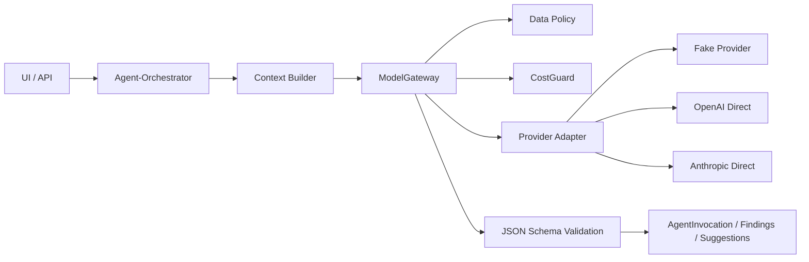

# Agent And LLM Architecture

## Überblick

Die Agent-/LLM-Schicht ist backend-only und liegt unter `backend/app/agents/*`. Der zentrale Call-Pfad ist `ModelGateway`, das Profil-/Route-Registry, Data Policy, CostGuard, Source Trust, Prompt-Injection-Kontrolle, strukturierte Output-Validierung, AgentInvocation, UsageRecord, ControlResult und AuditEvent kombiniert (`backend/app/agents/gateway.py:1`, `backend/app/agents/gateway.py:220`). A1/A2/A3 sind teilweise implementiert; sie sind nicht vollständig als autonome Multi-Agent-Pipeline im Hauptgraphen aktiv (`backend/app/runs/graph.py:191`, `backend/app/runs/graph.py:224`).

## Implementierte Agenten / agentische Funktionen

| Funktion | Status | Codebeleg |
|---|---|---|
| A1 Project Fact Extraction | Teilweise implementiert | `backend/app/agents/fact_extraction.py:1`, `backend/app/agents/schemas.py:35` |
| A1 Evidence Candidate Mapping | Teilweise implementiert | `backend/app/agents/evidence_mapping.py:1`, `backend/app/agents/schemas.py:95` |
| A1 Public Competence Research | Teilweise implementiert | `backend/app/agents/public_competence_research.py:1`, `backend/app/agents/schemas.py:321` |
| A2 Field Drafting | Teilweise implementiert, field-scoped | `backend/app/agents/a2_fields.py:23`, `backend/app/agents/field_drafting.py:1` |
| A3 Evidence Consistency | Teilweise implementiert, advisory/recheck | `backend/app/agents/a3_review.py:13`, `backend/app/agents/critic_review.py:145` |
| Market Comparison Agent | Teilweise implementiert | `backend/app/market/executor.py:1`, `backend/app/agents/schemas.py:388` |
| M9K Reliability | Deterministisch, kein Provider | `backend/app/reliability/__init__.py:3`, `backend/app/reliability/executor.py:3` |

## LLM-basiert vs. deterministisch vs. Human-in-the-loop

| Aufgabe | Einordnung | Codebeleg |
|---|---|---|
| Source Parsing/Fragmentierung | Deterministisch | `backend/app/ingestion/parsers.py:1`, `backend/app/ingestion/pipeline.py:145` |
| Evidence Discovery/Verification | Deterministisch plus advisory A1 Mapping | `backend/app/runs/graph.py:119`, `backend/app/runs/graph.py:123` |
| Requirements/Rules | Deterministisch | `backend/app/runs/graph.py:153`, `backend/app/rules/engine.py:1` |
| Template Drafts | Deterministisch | `backend/app/runs/graph.py:207`, `backend/app/drafts/templates.py:1` |
| A2 Suggestions | LLM/fake-provider möglich, explizit akzeptieren | `backend/app/fields/redraft_service.py:49`, `backend/app/repositories/draft_suggestions.py:4` |
| Review Findings | Deterministisch; A3 advisory optional | `backend/app/review/checks.py:1`, `backend/app/review/recheck.py:145` |
| Approval | Human-in-the-loop | `backend/app/review/service.py:405` |
| Reliability | Deterministisch, human review required bei Findings | `backend/app/reliability/gate.py:1` |

## ModelGateway / ProviderGateway

`ModelGateway.invoke` lädt Registry/Profile, erzeugt `AgentInvocation`, prüft Data Policy, prüft CostGuard, markiert Source Trust/Prompt Injection, ruft Provider und validiert JSON-Schema (`backend/app/agents/gateway.py:220`, `backend/app/agents/gateway.py:241`, `backend/app/agents/gateway.py:248`, `backend/app/agents/gateway.py:257`). Provider-Fallback erfolgt über Primary/Fallback Model Routes aus der Agent Registry (`backend/app/agents/gateway.py:289`, `backend/app/agents/registry.py:173`).

## Provider

| Provider | Status | Codebeleg |
|---|---|---|
| Fake Provider | Implementiert, Test/Dev | `backend/app/agents/providers/fake.py:1`, `backend/tests/test_agent_fake_provider.py:10` |
| OpenAI Direct | Dormant/env-gated | `backend/app/agents/providers/openai.py:1`, `backend/app/agents/gateway.py:112` |
| Anthropic Direct | Dormant/env-gated | `backend/app/agents/providers/anthropic.py:1`, `backend/app/agents/gateway.py:110` |
| Azure Provider | Nicht implementiert | Nur Policy/Zielarchitektur (`final_backend_contracts_v1_1/data_policy_v1_1.yaml:89`); keine Klasse in `backend/app/agents/providers/*` |
| Firecrawl Web Provider | Implementiert für Web Research, env-gated | `backend/app/research/providers/firecrawl.py:1`, `backend/app/research/providers/resolver.py:14` |
| Fake Web Provider | Implementiert | `backend/app/research/providers/fake.py:45` |

## CostGuard

CostGuard erzwingt Invocation-Limits, Retry-/Timeout- und Output-Token-Grenzen aus AgentProfile; CHF-Kosten werden nicht berechnet, `cost_chf=0.0` ist als technischer Placeholder dokumentiert (`backend/app/agents/cost_guard.py:3`, `backend/app/agents/cost_guard.py:38`, `backend/app/agents/cost_guard.py:70`, `backend/app/agents/cost_guard.py:84`). Das ist für Evaluation ausreichend, aber kein produktives Kostenmodell.

## Data Policy / Cloud Gate

Data Policy blockiert externe Modellaufrufe für `deterministic_only`/`local_only`, für nicht `cloud_assisted`, für NDA, für confidential und für internal ohne institutionell genehmigte Route plus Run-Bestätigung (`backend/app/agents/data_policy.py:34`, `backend/app/agents/data_policy.py:45`, `backend/app/agents/data_policy.py:49`, `backend/app/agents/data_policy.py:55`, `backend/app/agents/data_policy.py:62`). Cloud Processing Confirmation ist one-run gebunden (`backend/app/repositories/processing_confirmations.py:3`).

## Provider Payload Redaction / No Raw Logging

AgentInvocation speichert Hashes und Metadaten, nicht Rohprompt oder Source Content (`backend/app/agents/gateway.py:134`, `backend/app/db/models.py:1083`). Search Query Firewall speichert Raw Query nicht, sondern Hash und sanitized query (`backend/app/security/approval_service.py:3`, `backend/app/db/models.py:1457`). Reliability scannt Audit-Details auf raw logging Verdacht (`backend/app/reliability/summary.py:39`).

## Retry/Timeout/Error Handling

Provider-Timeouts, Provider-Errors und Schemafehler werden in `SafeFailure` übersetzt (`backend/app/agents/gateway.py:207`, `backend/app/agents/gateway.py:273`, `backend/app/agents/gateway.py:321`). Fake Provider unterstützt Timeout/Error/Malformed für Tests (`backend/app/agents/providers/fake.py:53`).

## Strukturierte Outputs / JSON Schemas

Pydantic-Schemas für A1/A2/A3/Public Research/Market liegen in `backend/app/agents/schemas.py`; `validate_payload` schlägt fehl, wenn ein Schema nicht implementiert ist (`backend/app/agents/schemas.py:35`, `backend/app/agents/schemas.py:199`, `backend/app/agents/schemas.py:270`, `backend/app/agents/schemas.py:329`, `backend/app/agents/schemas.py:397`, `backend/app/agents/schemas.py:465`).

## Prompt Files / Prompt Builders

Prompt Assets werden aus `backend/app/agents/prompts/*` gelesen (`backend/app/agents/prompt_assets.py:1`, `backend/app/agents/prompts/a1_project_fact_extraction_v1.md:1`, `backend/app/agents/prompts/a2_solution_innovation_v1.md:1`, `backend/app/agents/prompts/a3_evidence_consistency_v1.md:1`). Gateway setzt Prompt-Instructions und delimited untrusted source data zusammen (`backend/app/agents/gateway.py:121`, `backend/app/agents/gateway.py:147`).

## Provider Features blockiert oder nicht gefunden

Provider Vector Stores werden in der Policy-Matrix als blockiert getestet (`backend/tests/test_data_class.py:61`, `backend/app/security/policy_matrix.py:27`). Assistants/Threads/Files-Providerfeatures sind im Backend nicht als aktive Provider-Funktionen gefunden; OpenAI nutzt Chat Completions und sendet nur `messages` (`backend/app/agents/providers/openai.py:27`, `backend/app/agents/providers/openai.py:43`).

## Gaps

- Azure/Foundry Provider fehlt (`final_backend_contracts_v1_1/data_policy_v1_1.yaml:89`).
- A2 ist im Run-Graph deaktiviert und nur als targeted redraft/suggestion verfügbar (`backend/app/runs/graph.py:191`).
- A3 ist advisory und optional im Recheck; kein vollständiges A3-Review-Gate im Hauptgraph (`backend/app/review/recheck.py:145`).
- CostGuard hat technische Tokenlimits, aber kein echtes Kostenmodell (`backend/app/agents/cost_guard.py:84`).

