# Konzeptionelles Domain Model v4

## Evidenzbasierte Proposal-Unterstützung für Innosuisse-Innovationsprojekte

- **Version:** v4
- **Datum:** 21.06.2026
- **Status:** accepted for Evaluation-Beta implementation
- **Zweck:** Kanonisches Begriffs-, Beziehungs- und Invariantenmodell für Frontend, FastAPI, LangGraph, Registries, Audit und Export
- **Instrument-Scope:** Innosuisse «Create Innovation Project» auf Basis des UI-verifizierten Portal-Snapshots

## 1. Modellierungsprinzipien

1. `Project` ist das fachliche Aggregat.
2. Narrative Drafts und strukturierte Antragselemente sind getrennte, aber verknüpfte Domänenobjekte.
3. `AnalysisRun` verarbeitet einen unveränderlichen Snapshot aus Quellen-, Daten-, Instrument-, Registry- und Modellversionen.
4. Offizielle Requirements und Rules stammen nur aus versionierten Registries.
5. A1 erzeugt Fakten und Kandidaten, A2 Drafts und A3 beratende Findings; kein LLM setzt Regeln, Freigaben oder Datenklassifikationen.
6. Harte formale und numerische Kriterien werden deterministisch geprüft.
7. Jede wesentliche Aussage ist evidenzbasiert oder sichtbar offen/placeholder.
8. EvidenceCandidate, technische Verifikation, EvidenceLink und menschliche Bestätigung sind getrennt.
9. Jeder externe Aufruf verwendet die restriktivste Klassifikation aller beteiligten Inhalte.
10. Quellen- und Webinhalte sind untrusted data.
11. Agenten greifen nur über registrierte Tools zu.
12. `ControlResult`, Audit und Usage sind unveränderliche Historienobjekte.
13. ReviewApproval gilt nur für einen aktuellen, vollständig recheckten Scope.
14. Öffentliche Recherche ist explizit, orchestrator-controlled und source-first.
15. Audit-/Editdaten sind keine Trainingsdaten.
16. Der Katalog deckt alle bekannten Portalobjekte des Snapshots ab; unbekannte dynamische Portalzustände bleiben `needs_verification`.

## 2. Fachliche Bereiche

### Identity & Access
- `Workspace`
- `User`
- `RoleAssignment`
- `Session`

### Project & Application Structure
- `Project`
- `Partner`
- `PersonRef`
- `DataClassification` *(Value Object)*
- `ApplicationStructure`
- `PortalFieldValue`
- `ProjectDates`
- `WorkPackage`
- `PartnerAllocation`
- `Milestone`
- `MilestoneGoal`
- `PlannedHours`
- `BudgetPlan`
- `SalaryContribution`
- `MaterialCost`
- `CashContribution`
- `RiskRegister`
- `RiskEntry`

### Funding Context
- `FundingInstrumentProfile`
- `PortalFieldProfile`
- `RequirementDefinition`
- `RuleDefinition`

### Sources, Research & Evidence
- `SourceDocument`
- `SourceVersion`
- `SourceFragment`
- `ResearchTask`
- `ResearchResult`
- `ProfessionalEvidence`
- `PartnerRoleSuggestion`
- `ExtractedFact`
- `EvidenceCandidate`
- `EvidenceAnchor`
- `EvidenceLink`

### Assessment, Drafting & Review
- `RequirementAssessment`
- `RuleResult`
- `OpenIssue`
- `PortalFieldDraft`
- `DraftVersion`
- `ReviewFinding`
- `HumanDecision`
- `ReviewApproval`

### Execution, Controls, Audit & Output
- `AnalysisRun`
- `RunPolicySnapshot` *(Value Object)*
- `AgentDefinition`
- `AgentProfile`
- `AgentInvocation`
- `ToolDefinition`
- `ToolInvocation`
- `ControlDefinition`
- `ControlResult`
- `AuditEvent`
- `UsageRecord`
- `AsyncOperation`
- `ExportArtifact`

## 3. Identity & Access

### Workspace

Organisatorischer Container für Projekte und Nutzer:innen.

**Attribute:** `workspace_id`, Name, Status.

**Beziehungen:** enthält Projects und RoleAssignments.

### User

Identifizierte Person.

**Attribute:** `user_id`, Name, E-Mail/Identity-Referenz, Status.

### RoleAssignment

Wirksame Rolle auf Workspace- oder Projektebene.

**Attribute:** `role_assignment_id`, `user_id`, `workspace_id`, optional `project_id`, `effective_role: lead_admin | member`, optionales Anzeige-Label.

**Invariante:** Anzeige-Labels besitzen keine zusätzliche Rechtewirkung.

### Session

Serverseitige HTTP-only Sitzung.

**Attribute:** `session_id`, `user_id`, CSRF-Referenz, erstellt/ablaufend, revoked_at.

## 4. Project & Application Structure

### Project

Konkretes Innovationsprojekt.

**Attribute:** `project_id`, `workspace_id`, Titel, Kurzbeschreibung, Innovationsfeld, Status, `funding_instrument_profile_id`, Default-DataClassification, aktuelle ApplicationStructure-Version, Zeitstempel.

**Beziehungen:** Partners, Sources, ResearchTasks und AnalysisRuns.

### Partner

Forschungs-, Umsetzungs- oder weiterer Projektpartner.

**Attribute:**

- `partner_id`, `project_id`
- Name, Partnertyp, Projektrolle
- Land/Standort, UID
- Industry, FTE, Startup-Status
- `swiss_value_creation`
- Research-Partner-Eligibility-Status
- offizielle Vertretung
- Beitrag/Verantwortung
- personelle und finanzielle Unabhängigkeitsstatus
- Version

**Invariante:** LLMs dürfen Identität, UID, FTE, Rechtsstatus oder Independence-Bestätigungen nicht setzen.

### DataClassification *(Value Object)*

- Sensitivität: `public | internal | confidential`
- Herkunft: `public_source | synthetic | anonymized | real_project`
- Processing Mode: `deterministic_only | cloud_assisted | local_only`
- Web Research Mode: `off | validated_public`
- `nda_applies`
- Policy Environment
- klassifiziert durch/am
- Policy-Version

**Vererbung:** Project Default → SourceDocument → SourceFragment; jede Ebene darf restriktiver werden. Derived Artifacts erben die restriktivste Provenance.

### ApplicationStructure

Versionierter aktueller strukturierter Antragsstand.

**Attribute:** `application_structure_version_id`, `project_id`, Zeitstempel, `base_version_id`.

**Enthält:**

- PortalFieldValues
- ProjectDates
- WorkPackages
- Milestones
- PlannedHours
- BudgetPlan
- RiskRegister

### PortalFieldValue

Wert eines nicht als Draft-Entität oder eigenständiges strukturiertes Objekt modellierten Portalobjekts.

**Attribute:** `field_id`, Wert, Status `empty | partial | complete | needs_review | not_applicable`, Quelle `user | agent_draft | structured_data | imported`, Version.

### ProjectDates

`start_date`, `duration_months`, `end_date`, Version.

**Invariante:** Enddatum kann abgeleitet, aber nicht ohne sichtbare Regel still überschrieben werden.

### WorkPackage

- ID, Nummer, Name
- Starting Month, Duration
- Lead Partner
- PartnerAllocations
- Description, Activities, Deliverables
- Version

### PartnerAllocation

Partner und geplante Stunden/Rolle innerhalb eines WorkPackage.

### Milestone

- ID, Nummer, Name
- Month of Accomplishment
- Description
- MilestoneGoals
- Version

### MilestoneGoal

Nummer, Titel, Mess-/Akzeptanzkriterium.

### PlannedHours

- Stunden pro Partner
- Management Hours
- Management Explanation
- berechnete Total Hours und Management Percent
- Version

### BudgetPlan

- SalaryContributions
- MaterialCosts
- CashContributions
- direkte Forschungspartnerkosten
- Umsetzungspartner-Eigenbeitrag
- Umsetzungspartner-Barbeitrag
- gesamte direkte Projektkosten
- beantragter Innosuisse-Beitrag
- optional Overhead
- Version

**Invariante:** berechnete Summen und Quoten werden deterministisch erzeugt; LLMs dürfen Beträge nicht setzen.

### SalaryContribution

Partner, Rolle, Stundensatz, Stunden, Betrag, Drittfinanzierungsstatus, Version.

### MaterialCost

Partner, Name, Begründung, Kategorie, Used-by, Betrag, Evidenzquelle, Version.

### CashContribution

Art `salary | material`, Beschreibung, Paid-by, Used-by, Betrag, Tasks/Explanation, Kategorie, Evidenzquelle, Version.

### RiskRegister

Versionierte Sammlung von RiskEntries.

### RiskEntry

Kategorie, Beschreibung, Probability, Impact, Mitigation, Owner.

## 5. Funding Context

### FundingInstrumentProfile

Versionierte Definition des Förderinstruments.

**Enthält:** PortalFieldProfiles, RequirementDefinitions und RuleDefinitions.

### PortalFieldProfile

**Attribute:**

- `field_id`
- Bereich, Name, Anleitung
- Pflichtstatus und Zeichenlimit
- `field_kind`
- `support_mode`
- `agent_writable`
- `structured_data_path`
- Evidence-Anforderung
- Writing-/Review-Rubrik-Version

**Invariante:** A2 darf nur explizit `agent_writable=true` markierte IDs bearbeiten.

### RequirementDefinition

Kanonische offizielle oder kuratierte Anforderung.

**Attribute:** ID, Kategorie, Beschreibung, Typ `hard | semantic | hybrid`, Applies-When, betroffene Fields, verknüpfte Rules/Gates, Evidence-Anforderung, Assessment-Basis, Severity, Quellen, Status, Version.

### RuleDefinition

Deterministische oder hybride Prüfdefinition mit Inputvertrag, Bedingung, Ergebnisabbildung, Quelle, Override-Policy und Tests.

## 6. Sources, Research & Evidence

### SourceDocument

Projektquelle mit Typ `pdf | docx | txt | url`, eigener DataClassification und Status `uploaded | processing | processed | needs_manual_input | failed`.

### SourceVersion

Unveränderlicher Quellenstand mit Original-/Normalisierungs-Hash, Storage/URL, Parser-/Normalizer-Version, Status und Warnungen.

### SourceFragment

Referenzierbarer Original-/Normaltext mit Seite, Abschnitt, Offsets, Hash und optional restriktiverer Klassifikation.

### ResearchTask

Explizit ausgelöste öffentliche professionelle Recherche.

**Attribute:** `research_task_id`, Project, Zweck, Query/URL-Scope, requested roles/competence needs, Status, Data Policy/Confirmation, Operation-ID, erstellt durch/am.

**Invariante:** nur Projektleitung/Admin startet; LLM hat keinen direkten Netzwerkzugriff.

### ResearchResult

Such-/Fetch-Kandidat mit URL, Titel, Snippet, Accessed-at, Status `candidate | imported | rejected`, Identity-Match-Status sowie ProfessionalEvidence und PartnerRoleSuggestions.

### ProfessionalEvidence

Öffentliche professionelle Evidenz:

- Typ `institutional_profile | publication | public_project | professional_competence | track_record`
- Subject/Organisation
- Claim
- Source URL/Title/Date
- optionale importierte Source-ID
- Identity Confidence
- Human Review Status

### PartnerRoleSuggestion

Beratender Vorschlag für benötigte Rolle/Kompetenzlücke mit ProfessionalEvidence-Referenzen und Status `suggested | accepted | rejected`.

**Invariante:** keine automatische finale Partnerauswahl oder Kontaktaufnahme.

### ExtractedFact

A1-Vorschlag mit Faktentyp, normalisiertem Wert, Originalaussage, Status, Requirement-/Field-Zuordnung und Provenance.

### EvidenceCandidate

Noch nicht bestätigte Claim-/Requirement-/Field-zu-Fragment-Zuordnung mit Match-Type, Score, Coverage und Status.

### EvidenceAnchor

Versionierte konkrete Fundstelle mit Quote, Seite/Abschnitt, Offsets, Matchdaten, Normalizer-Version und Status `unverified | exact_verified | human_verified | rejected`.

### EvidenceLink

Target-spezifische Verbindung zwischen Anchor und Assessment/Draft/Claim/Finding/Fakt. Status `active | stale | removed`.

## 7. Assessment, Drafting & Review

### RequirementAssessment

Status `fulfilled | partial | open | needs_input | blocked`, Basis, Begründung, RuleResults, EvidenceLinks, OpenIssues, Human-Check und stale.

### RuleResult

Rule-ID/Version, Status `passed | failed | needs_input | not_applicable`, beobachtete Werte, erwartete Bedingung und Begründung.

### OpenIssue

Offene Frage, Lücke oder Konflikt mit Severity, Target, empfohlener nächster Aktion, Status und optional Verantwortlichem.

### PortalFieldDraft

Aktueller Entwurf eines agent-writable Portalfelds mit Current Version, Status, Zeichenstand, EvidenceLinks und OpenIssues.

### DraftVersion

Unveränderlicher Textstand, erstellt durch `agent | user | template`, Agent/Profile/Modell, Hash und Zeitstempel.

### ReviewFinding

Beratendes oder deterministisch abgeleitetes Finding mit Origin Profile, Severity, Beschreibung, Verbesserungsvorschlag, Evidence-Status, Status und Rubrik-Version.

### HumanDecision

Typisierte Entscheidung zu Requirement, Evidence, Finding oder Draft.

**Aktionen:** je Target begrenzte erlaubte Aktionen. Reklassifizierung läuft über den separaten Policy-Endpunkt.

**Invariante:** Override/Request Changes benötigen Kommentar.

### ReviewApproval

Versionsgebundene Freigabe mit Scope, Status, Approval-Scope-Hash, Review-Package-Version, User, Zeit, offenen Findings und Kommentar.

**Invarianten:**

- keine Approval bei `recheck_required=true`,
- keine Approval bei offenen Blockern,
- Scope-Änderung macht Approval stale,
- Review-Freigabe ist keine Innolink-Einreichfreigabe.

## 8. Execution, Controls, Audit & Output

### RunPolicySnapshot

Unveränderliche Kosten-, Call-, Retry-, Redraft-, Timeout-, Provider- und Modellgrenzen.

### AnalysisRun

- IDs und Snapshots
- Status `created | running | paused_for_review | completed | stopped | failed | cancelled`
- Stage, Fortschritt und Review-Package-Version
- `recheck_required`
- stale semantic findings
- Approval-Scope-Hash
- Kosten und Stop-Grund

### AgentDefinition / AgentProfile / AgentInvocation

Versionierte A1–A3-Konfiguration, Rubrik, Tools, Schemas, Autorität, Modelle, Limits und konkrete Invocation.

### ToolDefinition / ToolInvocation

Registrierte Toolgrenze und konkreter, kontrollierter Aufruf.

### ControlDefinition / ControlResult

Kanonischer Guardrailvertrag und unveränderliches Ergebnis `passed | warning | blocked | failed`.

### AsyncOperation

Status `queued | running | succeeded | failed | cancelled` für Research, Run Start, Recheck, Redraft, Final Review und Export.

### AuditEvent

Unveränderliches fachliches/technisches Event.

### UsageRecord

Provider-/Modell-/Tool-Nutzung, Umfang, Kosten und Limitstatus.

### ExportArtifact

Typ `docx | markdown | technical_evidence`, Dateireferenz, Hash, ReviewApproval und Draft-Kennzeichnung.

## 9. Zentrale Beziehungen

```mermaid
erDiagram
    WORKSPACE ||--o{ PROJECT : contains
    USER ||--o{ ROLE_ASSIGNMENT : receives
    PROJECT ||--|| APPLICATION_STRUCTURE : has_current
    PROJECT ||--o{ PARTNER : has
    APPLICATION_STRUCTURE ||--o{ PORTAL_FIELD_VALUE : contains
    APPLICATION_STRUCTURE ||--o{ WORK_PACKAGE : contains
    WORK_PACKAGE ||--o{ PARTNER_ALLOCATION : allocates
    APPLICATION_STRUCTURE ||--o{ MILESTONE : contains
    MILESTONE ||--o{ MILESTONE_GOAL : contains
    APPLICATION_STRUCTURE ||--o| PLANNED_HOURS : contains
    APPLICATION_STRUCTURE ||--o| BUDGET_PLAN : contains
    BUDGET_PLAN ||--o{ SALARY_CONTRIBUTION : contains
    BUDGET_PLAN ||--o{ MATERIAL_COST : contains
    BUDGET_PLAN ||--o{ CASH_CONTRIBUTION : contains
    APPLICATION_STRUCTURE ||--o| RISK_REGISTER : contains
    RISK_REGISTER ||--o{ RISK_ENTRY : contains

    PROJECT ||--o{ SOURCE_DOCUMENT : owns
    SOURCE_DOCUMENT ||--|{ SOURCE_VERSION : versions
    SOURCE_VERSION ||--o{ SOURCE_FRAGMENT : fragments
    PROJECT ||--o{ RESEARCH_TASK : starts
    RESEARCH_TASK ||--o{ RESEARCH_RESULT : returns
    RESEARCH_RESULT ||--o{ PROFESSIONAL_EVIDENCE : structures
    RESEARCH_RESULT ||--o{ PARTNER_ROLE_SUGGESTION : suggests

    PROJECT ||--o{ ANALYSIS_RUN : executes
    FUNDING_INSTRUMENT_PROFILE ||--|{ PORTAL_FIELD_PROFILE : defines
    FUNDING_INSTRUMENT_PROFILE ||--|{ REQUIREMENT_DEFINITION : defines
    FUNDING_INSTRUMENT_PROFILE ||--o{ RULE_DEFINITION : contains

    ANALYSIS_RUN ||--o{ EXTRACTED_FACT : produces
    ANALYSIS_RUN ||--o{ EVIDENCE_CANDIDATE : proposes
    EVIDENCE_CANDIDATE ||--o| EVIDENCE_ANCHOR : accepted_as
    EVIDENCE_ANCHOR ||--o{ EVIDENCE_LINK : linked_by

    ANALYSIS_RUN ||--o{ REQUIREMENT_ASSESSMENT : evaluates
    REQUIREMENT_DEFINITION ||--o{ REQUIREMENT_ASSESSMENT : assessed_as
    REQUIREMENT_ASSESSMENT ||--o{ RULE_RESULT : includes
    ANALYSIS_RUN ||--o{ OPEN_ISSUE : raises

    ANALYSIS_RUN ||--o{ PORTAL_FIELD_DRAFT : creates
    PORTAL_FIELD_DRAFT ||--|{ DRAFT_VERSION : versions
    ANALYSIS_RUN ||--o{ REVIEW_FINDING : produces
    ANALYSIS_RUN ||--o{ HUMAN_DECISION : receives
    ANALYSIS_RUN ||--o{ REVIEW_APPROVAL : receives

    ANALYSIS_RUN ||--o{ AGENT_INVOCATION : invokes
    ANALYSIS_RUN ||--o{ TOOL_INVOCATION : invokes
    ANALYSIS_RUN ||--o{ CONTROL_RESULT : controls
    ANALYSIS_RUN ||--o{ AUDIT_EVENT : logs
    ANALYSIS_RUN ||--o{ USAGE_RECORD : measures
    ANALYSIS_RUN ||--o{ EXPORT_ARTIFACT : exports
```

## 10. Verbindliche Invarianten

1. Pro Project maximal ein Run `running` oder `paused_for_review`.
2. RequirementDefinitions stammen nur aus der Registry.
3. Harte Regeln werden deterministisch entschieden.
4. Effektive Klassifikation ist die restriktivste Provenance-Klasse.
5. Der Processing Mode muss von Environment, Origin, Sensitivity und Providerroute erlaubt sein.
6. Keine automatische Herabstufung.
7. Agenten nutzen nur gegenseitig autorisierte Registry-Tools.
8. Webtools sind orchestrator-only.
9. A2 bearbeitet nur `agent_writable=true`.
10. LLMs verändern keine Identitäten, Rechtsbestätigungen, Termine, Stunden oder Beträge.
11. Nur exact-normalized Evidence kann automatisch exact-verified werden.
12. Fuzzy/semantic Evidence benötigt HumanDecision.
13. Claims ohne verifizierte Evidence bleiben offen/Placeholder.
14. Human Override benötigt Kommentar und Audit.
15. Relevante Edit-/Evidence-/Assessment-/Finding-Änderungen setzen `recheck_required=true`.
16. Approval ist erst nach erfolgreichem Recheck erlaubt.
17. Keine Approval bei offenen Blockern.
18. Export ohne gültige Approval trägt `ENTWURF`.
19. Jeder externe Call passiert Data Policy, Tool Authorization, CostGuard und Schema Controls.
20. Blockierte/fehlgeschlagene Controls verhindern die Aktion.
21. Run speichert alle relevanten Registry-, Prompt-, Modell-, Parser- und Normalizer-Versionen.
22. ResearchResult wird erst nach explizitem Import als SourceVersion in Runs nutzbar.
23. Audit-/Editdaten werden nicht automatisch als Trainingsdaten verwendet.
